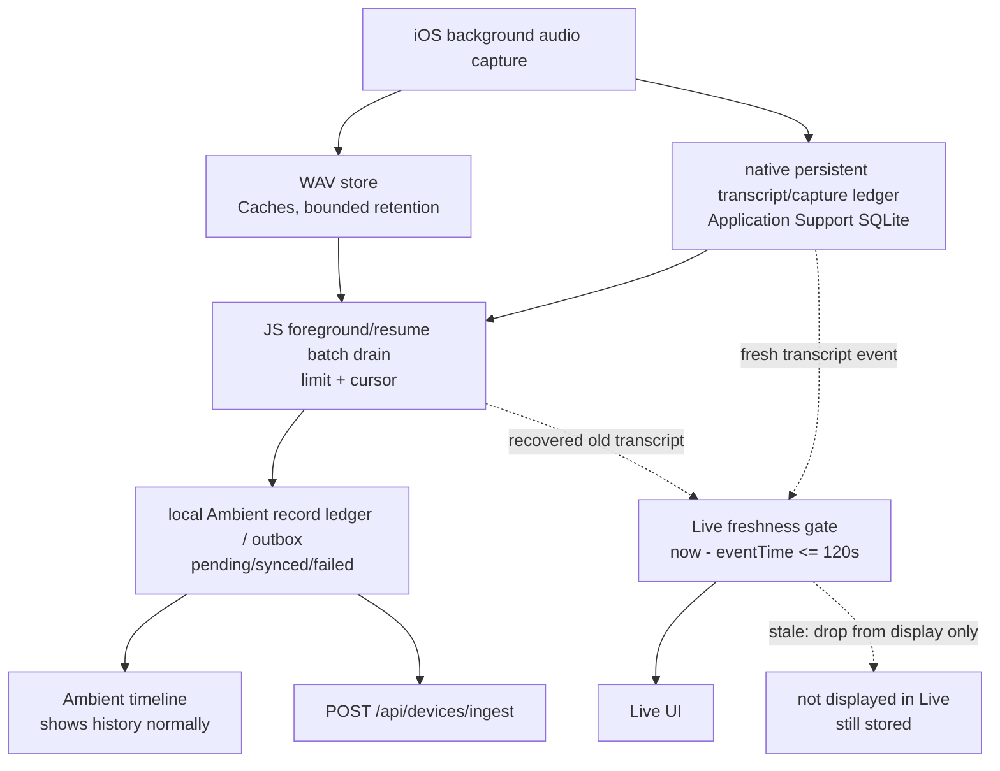
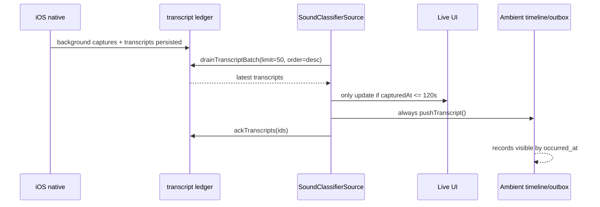

# Ambient Live Freshness + Persistent Transcript Queue

> 日期：2026-05-18
> 状态：实施计划
> 读者：改 `proactive-ai-frontend/src/hooks/useAmbientLiveSession.ts`、`proactive-ai-frontend/src/services/ambient/`、`capacitor-plugins/ambient-ai/ios/Sources/AmbientAi/Audio/`、`@pin/capacitor-ambient-ai` facade 的开发者。

## 结论

这次要修的是两个不同层级的问题，必须分开处理：

1. **Live 是显示层**：Live 打开时只展示最近 `120 秒`内的转录和当前 speech burst。超过新鲜度窗口的 transcript 不允许进入 Live UI，但仍然必须正常转录、持久化、进入 Ambient timeline、进入上传 outbox。
2. **Background transcript 是数据层**：iOS native 现在把 `pendingTranscripts` 放在内存数组里，最多 300 条，且 WAV 默认只保留 1 小时。长时间后台使用时，这不是产品级持久化。必须加 native 持久队列，并让 JS 前台恢复时按 batch drain、ack、backfill 到 Ambient timeline。

目标行为：

- 用户后台放一天后再打开 Ambient，如果 iOS 进程期间确实产生了 transcript，它们会从 native 持久队列分批进入本地 Ambient timeline/outbox，不会一次性塞进内存。
- Live 只显示刚刚发生的内容。十分钟前、一小时前、一天前的 transcript 不会跳到 Live。
- Ambient tab 里的 timeline 不受 Live 新鲜度过滤影响。该展示的历史记录照常展示，只是通过持久队列分批补进来。



## 当前问题

### Live 会读到旧 transcript

当前 `useAmbientLiveSession.ts` 在 native 且 Ambient on 时，每 5 秒读今天的 raw transcript：

```ts
store.listRawEvents({
  localDate,
  sourceType: "transcript",
  eventType: "transcript.ready",
  limit: 50,
})
```

随后 `rawTranscriptEventsToLiveSessionData()` 选择今天最新的 `captureSessionId`，没有 `120 秒`新鲜度判断。所以几分钟前的 transcript 仍可能被重建成 Live session。

另一条路径是 `candidateWindowsToLiveSessionContextItems()`。当前 `isRecentWindow()` 对 `transcript_session` 永远返回 true，`transcriptContextToMessages()` 又能把 candidate window 的 compact transcript 变成 Live message。这会让旧 transcript window 成为 Live fallback。

### recovered capture 会把旧文字推到 Live

`SoundClassifierSource.recoverPendingAudio()` 会在 start/refresh 时：

1. `drainPendingNativeTranscripts()`
2. `transcribeUnhandledRecentCaptures()`
3. `handleCaptureReady()` 对 recent capture 走 cloud transcription
4. `applyAmbientLiveTranscriptUpdate()` 推进 Live store
5. `pushTranscript()` 写入 Ambient ingest 链路

这里没有区分“可以存”和“可以显示在 Live”。如果 capture 是几分钟前的 recovered audio，它仍会进 Live。

### native pending transcript 不是持久化队列

当前 `AudioStreamManager.swift`：

- `pendingTranscripts: [TranscriptReadyRecord]` 是内存数组。
- `maxPendingTranscripts = 300`，超过就丢最旧。
- `drainPendingTranscripts()` 会把数组全量返回并 `removeAll()`。
- App 进程被 iOS kill 后，内存 pending 全部丢失。

这对短时间前后台切换够用，但不适合“用户后台放一天，让它默默转录”的产品假设。

### WAV retention 也不是一天级缓存

当前 `AudioCaptureConfig.swift` 默认：

- `wavRetentionTtlMs = 60 * 60 * 1000`
- `wavMaxFiles = 120`
- `wavMaxBytes = 100MB`

`AudioFileStore.swift` 会按 TTL、文件数、总字节数删除旧 WAV。也就是说，即使 native 产生了 WAV，默认也只能作为短期 recover buffer，不能支撑一天后再回来处理大量音频。

## 非目标

- 不改变 Ambient timeline 的展示语义。
- 不因为 Live 新鲜度过滤丢弃 transcript。
- 不把所有 transcript raw segment 直接上传为长期 signal。
- 不承诺 iOS 进程被系统 kill 后还能继续采集。只能保证 kill 前已经产生的 transcript/capture metadata 不因内存丢失。
- 不在本计划里重写整个 Ambient SSOT。它和 [Ambient AI-visible Records SSOT 重构](./2026-05-17-ambient-ai-visible-records-ssot) 互补。
- 不在本计划里解决 transcript window 重复 upsert。那个问题由 [Transcript Window Upsert + 存量清理](./2026-05-18-transcript-window-upsert-storage-cleanup) 处理。

## 硬规则

### R1：Live freshness 是纯显示层

Live 的 transcript 新鲜度窗口固定为：

```ts
const LIVE_TRANSCRIPT_FRESHNESS_MS = 120_000;
```

判断时间源优先级：

1. native event `capturedAt`
2. raw event `occurredAt`
3. live update `receivedAt`
4. 当前时间 `Date.now()` 作为最后 fallback

只有满足下面条件的 transcript 才能进入 Live：

```text
now - eventTime <= 120_000
```

超过窗口的 transcript：

- 不调用 `applyAmbientLiveTranscriptUpdate()`。
- 不从 raw transcript 重建 Live session。
- 不从 candidate window fallback 成 Live message。
- 仍然正常进入 `pushTranscript()`、local record ledger、outbox、cloud ingest。

### R2：Ambient timeline 不应用 Live freshness

Ambient tab 里的 timeline 是历史记录视图，不是 Live。它不能因为 transcript 超过 120 秒就隐藏。

具体规则：

- `session_summary` / `ambient.candidate_window` 仍按原 timeline/record ledger 规则展示。
- timeline 排序仍按 `occurred_at`。
- timeline 允许分页、分批 backfill，但不能丢数据。
- Live 的 freshness helper 不能被 outbox、sync-scheduler、device ingest 调用。

### R3：native 持久队列是 source of truth，内存 pending 只是缓存

`pendingTranscripts` 不能再作为唯一 pending store。

新增 native 持久 ledger，文件位置固定为：

```text
Application Support/pin-ambient-ai/audio-transcript-ledger.sqlite
```

最低要求：

- transcript record 写入必须先落盘，再 emit event。
- App crash 或 WebView reload 后，未 ack 的 transcript 仍可 drain。
- 内存 pending 只允许作为低延迟事件缓存，不能作为唯一恢复来源。
- 超过内存上限时只丢内存缓存，不丢持久 ledger。

### R4：drain 必须分批、可 ack、可重放

不能再用“全量返回并 removeAll”的语义做长期队列。

新的 drain contract：

```ts
type DrainTranscriptBatchRequest = {
  limit?: number;          // default 50, max 200
  cursor?: string | null;  // optional opaque cursor
  order?: "desc" | "asc";  // default desc, newest first for UI responsiveness
};

type DrainTranscriptBatchResult = {
  transcripts: TranscriptReadyEvent[];
  nextCursor: string | null;
  hasMore: boolean;
};
```

ack contract：

```ts
type AckTranscriptsRequest = {
  ids: string[];
};
```

语义：

- drain 只读取，不删除。
- JS 成功写入本地 Ambient record/outbox 后，才 ack native transcript。
- JS crash 在 ack 前，下一次 drain 会再次返回同一批，由 burst id / dedupe key 吸收重复。
- ack 后 native row 标记为 `drained` 或 `processed`，再按 retention 清理。

### R5：foreground 恢复先显示最新，再后台补历史

用户打开 Ambient 时，不能为了处理一天 backlog 卡住 UI。

固定顺序：

1. 先 drain 最新 `50` 条 transcript。
2. 写入本地 record ledger/outbox。
3. 立即通知 Ambient timeline 刷新。
4. 继续用 idle/background task 分批 drain 剩余 backlog。
5. 每批最多 `50` 条，每轮设置时间预算，例如 `2 秒`。
6. backlog 处理状态必须可观测。

这样晚上打开 Ambient 的行为是：最新一批记录先出现，较早记录随后逐批补进 timeline。

### R6：WAV 和 transcript metadata 分开 retention

transcript 文本 metadata 体积小，必须比 WAV 留得久。

retention 固定为：

| 数据 | 保留规则 |
|---|---|
| transcript ledger row | `7 天` 或 `20,000 行`，取先达到的上限清理最旧 processed/drained row。 |
| pending/failed transcript row | 不按时间删除，除非超过硬容量上限；超限只清理最旧 processed/drained。 |
| processed WAV | JS/local transcript 已持久化后立即删除。 |
| pending WAV | 最长 `24 小时`，`wavMaxFiles <= 1000`，`wavMaxBytes <= 1GB`。 |
| failed WAV | 保留 `24 小时`，供重试或 debug。 |

如果只需要 timeline/history，优先保 transcript text，不保 WAV。WAV 是 recover/refine 原料，不是长期用户数据源。

### R7：旧版本不能覆盖新版本

同一个 `burstId` / `captureSessionId` / transcript id 重复 drain 时：

- JS `pushTranscript()` 和 outbox 依赖 dedupe key 吸收重复。
- native ack 必须幂等。
- 如果同一 burst 有 local 和 cloud refinement 两个版本，provider 优先级固定为：
  1. `cloud_whisper`
  2. `local_speech`
  3. fallback/unavailable
- 更低优先级版本不能覆盖更高优先级版本。

### R8：观测必须先补

实现前先补最低限度诊断输出，避免真机上看不到 backlog 状态。

`AudioCaptureSnapshot` 或新增 diagnostics API 至少返回：

- `pendingTranscriptCount`
- `oldestPendingTranscriptAt`
- `latestPendingTranscriptAt`
- `pendingCaptureCount`
- `oldestPendingCaptureAt`
- `wavTotalBytes`
- `lastLedgerCleanupAt`
- `lastDrainAt`

前端 `SoundClassifierSource` 至少记录：

- 每次 drain 的 transcript 数量。
- 是否还有 `hasMore`。
- 每批 ack 数量。
- stale transcript 被 Live freshness gate 拦截的数量。

## Native 数据模型

新增 `AudioTranscriptLedger` actor，负责 SQLite schema、migration、写入、batch drain、ack、cleanup。

表名固定为：

```sql
CREATE TABLE IF NOT EXISTS audio_transcript_ledger (
  id TEXT PRIMARY KEY,
  wav_id TEXT,
  burst_id TEXT NOT NULL,
  capture_session_id TEXT NOT NULL,
  captured_at TEXT NOT NULL,
  duration_ms INTEGER NOT NULL DEFAULT 0,
  byte_size INTEGER NOT NULL DEFAULT 0,
  trigger_source TEXT,
  transcript_text TEXT,
  provider TEXT,
  local_provider TEXT,
  transcript_locale TEXT,
  fallback INTEGER NOT NULL DEFAULT 0,
  segment_index INTEGER,
  status TEXT NOT NULL,
  attempts INTEGER NOT NULL DEFAULT 0,
  last_error TEXT,
  content_hash TEXT,
  created_at TEXT NOT NULL,
  updated_at TEXT NOT NULL,
  drained_at TEXT,
  processed_at TEXT
);

CREATE UNIQUE INDEX IF NOT EXISTS ux_audio_transcript_burst
  ON audio_transcript_ledger (burst_id, provider);

CREATE INDEX IF NOT EXISTS ix_audio_transcript_status_time
  ON audio_transcript_ledger (status, captured_at DESC);

CREATE INDEX IF NOT EXISTS ix_audio_transcript_time
  ON audio_transcript_ledger (captured_at DESC);
```

`status` 固定值：

| status | 含义 |
|---|---|
| `captured` | WAV 已保存，但 transcript 还没完成。 |
| `transcribed` | transcript 已产生，等待 JS drain。 |
| `drained` | JS 已确认写入本地 record/outbox。 |
| `failed` | transcription 或持久化失败。 |
| `processed` | 对应 WAV 已处理并可清理。 |

`id` 固定为：

```text
transcript:{burstId}:{provider}
```

如果同一个 burst 后续有 cloud refine，写入同一 burst 的更高 provider priority row，JS 侧根据 provider priority 做最终展示和上报。

## Native API 改造

### 保留兼容方法

当前 facade 已暴露：

- `drainPendingTranscripts()`
- `listRecentCaptures()`
- `markCaptureProcessed({ wavId })`

为了降低一次性破坏面，必须保留旧方法，但把实现改为基于 ledger：

- `drainPendingTranscripts()` 作为 compatibility wrapper，返回最新一批 `limit=50` 的 `transcribed` rows，并在旧 JS 路径下保持原返回形态。
- 新代码使用 `drainTranscriptBatch(options)` 和 `ackTranscripts(options)`。

### 新增方法

`AudioCapturePlugin.swift` 增加：

```swift
drainTranscriptBatch(_ call: CAPPluginCall)
ackTranscripts(_ call: CAPPluginCall)
getTranscriptQueueStats(_ call: CAPPluginCall)
```

facade type 增加：

```ts
AmbientAi.audio.drainTranscriptBatch(options?: DrainTranscriptBatchRequest)
AmbientAi.audio.ackTranscripts(options: AckTranscriptsRequest)
AmbientAi.audio.getTranscriptQueueStats()
```

## JS 改造计划

### Step 1：加 Live freshness helper

落点：

- `proactive-ai-frontend/src/services/ambient/live-session.ts`
- `proactive-ai-frontend/src/services/ambient/live-transcript-store.ts`
- `proactive-ai-frontend/src/hooks/useAmbientLiveSession.ts`
- `proactive-ai-frontend/src/services/ambient/sources/sound-classifier.ts`

新增 helper：

```ts
export const LIVE_TRANSCRIPT_FRESHNESS_MS = 120_000;

export function isFreshForLive(
  eventTime: string | number | undefined,
  now = Date.now(),
  freshnessMs = LIVE_TRANSCRIPT_FRESHNESS_MS,
): boolean;
```

应用点：

- `handleNativeLiveEvent()` 对 `transcriptDraft` / `transcriptReady` 先判断 `capturedAt`。
- `SoundClassifierSource.handleCaptureReady()` 只在 capture fresh 时调用 `applyAmbientLiveTranscriptUpdate()`。
- `rawTranscriptEventsToLiveSessionData()` 只接收 fresh events；如果最新 transcript 超过 120 秒，返回 `null`。
- 删除 `transcriptContextToMessages()` 这条 transcript candidate window fallback，和 Ambient SSOT 的 R6 保持一致。

### Step 2：确保 stale transcript 仍入 timeline

`SoundClassifierSource.handleCaptureReady()` 必须拆成两步：

```text
if fresh -> update Live
always -> pushTranscript -> local record/outbox
```

`handleTranscriptReady()` 同理。Live gate 只包住 `applyAmbientLiveTranscriptUpdate()`，不能包住 `pushTranscript()`。

### Step 3：native ledger 写入

`AudioStreamManager.emitTranscriptReady()` 改为：

1. 构造 `TranscriptReadyRecord`。
2. `await transcriptLedger.upsertTranscribed(record)`。
3. 写入成功后 append 内存 cache。
4. emit `transcriptReady` event。

`runOneCaptureCycle()` 保存 WAV 后也要写一条 `captured` row，避免 transcript 阶段失败时完全没有可恢复 metadata。

### Step 4：JS batch drain

`SoundClassifierSource.recoverPendingAudio()` 改为：

```text
while hasMore and timeBudget not exceeded:
  batch = drainTranscriptBatch({ limit: 50, cursor, order: "desc" })
  for transcript in batch:
    pushTranscript(...)
  ackTranscripts(successfullyPersistedIds)
```

ack 时机：

- `ctx.push()` 成功返回后 ack。
- 如果后续 cloud upload 失败，不影响 ack，因为 local outbox 已是持久重试真源。
- 如果 `ctx.push()` 抛异常，不 ack，下一轮重放。

### Step 5：recent captures 只处理未 transcribed 的 WAV

`transcribeUnhandledRecentCaptures()` 不再无脑扫所有 recent WAV。必须优先走 ledger：

- 查 `status='captured'` 且未 transcribed 的 capture。
- 按 `captured_at DESC` 分批处理。
- cloud transcription 成功后写回 ledger `transcribed`，再进入 JS drain。
- Live 更新仍走 120 秒 freshness gate。

### Step 6：retention cleanup

新增 cleanup 触发点：

- app start / `startCapture()`
- `ackTranscripts()`
- `markCaptureProcessed()`
- 每次 `getTranscriptQueueStats()` 前执行轻量 cleanup

cleanup 顺序：

1. 删除 processed WAV。
2. 删除超过 24 小时的 failed/pending WAV，但保留 transcript metadata。
3. 删除超过 7 天的 processed/drained transcript rows。
4. 如果总 row 超过 20,000，只删 processed/drained 最旧行。
5. 不删除 pending/failed transcript rows，除非达到硬容量且已经没有 processed/drained 可删，这时只记录 warning。

## 端到端行为

### 场景 A：用户切后台 10 分钟后回来



结果：

- 10 分钟前的 transcript 不出现在 Live。
- transcript 进入 Ambient timeline。
- 后续 backlog 分批补齐。

### 场景 B：用户后台放一天，晚上打开 Ambient

目标行为：

- 如果 iOS 进程没有被系统 kill，且 native 捕获/转录成功，ledger 里有 rows。
- 打开 Ambient 后先 drain 最新 50 条，timeline 很快出现最近记录。
- 剩余记录分批 backfill，不一次性塞进 React state。
- Live 只显示最近 120 秒内的内容，通常不会显示白天旧 transcript。
- 如果 iOS 系统中途 kill 了进程，kill 之后不能继续采集；但 kill 前已落盘 transcript 不丢。

### 场景 C：JS crash 在 drain 后 ack 前

结果：

- native ledger row 仍是 `transcribed`。
- 下次 drain 重新返回。
- JS outbox 通过 dedupe key 吸收重复。
- ack 成功后才进入 `drained`。

## 实施顺序

### Phase 0：诊断与基线测试

目标：先让真机上能看见 backlog 规模。

改动：

- 增加 native queue stats。
- `SoundClassifierSource` 输出 drain count、ack count、stale Live drop count。
- 补当前 Live raw replay 测试，证明旧 transcript 目前会被重建。

验收：

- Debug log 能看到 pending transcript/capture 数量。
- 单测能复现 old transcript 进入 Live 的问题。

### Phase 1：Live 120 秒显示过滤

目标：最快止血，避免用户一打开 Live 看到旧转录跳动。

改动：

- `LIVE_TRANSCRIPT_FRESHNESS_MS = 120_000`。
- native event handler、raw replay、recovered capture Live update 全部加 freshness gate。
- 删除或 gate transcript candidate fallback。

验收：

- 5 分钟前 raw transcript 存在时，`rawTranscriptEventsToLiveSessionData()` 返回 `null`。
- 10 分钟前 recovered capture 会调用 `pushTranscript()`，但不会调用 `applyAmbientLiveTranscriptUpdate()`。
- `AmbientView` / timeline 测试不变。

### Phase 2：native transcript ledger

目标：pending transcript 不再只存在内存里。

改动：

- 新增 `AudioTranscriptLedger.swift`。
- `AudioStreamManager` 写 captured/transcribed rows。
- `AudioCapturePlugin` 增加 batch drain / ack / stats。
- TS facade 增加类型。

验收：

- 模拟 301 条 transcript，不丢持久 ledger。
- App manager 重建后，未 ack transcript 仍可 drain。
- 旧 `drainPendingTranscripts()` wrapper 仍能返回可用数据。

### Phase 3：JS 分批 drain + timeline backfill

目标：打开 Ambient 时处理 backlog，但不撑爆内存。

改动：

- `SoundClassifierSource.recoverPendingAudio()` 使用 batch drain。
- 每批写入本地 record/outbox 后 ack。
- drain 最新 batch 后立即通知 UI。
- 剩余 backlog 按时间预算继续补。

验收：

- 500 条 pending transcript 分 10 批 drain。
- 第一批完成后 timeline 已可见最新记录。
- React state 不一次性持有所有 transcript。

### Phase 4：WAV/capture retention 和 processed cleanup

目标：磁盘不会无限增长，且不会删掉还没转成 transcript 的数据。

改动：

- `AudioFileStore` retention 分状态处理。
- `markCaptureProcessed()` 删除 processed WAV，但不删 transcript metadata。
- cleanup 不删除 pending/failed transcript rows。

验收：

- processed WAV 被删除。
- transcribed metadata 保留 7 天。
- pending WAV 24 小时内可 recover。
- 超容量优先删 processed/drained，不删 pending/failed。

### Phase 5：真机验证

目标：验证产品行为，不只看单测。

验证路径：

1. 安装到连接的 iPhone。
2. 打开 Ambient，允许 microphone。
3. 产生一段 speech transcript。
4. 手工把测试 transcript 时间改成 10 分钟前，或用测试 hook 注入 stale native event。
5. 打开 Live，确认 stale transcript 不出现。
6. 打开 Ambient tab，确认 stale transcript 在 timeline 里正常出现。
7. 模拟大量 native ledger rows，确认分批 drain 和 stats 正常。

## 验收标准

1. Live 只显示 `now - capturedAt <= 120s` 的 transcript。
2. 超过 120 秒的 transcript 不会通过 raw replay、native listener、recent capture scan、candidate window fallback 进入 Live。
3. 超过 120 秒的 transcript 仍会进入 local record/outbox/Ambient timeline。
4. Ambient timeline 不引用 Live freshness helper。
5. native transcript 先落盘再 emit。
6. `pendingTranscripts` 超过 300 时，不会丢持久 ledger row。
7. App/WebView 重启后，未 ack transcript 仍可 drain。
8. drain 是 batch + cursor + ack，不再全量返回并删除。
9. JS crash 在 ack 前不会丢 transcript。
10. 500 条 backlog 不会一次性进入 React state；timeline 最新 batch 先显示，其余分批补。
11. processed WAV 清理后 transcript metadata 仍在。
12. pending/failed transcript 不因时间自动删除。
13. `npm run type-check` 通过。
14. ambient 相关 vitest 覆盖 Live freshness、stale recovered capture、batch drain、ack idempotency、timeline unaffected。
15. iOS native build 通过，真机基础 capture/transcript 仍可用。

## 文件落点

| 范围 | 文件 |
|---|---|
| Live freshness logic | `proactive-ai-frontend/src/services/ambient/live-session.ts` |
| Live hook raw replay/native bridge | `proactive-ai-frontend/src/hooks/useAmbientLiveSession.ts` |
| Live store | `proactive-ai-frontend/src/services/ambient/live-transcript-store.ts` |
| Native transcript listener types | `proactive-ai-frontend/src/services/ambient/transcript-listener.ts` |
| Sound source recovered capture/drain | `proactive-ai-frontend/src/services/ambient/sources/sound-classifier.ts` |
| Sound source tests | `proactive-ai-frontend/src/services/ambient/sources/sound-classifier.test.ts` |
| Native ledger | `capacitor-plugins/ambient-ai/ios/Sources/AmbientAi/Audio/AudioTranscriptLedger.swift` |
| Native audio manager | `capacitor-plugins/ambient-ai/ios/Sources/AmbientAi/Audio/AudioStreamManager.swift` |
| WAV retention | `capacitor-plugins/ambient-ai/ios/Sources/AmbientAi/Audio/AudioFileStore.swift` |
| Native models | `capacitor-plugins/ambient-ai/ios/Sources/AmbientAi/Audio/AudioCaptureModels.swift` |
| Capacitor bridge | `capacitor-plugins/ambient-ai/ios/Sources/AmbientAi/Plugins/AudioCapturePlugin.swift` |
| TS facade types | `capacitor-plugins/ambient-ai/src/facade/audio-capture.ts`、`capacitor-plugins/ambient-ai/src/facade/types.ts` |
| Ambient record/outbox integration | `proactive-ai-frontend/src/services/ambient/outbox.ts`、`sync-scheduler.ts` |
| docs | `docs/modules/data-connectors.mdx`、本 plan |

## 和现有计划的关系

- [Ambient AI-visible Records SSOT 重构](./2026-05-17-ambient-ai-visible-records-ssot)：定义 Ambient timeline 的产品事实源是 record ledger。本计划承接它，保证 transcript backlog 可靠进入 record ledger。
- [Transcript Window Upsert + 存量清理](./2026-05-18-transcript-window-upsert-storage-cleanup)：解决同一个 transcript window 在 local/cloud 写出多条递增快照。本计划不替代它，但依赖它避免 backlog backfill 时产生 cloud 重复。
- [Ambient AI Plugin(V2 设计存档)](./2026-05-10-ambient-ai-plugin)：提供 iOS AudioCapture 当前事件、facade、WAV、transcript API 背景。

## 暂不做

- 不把 Live 新鲜度窗口做成用户设置。先固定 120 秒，稳定后再评估配置。
- 不做无限期音频保存。
- 不把 WAV 上传到 cloud 做长期存储。
- 不在后台强行绕过 iOS 系统限制。iOS kill 后无法继续采集是平台限制，不用代码假装能保证。
- 不重写 Ambient timeline UI，只保证它收到持久 transcript backfill。
