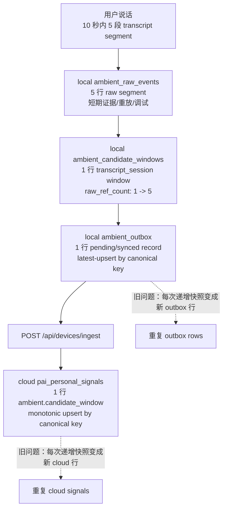
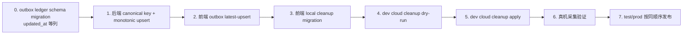

# Transcript Window Upsert + 存量清理计划

> 日期：2026-05-18
> 状态：实施计划
> 读者：改 `proactive-ai-frontend/src/services/ambient/`、`/api/devices/ingest`、`pai_personal_signals`、Ambient 本地 SQLite/outbox/sync 链路的开发者。

## 结论

现在的问题不是“转录分段不该存在”，而是 **同一个 transcript session 的递增快照在 outbox 和 cloud 被当成了多条独立 signal**。

正确形态应该是：

- 本地 raw transcript segment：可以多行，作为短期原始证据。
- 本地 transcript candidate window：同一个 `local_window_id` 只能一行，持续更新。
- 本地 outbox：同一个逻辑 transcript window 只能一行，保存最新版本。
- cloud `pai_personal_signals`：同一个逻辑 transcript window 只能一行，保存最新版本。

本 plan 的核心改法是：**对 transcript candidate window 使用稳定 canonical key，端侧 outbox 做 latest-upsert，cloud 做 monotonic upsert，并把已有 local/cloud 重复数据按同一规则合并。**



## 当前真实情况

### 5 段两秒 transcript 的当前过程

假设用户 10 秒内说了 5 段话，端侧按两秒左右切出 5 个 transcript segment。

当前本地链路是：

1. 每段 transcript 先变成一个 raw event，写入 `ambient_raw_events`。
2. `upsertTranscriptWindow(raw)` 用 `payload.captureSessionId ?? raw.dedupeKey` 算出 session id，再生成 `stableId("win", ["transcript_session", sessionId])`。
3. 同一个 session id 下的 segment 会合并进同一个 `ambient_candidate_windows` row。
4. 这个 window 的 `compactContext` 会逐步累加，`rawRefs` 会从 1 个变成 5 个。
5. `candidateWindowToSignal()` 把 window 包成 `kind='ambient.candidate_window'` 的 `PersonalSignalInput`，`payload.raw_ref_count` 等于 raw ref 数量。
6. 这个 signal 进入 `ambient_outbox`，再由 drain 上传到 `/api/devices/ingest`。
7. 后端写入 `pai_personal_signals`。

也就是说，“合到一起”的依据不是语义理解，也不是把 5 句话硬拼成一条；依据是 **同一个 capture session 对应同一个 `local_window_id`**。这个 window 是“会话窗口”，不是“每句话一行”。

### 已确认的代码入口

| 位置 | 当前行为 |
|---|---|
| `proactive-ai-frontend/src/services/ambient/timeline/pipeline.ts` | `upsertTranscriptWindow()` 用 `captureSessionId` 生成稳定 window id，并把 raw refs / compact context 合并进同一个 candidate window。 |
| `proactive-ai-frontend/src/services/ambient/timeline/envelope.ts` | `candidateWindowToSignal()` 设置 `payload.local_window_id`、`payload.raw_ref_count`、`summary=compactContext`。 |
| `proactive-ai-frontend/src/services/ambient/outbox.ts` | `makeRecord()` 使用 item 的 `dedupe_key`；SQLite `enqueue()` 当前是 `INSERT OR IGNORE`，不适合“同 key 但内容更新”的 transcript window。 |
| `pinai-agents/src/pinai_agents/web/routes/ui/devices.py` | `/api/devices/ingest` 接收 device item，当前优先信任 client 传入的 `dedupeKey`，否则 fallback 到 `device:{device_id}:{item.id}`。 |
| `pinai-agents/src/pinai_agents/web/db/repositories/personal_signals.py` | `ingest_one()` 已经对 `(user_id, dedupe_key)` 做 `ON CONFLICT DO UPDATE`，但前提是 dedupe key 稳定。 |

### dev DB 里看到的问题形态

在 dev DB 里，同一个用户、同一个 `local_window_id='win_1ikrxdc'` 已出现多条 `ambient.candidate_window` row。

这些 row 的共同点：

- `kind='ambient.candidate_window'`
- `payload.window_type='transcript_session'`
- `payload.local_window_id='win_1ikrxdc'`
- `payload.local_date` 相同
- `payload.raw_ref_count` 递增

差异点是 `dedupe_key` 后面有不稳定 suffix，例如同一个 window 被写成多条不同 key 的 row。这样后端的 `ON CONFLICT (user_id, dedupe_key)` 没法命中，只能一直 insert。

## 目标

1. 同一个 transcript logical window 在 local window / outbox / cloud 都只保留一个最新版本。
2. raw segment 多行保留在本地短期 raw store，不直接变成 cloud 上多条 long-term signal。
3. 端侧和服务端都能识别旧 client/旧数据产生的不稳定 key，并收敛到 canonical key。
4. 新版本不能被旧版本覆盖：`raw_ref_count=5` 的 row 不能被迟到的 `raw_ref_count=3` retry 降级。
5. local 和 cloud 存量重复数据要可 dry-run、可回滚地合并。

## 非目标

- 不把 transcript raw segment 全量上传到 `pai_personal_signals`。
- 不删除本地 raw segment 作为调试/重算证据的能力。
- 不重写整个 Ambient timeline 架构；本 plan 是对 [Ambient AI-visible Records SSOT 重构](./2026-05-17-ambient-ai-visible-records-ssot) 的 transcript-window identity 补强。
- 不改变 transcript 的采集切段频率。两秒左右一段是采集层行为，本 plan 只管窗口合并、outbox、cloud 存储。

## 核心规则

### R1：local raw segment 可以多行，但只是短期证据

`ambient_raw_events` 保留每个 transcript segment 的原始证据，原因是：

- 支持本地重新生成 window。
- 支持排查“是哪一段 transcript 导致 compactContext 错了”。
- 支持附近 context matching，例如声音/位置/运动窗口匹配。
- 支持端侧 agent 或 debug UI 查看采集链路。

但 raw segment 不是 cloud long-term memory 的最终形态。AI 主要消费的是合并后的 window signal。

### R2：一个 transcript logical window = 本地一行 candidate window

逻辑 key：

```text
local_user_id + local_date + window_type + local_window_id
```

其中 transcript 的 `local_window_id` 来自同一个 capture session：

```text
stableId("win", ["transcript_session", captureSessionId])
```

同一个 window 每来一个新 segment，只更新这一行：

- `raw_refs` 增加。
- `compact_context` 追加或重算。
- `raw_ref_count` 等价于 `raw_refs.length`。
- `started_at` 取最早值，`ended_at` 取最晚值。

### R3：一个 transcript logical window = outbox 一行 latest record

`ambient_outbox.dedupe_key` 必须使用 canonical key。对于 transcript candidate window：

```text
ambient:candidate_window:{device_id}:{local_date}:transcript_session:{local_window_id}
```

如果 device id 在端侧 enqueue 时还不可用，端侧可以临时使用无 device id 的 local canonical key：

```text
ambient:candidate_window:{local_date}:transcript_session:{local_window_id}
```

但服务端必须最终 canonicalize 成带 `device_id` 的 key，避免同一用户多设备产生相同 `local_window_id` 时冲突。

outbox 不再对这个场景使用 `INSERT OR IGNORE` 的语义。正确逻辑是：

| incoming vs existing | outbox 行为 |
|---|---|
| incoming `raw_ref_count` 更大 | 更新 `item`、`dedupe_key`、`updated_at`，重置为 `pending`，清空 `synced_at/last_error/next_retry_at`。 |
| incoming `raw_ref_count` 相等但 content hash 更新 | 更新 `item`，重置为 `pending`。 |
| incoming `raw_ref_count` 更小 | 忽略，不让旧 retry 覆盖新内容。 |
| existing 正在 pending/failed | 更新内容但保留 retry 语义可重新 drain。 |
| existing 已 synced | 如果 incoming 更新更“新”，改回 pending 重新上传最新版本。 |

### R4：一个 transcript logical window = cloud 一行 personal_signal

cloud canonical key 固定为：

```text
ambient:candidate_window:{device_id}:{local_date}:transcript_session:{local_window_id}
```

后端 `/api/devices/ingest` 对 `kind='ambient.candidate_window'` 且 `payload.window_type='transcript_session'` 的 item 必须自行生成 canonical key，不信任 client 传入的旧 suffix key。

写入 `pai_personal_signals` 时仍复用 `(user_id, dedupe_key)` unique upsert，但要补一个 monotonic guard：

- incoming `payload.raw_ref_count > existing.payload.raw_ref_count` 才更新。
- incoming `payload.raw_ref_count == existing.payload.raw_ref_count` 且 `payload.content_hash` 变化时才更新。
- incoming `payload.raw_ref_count == existing.payload.raw_ref_count` 且 `payload.content_hash` 相同，视为完全重复，不更新。
- incoming `payload.raw_ref_count < existing.payload.raw_ref_count` 时不更新，返回 duplicate。
- 如果 `raw_ref_count` 缺失，按 0 处理，但记录 warning。

### R5：状态重置要谨慎

当前 `PersonalSignalsRepository.ingest_one()` upsert 会把 existing row 重置为 `status='open'`、`consumed_by_run_id=NULL`。

这个行为对“新鲜 signal”合理，但对迟到旧版本有风险。所以 monotonic guard 必须放在 repository SQL 或 device ingest 写入前，避免 stale upload 把 consumed/open 状态来回打乱。

建议最终语义：

- incoming 更新成功：row 是新鲜版本，`status='open'`。
- incoming stale 或 exact duplicate：row 不变，接口返回 `duplicate`。
- cleanup 合并 loser：不要重置 winner 的 status，除非 winner 本身是 open。

不要引入新的 ingest status，除非同步改端侧 `IngestItemStatus` 和 scheduler bucket 逻辑。当前推荐保持 5-state contract：`inserted / duplicate / rejected / parse_failed / retryable_failed`。

## 数据模型与 key 设计

### Canonical identity

| 字段 | 来源 | 作用 |
|---|---|---|
| `user_id` | auth token | cloud tenant scope。 |
| `device_id` | device token / registered device | 防止多设备 window id 冲突。 |
| `kind` | `ambient.candidate_window` | signal 类型。 |
| `payload.local_date` | 端侧 local date | 本地天粒度窗口归属。 |
| `payload.window_type` | `transcript_session` | 区分 sound/motion/transcript 等窗口。 |
| `payload.local_window_id` | `win_*` | transcript session 的稳定 window id。 |

Canonical cloud dedupe key：

```text
ambient:candidate_window:{device_id}:{local_date}:{window_type}:{local_window_id}
```

### Content freshness

建议同时保存/使用两个 freshness 指标：

| 字段 | 用途 |
|---|---|
| `payload.raw_ref_count` | 判断 transcript window 是否包含更多 segment。 |
| `payload.content_hash` | 判断 raw_ref_count 相同但 compact context / source payload 更新的情况。 |

更新判断：

```text
incoming.raw_ref_count > existing.raw_ref_count
  -> update

incoming.raw_ref_count == existing.raw_ref_count
  AND incoming.content_hash != existing.content_hash
  -> update

incoming.raw_ref_count == existing.raw_ref_count
  AND incoming.content_hash == existing.content_hash
  -> exact duplicate, no update

incoming.raw_ref_count < existing.raw_ref_count
  -> stale, no update
```

所有 SQL 里的 `raw_ref_count` 都必须 safe-cast。历史 payload 可能有缺失或非数字字符串，不能用 `(payload->>'raw_ref_count')::int` 直接 cast。

```sql
CASE
  WHEN payload->>'raw_ref_count' ~ '^[0-9]+$'
  THEN (payload->>'raw_ref_count')::int
  ELSE 0
END
```

## 端侧改造计划

### Step 1：确认 candidate window 一行语义，并补测试

目标：保证 5 个 transcript raw segment 只生成一个 transcript candidate window。

测试覆盖：

- 同一 `captureSessionId` 下 5 个 raw segment。
- `ambient_raw_events` 是 5 行。
- `ambient_candidate_windows` 是 1 行。
- `rawRefs.length=5`。
- `compactContext` 包含 5 段文本或等价摘要。

### Step 2：`candidateWindowToSignal()` 改 canonical dedupe key

端侧生成 transcript candidate window signal 时：

- `payload.local_window_id` 保持不变。
- `payload.raw_ref_count` 保持不变。
- `payload.content_hash` 保持不变。
- `dedupe_key` 使用 canonical key，不再包含随机 suffix。

如果端侧无法可靠拿到 `device_id`，先用无 device id 的 local canonical key；服务端接收后再覆盖为带 device id 的 cloud canonical key。

### Step 3：outbox enqueue 从 ignore 改成 latest-upsert

`SqliteOutboxStore.enqueue()` 对 transcript candidate window 不能 `INSERT OR IGNORE` 后丢掉新版内容。

前置条件：如果 [Ambient AI-visible Records SSOT 重构](./2026-05-17-ambient-ai-visible-records-ssot) 里的 outbox ledger schema 还没落地，必须先给 `ambient_outbox` 增加 `updated_at`。latest-upsert 和 cleanup 可以用 `inserted_at` 做兼容 fallback，但新写入 row 必须维护 `updated_at`。

需要新增逻辑：

1. 先按 `dedupe_key` 查 existing row。
2. 如果不存在，insert。
3. 如果存在，用 `raw_ref_count/content_hash` 判断 incoming 是否更新。
4. 更新时覆盖 `item`，重置为 `pending`，清空 `synced_at`。
5. stale 时忽略。

内存版 `OutboxStore` 也要同样改，避免测试和 web fallback 语义漂移。

### Step 4：local SQLite 存量合并

本地合并只处理 outbox 和 candidate window，不合并 raw segment。

| 表 | 处理方式 |
|---|---|
| `ambient_raw_events` | 不合并。保留短期 raw segment 证据；可另行按 TTL prune。 |
| `ambient_candidate_windows` | 按 `local_date/window_type/local_window_id` 检查重复；理论上 id 已稳定，若存在重复则保留 raw_refs 最多/updated_at 最新的一行，合并 raw_refs 和 compact_context。 |
| `ambient_outbox` | 按 canonical transcript key 合并；保留 raw_ref_count 最大、updated_at/inserted_at 最新的一行；如果 winner 内容比 synced 云端新，标记 pending。 |

本地迁移要求：

- 启动时在 `ensureSchema()` 或专门 migration step 中 dry-safe 执行。
- 只处理 `kind='ambient.candidate_window'` 且 `window_type='transcript_session'`。
- 每次迁移记录合并数量到 log。
- 不删除 pending/failed 中唯一最新 row。

## 后端改造计划

### Step 1：device ingest canonicalize transcript window

在 `/api/devices/ingest` normalize item 阶段加入：

```python
if kind == "ambient.candidate_window" and payload["window_type"] == "transcript_session":
    dedupe_key = canonical_transcript_window_key(device_id, payload)
```

必要校验：

- `payload.local_window_id` 必填。
- `payload.local_date` 必填。
- `payload.raw_ref_count` 必须能转成整数，缺失按 0 但 log warning。
- `payload.source_types` 必须包含 `transcript`，否则只 canonicalize `window_type=transcript_session` 的情况，不影响 sound/motion window。

### Step 2：repository 增加 monotonic upsert

可选两种实现：

1. 在 `PersonalSignalsRepository` 增加专用方法 `ingest_candidate_window_latest()`。
2. 扩展 `ingest_one()` 支持 optional `freshness_guard`。

推荐第一种。理由是普通 connector/device signal 的 upsert 不一定都有 `raw_ref_count` 语义，强行把所有 signal 写入都套一层 freshness guard 会增加误伤。

SQL 语义：

```sql
INSERT INTO pai_personal_signals (...)
VALUES (...)
ON CONFLICT (user_id, dedupe_key) WHERE dedupe_key IS NOT NULL
DO UPDATE SET ...
WHERE
  (
    CASE
      WHEN EXCLUDED.payload->>'raw_ref_count' ~ '^[0-9]+$'
      THEN (EXCLUDED.payload->>'raw_ref_count')::int
      ELSE 0
    END
  ) > (
    CASE
      WHEN pai_personal_signals.payload->>'raw_ref_count' ~ '^[0-9]+$'
      THEN (pai_personal_signals.payload->>'raw_ref_count')::int
      ELSE 0
    END
  )
  OR (
    (
      CASE
        WHEN EXCLUDED.payload->>'raw_ref_count' ~ '^[0-9]+$'
        THEN (EXCLUDED.payload->>'raw_ref_count')::int
        ELSE 0
      END
    ) = (
      CASE
        WHEN pai_personal_signals.payload->>'raw_ref_count' ~ '^[0-9]+$'
        THEN (pai_personal_signals.payload->>'raw_ref_count')::int
        ELSE 0
      END
    )
    AND EXCLUDED.payload->>'content_hash'
      IS DISTINCT FROM pai_personal_signals.payload->>'content_hash'
  )
RETURNING *;
```

如果 `RETURNING` 为空：

- 再查一次 existing row。
- 返回 `duplicate`，不要让 outbox 无限 retry。
- 不改 existing row。

### Step 3：ingest result 返回更准状态

当前 signal upsert 成功统一返回 `inserted`。本 plan 不新增 wire status，避免旧端侧把未知 status 当 retryable。新语义固定为：

| 服务端结果 | API status | outbox 行为 |
|---|---|---|
| 新 row insert | `inserted` | mark synced |
| existing row updated | `inserted` | mark synced |
| incoming stale, existing 保持不变 | `duplicate` | mark synced，不重试 |
| incoming exact duplicate, existing 保持不变 | `duplicate` | mark synced，不重试 |
| 写入异常 | `retryable_failed` | 保留 outbox retry |

如果未来想区分 `updated` / `stale`，必须先同步改 `proactive-ai-frontend/src/lib/devices.ts` 的 `IngestItemStatus`、`sync-scheduler.ts` 的 `bucketRecords()`，以及对应测试；不能只改后端。

## Cloud 存量合并计划

### 分组规则

只处理 transcript candidate window：

```sql
kind = 'ambient.candidate_window'
payload->>'window_type' = 'transcript_session'
payload ? 'local_window_id'
```

逻辑分组 key：

```text
user_id
device_id
payload.local_date
payload.window_type
payload.local_window_id
```

如果历史 row 没有 `device_id`：

- 优先从 row 顶层 `device_id` 取。
- 再从 payload 里可用字段取。
- 都没有时使用 `unknown_device` 作为 cleanup 分组，不和有 device_id 的 row 合并。

此外，cleanup dry-run 必须单独报告“同一用户、同一 `local_date/window_type/local_window_id`、但跨多个 `device_id`”的重复组。能通过 `pai_user_devices.device_fingerprint_hash` 或注册历史确认是同一物理设备 alias 的，按 canonical device 合并；不能确认的，只报告不自动 apply。

### Winner 选择

每组保留一条 winner：

1. safe-cast 后的 `payload.raw_ref_count` 最大。
2. 若相同，`ingested_at` 最新。
3. 若仍相同，`occurred_at` 最新。
4. 若仍相同，`id` 字典序最小，保证 deterministic。

winner 更新为 canonical dedupe key：

```text
ambient:candidate_window:{device_id}:{local_date}:transcript_session:{local_window_id}
```

这里的 winner 指“最新内容”，不一定等于最终保留下来的物理 row id。apply 脚本必须先解决 `(user_id, dedupe_key)` unique collision，再写 canonical key。

### Loser 处理

| loser 状态 | 处理 |
|---|---|
| `reference_count=0` 且未被 consume/reference | 删除，减少 cloud 噪音。 |
| 已被 card/memory/reference 消费 | 标记 `status='archived'`，保留审计和引用稳定性。 |
| loser 的 raw_ref_count 比 winner 还大 | 不应该出现；dry-run 标红，不自动处理。 |

如果现有表没有足够外键判断“被 card/memory/reference 消费”，先保守只删除 `reference_count=0 AND consumed_by_run_id IS NULL` 的 loser，其余 archive。

### Apply 顺序和 unique collision

`pai_personal_signals` 有 `(user_id, dedupe_key)` unique index，不能直接把 winner 改成 canonical key。每个重复组按下面顺序处理：

1. 计算 `freshest_payload`：按 raw_ref_count、ingested_at、occurred_at、id 选最新内容。
2. 选择 `survivor_row`：
   - 如果组内已有 canonical dedupe key 且这行已被引用，优先保留这行 row id，并把 `freshest_payload` merge 到这行。
   - 否则优先保留 freshest row。
3. 如果 canonical key 被组内另一个未引用 row 占用，先删除这个占用 row，再把 survivor 改成 canonical key。
4. 如果 canonical key 被组内另一个已引用 row 占用，保留 canonical row 作为 survivor，把 freshest 内容 merge 进去，freshest row 作为 loser 处理。
5. 组外如果已有同 user 的 canonical key，占用原因不明，dry-run 标红，apply 不自动处理。
6. 所有已引用 loser 标记 `archived`；如果 loser 持有 canonical key 但不是 survivor，必须先把它的 `dedupe_key` 改成 `archived:{id}:{old_dedupe_key}`，否则 unique index 仍会阻塞 survivor。

### Dry-run SQL 草稿

重复组查询：

```sql
WITH transcript AS (
  SELECT
    id,
    user_id,
    COALESCE(device_id, payload->>'device_id', 'unknown_device') AS cleanup_device_id,
    dedupe_key,
    status,
    reference_count,
    consumed_by_run_id,
    occurred_at,
    ingested_at,
    payload->>'local_date' AS local_date,
    payload->>'window_type' AS window_type,
    payload->>'local_window_id' AS local_window_id,
    payload->>'raw_ref_count' AS raw_ref_count_text,
    CASE
      WHEN payload->>'raw_ref_count' ~ '^[0-9]+$'
      THEN (payload->>'raw_ref_count')::int
      ELSE 0
    END AS raw_ref_count
  FROM pai_personal_signals
  WHERE kind = 'ambient.candidate_window'
    AND payload->>'window_type' = 'transcript_session'
    AND payload ? 'local_window_id'
),
ranked AS (
  SELECT
    *,
    COUNT(*) OVER (
      PARTITION BY user_id, cleanup_device_id, local_date, window_type, local_window_id
    ) AS group_count,
    ROW_NUMBER() OVER (
      PARTITION BY user_id, cleanup_device_id, local_date, window_type, local_window_id
      ORDER BY raw_ref_count DESC, ingested_at DESC, occurred_at DESC, id ASC
    ) AS rn
  FROM transcript
)
SELECT *
FROM ranked
WHERE group_count > 1
ORDER BY user_id, cleanup_device_id, local_date, local_window_id, rn;
```

Dry-run 报告必须包含 malformed `raw_ref_count` 数量：

```sql
SELECT count(*) AS malformed_raw_ref_count
FROM pai_personal_signals
WHERE kind = 'ambient.candidate_window'
  AND payload->>'window_type' = 'transcript_session'
  AND payload ? 'raw_ref_count'
  AND NOT (payload->>'raw_ref_count' ~ '^[0-9]+$');
```

Apply 脚本还必须先检查 canonical key collision：如果 canonical key 已经被分组外 row 占用，dry-run 标红，apply 不自动处理。

Apply 不建议手敲 SQL 直接跑。应该写成 repo script：

```text
pinai-agents/scripts/cleanup_transcript_window_duplicates.py
```

脚本模式：

- `--env dev --dry-run`
- `--env dev --apply`
- `--user-id <uuid>` 可先只处理单用户。
- 输出 grouped count、delete count、archive count、winner ids。
- apply 时用 transaction；失败整体 rollback。

## Local 存量合并计划

本地清理随前端版本启动执行，目标是让用户设备上的 SQLite 不再保留重复 outbox snapshot。

### local outbox dry-run 逻辑

扫描 `ambient_outbox.item`：

- `item.kind === 'ambient.candidate_window'`
- `item.payload.window_type === 'transcript_session'`
- `item.payload.local_window_id` 存在

生成 canonical local key：

```text
ambient:candidate_window:{local_date}:transcript_session:{local_window_id}
```

同 key 分组后：

- winner：raw_ref_count 最大，`updated_at` 最新，老 schema 缺 `updated_at` 时 fallback 到 `inserted_at`。
- loser：如果 synced，删除；如果 pending/failed，但不是最新，删除并记录。
- winner：如果不是 synced，保持 pending/failed；如果 synced 但 item 内容更新过，改 pending。

### local candidate window dry-run 逻辑

正常情况下 `ambient_candidate_windows.id` 已经是稳定 key，也就是本地的 `local_window_id`，不应有重复。只需要加检测和防御合并：

- 同 `local_date/window_type/id` 多行：保留 updated_at 最新。
- `raw_refs` 做去重 union。
- `compact_context` 选择 raw_ref_count 最大的版本；不要简单拼接多份重复文本。

## 发布顺序



推荐先确认 outbox ledger schema 已具备 `updated_at`，再上后端。原因是旧 client 还可能继续上传不稳定 suffix key，后端 canonicalize 可以先止血，防止 cloud 继续新增重复。

然后上端侧 outbox latest-upsert，解决本地重复和“稳定 key 后新版被 `INSERT OR IGNORE` 丢掉”的问题。

最后做存量 cleanup。cleanup 必须先 dev dry-run，确认 winner 规则符合实际数据，再 apply。

## 回滚策略

| 变更 | 回滚方式 |
|---|---|
| 后端 canonicalize | 回滚代码即可；已写入 canonical key 的 row 仍然可被旧逻辑读取。 |
| 后端 monotonic guard | 回滚代码即可；风险是旧版本又可能覆盖新版，所以 rollback 后需暂停 cleanup。 |
| 前端 outbox latest-upsert | 回滚前端版本；已合并后的 outbox row 仍是合法上传 record。 |
| local cleanup | 只做删除 loser，无法完整恢复；因此第一版必须只处理 clearly duplicated transcript window rows，并在 log 里输出计数。 |
| cloud cleanup | apply 前导出 affected rows；apply 使用 transaction。删除只针对 `reference_count=0 AND consumed_by_run_id IS NULL`，其余 archive，降低不可逆风险。 |

## 验证计划

### 自动测试

Frontend：

```bash
cd proactive-ai-frontend && npm test -- --run \
  src/services/ambient/timeline/pipeline.test.ts \
  src/services/ambient/timeline/envelope.test.ts \
  src/services/ambient/outbox.test.ts \
  src/services/ambient/outbox.sqlite.test.ts \
  src/services/ambient/sync-scheduler.test.ts
```

Backend：

```bash
cd pinai-agents && uv run pytest \
  tests/web/devices/test_ingest_http.py \
  tests/web/db/test_personal_signals_repo.py
```

新增测试必须覆盖：

- 同一 transcript session 5 个 segment -> candidate window 1 行。
- outbox 同 canonical key 多次 enqueue -> 1 行 latest item。
- 后端同 canonical key 多次 ingest -> cloud 1 行 latest payload。
- incoming `raw_ref_count` 更小 -> 不覆盖 existing。
- incoming `raw_ref_count` 相等且 `content_hash` 相同 -> 返回 duplicate，不重置 consumed/open 状态。
- 后端不返回 `updated` / `stale` 等端侧未知 status。
- cleanup dry-run 能识别重复 group 且 winner 正确。
- cleanup dry-run 能识别 canonical key collision、跨 device alias、malformed raw_ref_count。

### 真机 / dev 验证

1. 在 iOS 真机连续说 10 秒，让端侧产生 5 个左右 transcript segment。
2. 查询本地 SQLite：
   - `ambient_raw_events`：约 5 行 transcript raw segment。
   - `ambient_candidate_windows`：1 行 `window_type='transcript_session'`。
   - `ambient_outbox`：1 行对应 canonical transcript window record。
3. drain 上传后查 dev DB：
   - `pai_personal_signals`：同 `local_window_id` 只有 1 行。
   - `payload.raw_ref_count` 等于最新 segment 数。
   - `summary` 是最新 compact context。
4. 重启 app / 网络失败重试后再次 drain：
   - cloud 不新增重复行。
   - stale retry 不覆盖 latest row。

### dev DB 验收 SQL

```sql
WITH transcript AS (
  SELECT
    user_id,
    COALESCE(device_id, payload->>'device_id', 'unknown_device') AS cleanup_device_id,
    payload->>'local_date' AS local_date,
    payload->>'window_type' AS window_type,
    payload->>'local_window_id' AS local_window_id,
    COUNT(*) AS row_count,
    MAX(
      CASE
        WHEN payload->>'raw_ref_count' ~ '^[0-9]+$'
        THEN (payload->>'raw_ref_count')::int
        ELSE 0
      END
    ) AS max_raw_ref_count
  FROM pai_personal_signals
  WHERE kind = 'ambient.candidate_window'
    AND payload->>'window_type' = 'transcript_session'
    AND payload ? 'local_window_id'
  GROUP BY user_id, cleanup_device_id, local_date, window_type, local_window_id
)
SELECT *
FROM transcript
WHERE row_count > 1
ORDER BY row_count DESC, max_raw_ref_count DESC;
```

验收标准：目标用户和新采集数据不再出现重复 group。存量 cleanup apply 后，dev 全量重复 group 应显著下降；剩余 group 必须有明确“不自动处理”的原因。

## 接受标准

1. 10 秒内 5 个 transcript segment：
   - local raw segment 约 5 行。
   - local candidate window 1 行。
   - local outbox 1 行。
   - cloud personal signal 1 行。
2. 同一个 `local_window_id` 不再因为 `raw_ref_count` 递增写出 5/16/17 行 cloud signals。
3. 迟到旧版本不会覆盖新版本。
4. 完全相同重试不会重新打开 consumed/archived row。
5. dev DB 中已有重复 transcript window 可以 dry-run 展示、apply 合并。
6. cleanup 不破坏已被 card/memory/reference 消费的历史引用。
7. cleanup 不会因为 canonical key collision 或 malformed `raw_ref_count` 中途失败。

## 相关代码

| 责任 | 文件 |
|---|---|
| transcript raw -> candidate window | `proactive-ai-frontend/src/services/ambient/timeline/pipeline.ts` |
| candidate window -> PersonalSignalInput | `proactive-ai-frontend/src/services/ambient/timeline/envelope.ts` |
| local outbox enqueue/drain/schema | `proactive-ai-frontend/src/services/ambient/outbox.ts` |
| device ingest route | `pinai-agents/src/pinai_agents/web/routes/ui/devices.py` |
| signal upsert repository | `pinai-agents/src/pinai_agents/web/db/repositories/personal_signals.py` |
| device ingest policy | `pinai-agents/src/pinai_agents/web/device_ingest/policies.py` |
| cloud cleanup script | `pinai-agents/scripts/cleanup_transcript_window_duplicates.py` |

## 与其它 plan 的关系

- [Ambient AI-visible Records SSOT 重构](./2026-05-17-ambient-ai-visible-records-ssot)：定义 Ambient UI/outbox/cloud 应读写同一批 AI-visible records。本 plan 是其 transcript window 去重和 cleanup 的补充，不替代它。
- [Device Ingest Policy + Health Raw](./2026-04-30-device-ingest-policy-and-health-raw)：定义 `/api/devices/ingest` 的 policy 边界。本 plan 只改 `ambient.candidate_window` 的 transcript upsert 语义，不改变 health raw-only 规则。
- [Web Cloud Data Self-Sufficient Plan](./2026-05-17-web-cloud-data-self-sufficient)：要求 Web 端能只靠 cloud uploaded data 自洽。本 plan 确保 cloud transcript window 不是重复快照堆，而是一条最新事实。
