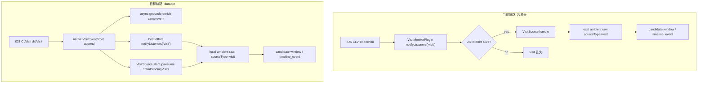

# iOS Place Visits Durable Capture

## 结论

当前 iOS Place Visits 采不到的核心问题不是用户没有给 Always permission，而是采集链路不耐后台：`CLVisit` 事件只在 native `didVisit` 里 `notifyListeners("visit")`，没有 native 持久队列。只要 iOS 在后台唤醒 App、WebView/JS listener 还没挂上、或者 App 进程被系统重启，这条 visit 就可能在进本地 SQLite 之前丢掉。

这次修复要把 `visit` 从「JS listener 在线才算收到」改成「native 收到先落盘，JS 之后 drain」。Always 权限仍然是必要条件，但不再是唯一判断标准。

当前产品未公开，处在快速迭代期。本计划只保留一条主路径：native durable queue + JS drain。目标是尽快在真机上采到 `visit` raw，不引入 GPS 推断、替代采集、复杂 consent ledger 或长期迁移方案。



## 真实排查证据

- 真机 `Smile iPhone` 当前是 iOS `26.4.2`；本机曾同时查到 `ai.pin.proactive.dev` 和 `ai.pin.proactive`，后续只剩 `ai.pin.proactive.dev`。后续验证必须确认当前用户实际打开的是哪个 bundle。
- 端侧 SQLite 里有其他 ambient 数据，但没有 visit：
  - `ai.pin.proactive.dev`: `health=51`, `location=11`, `motion=9`, `transcript=14`, `visit=0`。
  - `ai.pin.proactive`: `health=102`, `location=15`, `motion=7`, `transcript=38`, `visit=0`。
- 本地 timeline 里 `source_types` 包含 `visit` 的 candidate window / timeline event 也是 `0`。
- 同事最新提交 `caa22877 feat(ambient): upload normalized POI context` 只处理已有 location/visit raw 之后的 POI payload 归一化；没有改 `VisitMonitorPlugin`、`VisitSource`、权限语义、后台持久化或 drain 机制，因此不能修复「本机没有 visit raw」。
- 当前 dev server settings 曾返回所有 ambient source disabled，且 `pin.ambient.enabled=1` 本地 flag 会让 UI 看起来像开启。这是另一个设置漂移问题，会影响排查判断，需要同修。

## 核心问题

### 1. `CLVisit` 是系统后台事件，不是主动轮询

`LocationSource` 可以在 App runtime 活着时主动取当前位置；`VisitSource` 依赖 iOS 认为用户到达或离开一个地点后回调 `CLLocationManagerDelegate.locationManager(_:didVisit:)`。这个事件可能发生在锁屏、后台、App 被系统 relaunch 的时刻。

所以 `visit` 不能只靠 JS listener 在线。native 必须是第一落点。

### 2. native 当前没有 durable queue

当前实现位置：

- `capacitor-plugins/ambient-ai/ios/Sources/AmbientAi/Plugins/VisitMonitorPlugin.swift`

`didVisit` 当前做了：

1. 取 `arrivalAt/departureAt/lat/lng/accuracy`。
2. 反查 `place`。
3. `notifyListeners("visit", data: payload)`。

这里没有写文件、SQLite、UserDefaults queue，也没有 pending drain API。listener 不在时，事件没有补偿路径。

### 3. monitoring lifecycle 由 JS 启动，不适合后台 relaunch

当前 `VisitSource.start()` 在 JS 侧调用：

- `AmbientAi.visit.requestPermissions()`
- `AmbientAi.addListener("visit", ...)`
- `AmbientAi.visit.startMonitoring()`

如果 iOS 因 visit 在后台唤醒 App，native plugin 需要能根据持久化的 enabled state 重新创建 `CLLocationManager`、设置 delegate、恢复 `startMonitoringVisits()`。现在没有 `load()` auto-resume，也没有 `pin.visitMonitoring.enabled` 一类的 native 状态。

### 4. 权限语义过粗

当前 native 把 `.authorizedWhenInUse` 和 `.authorizedAlways` 都返回 `"granted"`。但 Place Visits 的真实后台能力必须按 Always 判断。前端看到 `"granted"` 无法区分「前台可定位」和「后台 visit 可用」。

### 5. `device.visit` 不直接上传 cloud

当前上传 whitelist 在 `proactive-ai-frontend/src/services/ambient/sync-scheduler.ts`，只上传：

- `ambient.timeline_event`
- `ambient.candidate_window`
- `health.observation`

`device.visit` raw 先进入本地 timeline pipeline，生成 candidate/timeline 后才有云端可见结果。因此云端没有 visit 不一定代表 native 没回调；但这次真机本地 raw 也是 `visit=0`，说明根因在端侧采集入口之前。

## 非目标

- 不改 health 的 raw-only 策略。
- 不改 audio/transcript 采集质量、WAV 参数、STT 参数。
- 不把 `device.visit` raw 直接上传 cloud，除非另开数据可见性 plan。
- 不做 GPS 推断、significant-location 替代采集、低频 POI dwell 推断。
- 不切 bundle id 绕过签名或安装问题。真机验证必须覆盖当前用户实际安装和使用的 bundle。
- 不做公开产品级 consent ledger。当前只做本机 enabled flag + App 打开后 settings reconcile。

## 目标规则

1. **native 先持久化**：`didVisit` 收到后必须先 append 到 native pending queue，再通知 JS。
2. **JS 可以迟到**：App 冷启动、后台唤醒、前端还没 hydrate 时产生的 visit，之后打开 App 必须能 drain。
3. **monitoring native 可恢复**：`startMonitoring()` 成功后写 native enabled state；plugin `load()` 时如果 enabled，自动恢复 `CLLocationManager` 和 `startMonitoringVisits()`。
4. **权限必须精确**：native API 区分 `always` / `when_in_use` / `denied` / `restricted` / `prompt`。`VisitSource` 只有 `always` 才认为 Place Visits 可用。
5. **先写最小事件，再异步补 place**：`didVisit` 里先同步 append lat/lng/arrival/departure/accuracy；POI/geocode 只做 enrich，失败不能影响 raw 产生。
6. **drain 要幂等**：pending visit 要有稳定 id；JS 确认本地 raw/timeline ingest 成功后再 ack，避免 drain 中途崩溃导致永久丢失。
7. **快速迭代 consent 策略**：native 本机 enabled flag 可以用于后台 auto-resume；App/settings hydrate 后，如果 server `ambientSources.visit=false`，立即 stop native monitoring 并清本机 enabled flag。
8. **可观测**：UI/debug panel 和日志必须能看到 `authorization`, `nativeMonitoring`, `pendingVisitCount`, `lastNativeVisitAt`, `lastDrainAt`, `lastError`。

## 设计

### Native: VisitEventStore

新增 native store，建议放在 `Application Support/AmbientAi/visit-events.jsonl` 或同等 lightweight SQLite。每条记录包含：

- `id`: stable id，例如 `visit:<lat-grid>:<arrivalAt>:<departureAt|null>`。
- `payload`: 当前 `VisitEvent` bridge payload。
- `placeStatus`: `pending` / `resolved` / `failed`。
- `createdAt`, `updatedAt`。
- `state`: `pending` / `delivered`。
- `deliveryAttempts`, `lastDeliveredAt`。

核心 API：

```swift
append(_ event: VisitPendingEvent) throws
updatePayload(id: String, payload: [String: Any], placeStatus: String) throws
listPending(limit: Int) throws -> [VisitPendingEvent]
ack(ids: [String]) throws
stats() throws -> VisitStoreStats
```

### Native: VisitMonitorPlugin

改造 `VisitMonitorPlugin`：

- 新增 `load()`：
  - 初始化 `VisitEventStore`。
  - 读取 `UserDefaults["pin.visitMonitoring.enabled"]`。
  - 如果为 true，执行 `startMonitoringInternal(reason: "plugin_load")`。
- `requestPermissions/checkPermissions`：
  - 返回 `location: "always" | "when_in_use" | "denied" | "restricted" | "prompt"`。
- `startMonitoring()`：
  - 检查 location services。
  - 只有 `authorizedAlways` 才成功；`when_in_use` 要返回明确错误。
  - 创建并强持有 `CLLocationManager`，设置 delegate。
  - 调 `startMonitoringVisits()`。
  - 写 `pin.visitMonitoring.enabled=true`。
- `stopMonitoring()`：
  - `stopMonitoringVisits()`。
  - 写 `pin.visitMonitoring.enabled=false`。
  - 不清空 pending queue。
- `didVisit`：
  - 构造最小 payload：`id`, `arrivalAt`, `departureAt`, `latitude`, `longitude`, `accuracy`, `placeStatus="pending"`。
  - 立即 append 到 store。这里不能等待 `GeocodeService.lookup`。
  - `notifyListeners("visit", data: payload, retainUntilConsumed: true)` 作为实时路径。
  - 后台异步跑 `GeocodeService.lookup`，成功后 `updatePayload(id, payloadWithPlace, placeStatus="resolved")`；失败则写 `placeStatus="failed"` 和错误字段。
- 新增 `drainPendingVisits({ limit })`：
  - 返回 `{ visits: PendingVisit[] }`，每条包含 `id` 和 `payload`，不立刻删除。
- 新增 `ackPendingVisits({ ids })`：
  - JS 本地 raw 写入成功后 ack。
- 新增 `getMonitoringState()`：
  - 返回权限、native monitoring、store stats、最近错误。

### Frontend: VisitSource

改造 `proactive-ai-frontend/src/services/ambient/sources/visit.ts`：

- `start()` 顺序：
  1. `checkPermissions/requestPermissions`，要求 `always`。
  2. 先 attach listener。
  3. `startMonitoring()`。
  4. `drainPendingVisits()`，逐条 `handle()`。
  5. 成功写入后 `ackPendingVisits(ids)`。
- listener 实时收到 event 时仍走 `handle()`，但同一 `dedupe_key` 由 local raw store 幂等。
- `refresh({ reason: "resume" })` 或 runtime resume hook 也要 drain。
- `status.lastError` 要能表达 `location permission when_in_use; always required for visit`。

### Frontend runtime: durable push + ack

当前 `SourceContext.push` 是同步 `void`，内部只是 fire-and-forget 调 `ingestLocalSignal()`。这不能支撑 “写入成功后 ack native pending”。

为缩小改动，第一版不要重构所有 source，只给 `SourceContext` 增加一个可选方法：

```ts
pushDurable?: (item: PersonalSignalInput) => Promise<void>
```

runtime 实现：

- `push` 保持现状，继续服务现有实时 source。
- `pushDurable` 直接 `await ingestLocalSignal(item)`，只有成功才 resolve。
- `VisitSource` drain/native realtime path 使用 `await ctx.pushDurable(item)`；成功后调用 `ackPendingVisits({ ids: [id] })`。
- iOS 真机路径必须有 `pushDurable`；没有就直接报错，不 ack。

`VisitEvent` payload 必须带 native `id`。`VisitSource` 的 `dedupe_key` 改成优先使用 `visit:${event.id}`，避免 realtime notify 和 drain 同一条 pending event 生成两条 raw。

### Runtime/settings: 快速迭代 reconcile

改造 `proactive-ai-frontend/src/App.tsx` 和 `proactive-ai-frontend/src/components/constellation/AmbientView.tsx` 里的全局 Ambient 开关逻辑：

- settings 未 hydrate 前，可以用 `pin.ambient.enabled` 做临时 UI 显示。
- settings hydrate 之后，`ambientSources` 是真源；不能因为本地 `pin.ambient.enabled=1` 把所有 source 当成 enabled。
- 如果 server 返回 `visit=false`，要停止 runtime 的 visit source，并调用 native `stopMonitoring()` 清掉 `pin.visitMonitoring.enabled`。
- 内部/dev 阶段允许 native 在 settings hydrate 前短暂 auto-resume。
- 主开关 POST all-source patch 前，要基于 server 当前值计算 next，避免 UI stale 导致一次点击把所有 source 写反。

### Permission upgrade

当权限是 `when_in_use`：

- `VisitSource` 不启动 `startMonitoringVisits()`。
- source status 显示 `Always required for Place Visits`。
- debug UI 提供“Open Settings”路径，第一版可以只用 Capacitor App/settings 能力或提示用户手动到系统设置改成 Always。
- `requestPermissions()` 仍可尝试 `requestAlwaysAuthorization()`，但验收不能依赖系统一定弹二次授权框；最终以 `checkPermissions().location === "always"` 为准。

## 实施步骤

1. **加 native pending queue**
   - 新增 `VisitEventStore.swift`。
   - 给 pending record 加稳定 id、append/list/ack/stats。
   - 给 store 写最小单测或 debug-only self-check。

2. **改 VisitMonitorPlugin lifecycle**
   - 增加 `load()` auto-resume。
   - 精确权限返回。
   - `startMonitoring()` 持久化 enabled state。
   - `didVisit` 先 append，再 notify。
   - 新增 `drainPendingVisits`, `ackPendingVisits`, `getMonitoringState`。

3. **补 JS bridge 类型**
   - 更新 `capacitor-plugins/ambient-ai/src/modules/visit-monitor/definitions.ts` 或 facade public types。
   - iOS 真机路径必须实现；web 只保持类型能编译。

4. **改 VisitSource drain**
   - start/resume 时 drain pending。
   - 增加 native `id` 到 `VisitEvent` 类型。
   - 用 `pushDurable` 成功写入 local raw/timeline 后 ack。
   - 当权限不是 Always 时，不启动 visit，并把诊断写入 source status。

5. **修 Ambient settings 漂移**
   - `App.tsx` boot reconcile 以 server `ambientSources` 为准。
   - `AmbientView.tsx` 主开关 hydrate 后不再被 stale `pin.ambient.enabled` 强行点亮。
   - server `visit=false` 时调用 native `stopMonitoring()`，清掉本机 `pin.visitMonitoring.enabled`。
   - 保留 source-level toggle 的现有 per-key patch 语义。

6. **加调试面板信息**
   - `AmbientSourceControlsPanel` 的 visit 行显示 native state。
   - 或新增 debug-only `Visit Diagnostics` 小块，展示 pending count 和 last native visit。
   - When In Use 时显示 Always required，并提供打开系统设置的入口或明确提示。

7. **真机验证**
   - 先 debug fake visit 验证 native queue/drain。
   - 再用锁屏/后台真实移动验证 OS delivery。

## 验证标准

### 自动化

- `cd proactive-ai-frontend && npm test -- ambient`
- `cd proactive-ai-frontend && npm run type-check`
- iOS build 至少跑到当前签名目标可安装；不要切换 bundle id 绕过。

### 真机

1. 安装并启动当前用户实际使用的 bundle。
2. 打开 Ambient，并确认 server `ambientSources.visit.enabled=true`。
3. `getMonitoringState()` 返回：
   - `authorization=always`
   - `nativeMonitoring=true`
   - `pendingVisitCount=0` 或可解释的 pending 数。
4. 触发 debug-only fake visit：
   - native pending count 增加。
   - App 打开后 drain。
   - 本地 SQLite `ambient_raw_events` 出现 `source_type='visit'`。
   - candidate window 或 timeline event 的 `source_types` 包含 `visit`。
5. 锁屏/后台真实路线验证：
   - 出发前记录 local visit count。
   - 到达/离开地点后打开 App。
   - visit count 增加，且没有依赖实时 listener 在线。

### 数据查询

本地 SQLite 验证：

```sql
SELECT source_type, count(*), max(occurred_at)
FROM ambient_raw_events
GROUP BY source_type;

SELECT count(*)
FROM ambient_candidate_windows
WHERE source_types_json LIKE '%"visit"%';
```

云端验证只看派生记录：

```sql
SELECT kind, count(*), max(occurred_at)
FROM pai_personal_signals
WHERE user_id = $1
  AND kind IN ('ambient.timeline_event', 'ambient.candidate_window')
GROUP BY kind;
```

## 风险

- iOS 26 系列可能存在 `CLVisit` 本身不稳定的问题。本计划只修复「App 侧收到但丢了」；如果系统根本不回调，本轮不引入替代采集。
- 当前设备上 bundle 状态曾变化，验证前必须确认用户实际打开的是 `ai.pin.proactive.dev` 还是 `ai.pin.proactive`。
- 本计划保持当前 `device.visit -> local raw -> candidate/timeline -> upload` 模型，不改 raw upload 策略。
- 当前 consent 方案按内部/dev 快速迭代设计：native flag 可 auto-resume，App hydrate 后 reconcile。

## 代码位置

- Native visit plugin: `capacitor-plugins/ambient-ai/ios/Sources/AmbientAi/Plugins/VisitMonitorPlugin.swift`
- Native geocode: `capacitor-plugins/ambient-ai/ios/Sources/AmbientAi/Geocoding/GeocodeService.swift`
- JS visit source: `proactive-ai-frontend/src/services/ambient/sources/visit.ts`
- Ambient lifecycle: `proactive-ai-frontend/src/services/ambient/lifecycle.ts`
- Ambient runtime: `proactive-ai-frontend/src/services/ambient/index.ts`
- Timeline normalize: `proactive-ai-frontend/src/services/ambient/timeline/normalize.ts`
- Timeline pipeline: `proactive-ai-frontend/src/services/ambient/timeline/pipeline.ts`
- Upload whitelist: `proactive-ai-frontend/src/services/ambient/sync-scheduler.ts`
- App boot reconcile: `proactive-ai-frontend/src/App.tsx`
- Ambient main toggle: `proactive-ai-frontend/src/components/constellation/AmbientView.tsx`

## 验收条件

- `VisitMonitorPlugin.didVisit` 不再只有 listener 通知路径，native 先落 pending queue。
- `didVisit` 不等待 geocode；最小 visit event 先入 queue，place 信息后续 enrich。
- App 冷启动或后台恢复后，`VisitSource` 能 drain，并且只在 `pushDurable` 成功后 ack pending visits。
- Always 和 When In Use 在 UI/debug/status 里可区分，When In Use 不再显示为 Place Visits 已可用。
- server settings 全 false 时，UI 和 runtime 不再被 stale `pin.ambient.enabled=1` 误判为开启；App hydrate 后 native visit monitoring 也会被 stop。
- 真机 SQLite 可以看到至少一条 `source_type='visit'` 的 raw event，且后续有包含 `visit` 的 candidate/timeline 派生记录。


## Ambient P0 Source Expansion 补充计划

本计划的 durable capture 模式要扩展为所有 P0 Ambient Source 的统一原则。新增 Calendar、Focus、AudioRoute/CarPlay、DeviceState 和 `context_snapshot` 时,不能再依赖“JS listener 在线才收到事件”;native 能收到的变化必须先落到本地 pending queue 或 latest-state store,JS 在 start/resume/watchdog 时 drain,成功写入 Ambient local raw 后再 ack。

### 背景故事

`capacitor-plugins/ambient-ai` 已经有比 App 控制面板更多的 iOS ambient 能力,但 App 侧 Ambient Source 仍主要是 sound/visit/activity/location/health 五类。另一方面,现有端侧上报模型已经确定为:

```mermaid
flowchart TD
  Src[Native Source] --> NativeQ[Native Queue or State]
  NativeQ --> Drain[JS Drain]
  Drain --> Raw[Local Raw]
  Raw --> Win[Candidate Window]
  Win --> Outbox[Outbox]
  Outbox --> API[/api/devices/ingest]
```

移动端只负责采集事实、去噪、按时间组织 Window,不负责最终场景/意图判断。分析端消费 `ambient.candidate_window`、`ambient.timeline_event`、`health.observation`;新增 source raw 不直接上传。

### P0 需求

P0 集成范围:

- `calendar`:上传完整日历事件数据,不做隐私脱敏。
- `focus`:集成 Focus 插件,上传可用的 focused/status 信息。
- `audio_route`:采集 CarPlay、Bluetooth、speaker/headphones 等 route state,作为驾驶/通话/车内上下文证据。
- `device_state`:采集 battery/thermal/low power,但只有影响采集质量时才上传 evidence。
- `context_snapshot`:每 15 分钟 best-effort 生成全组状态快照,覆盖用户没说话或麦克风权限 denied 的场景。

P0 不做 Wi-Fi、BLE、Media、Contacts、Barometer/Altimeter、端上 scene classification。Health 已集成,本计划只保持兼容。

### 后台常驻约束

“后台正常获取并保持常驻”在 iOS 上不能理解成 JS 永久在线或任意插件 15 分钟准点后台轮询。可实现边界是:

1. 系统能后台唤醒的 source,例如 CLVisit / 部分系统 notification,必须 native auto-resume + durable queue。
2. 系统不能保证后台唤醒的 source,例如 Calendar 快照类数据,必须保存 latest known state,App foreground/resume 时立即 refresh/drain。
3. `context_snapshot` 在前台和 resume 后稳定执行;后台只做 BackgroundTasks best-effort,不能作为唯一采集保证。
4. 所有 source 都要有 monitoring state/debug state,至少能看 authorization、nativeMonitoring、pendingCount/lastStateAt、lastDrainAt、lastError。

### 统一 Durable Source Contract

新增或改造 native source 时优先实现以下契约:

```ts
startMonitoring(): Promise<void>
stopMonitoring(): Promise<void>
drainPendingEvents({ limit }): Promise<{ events: PendingEvent[] }>
ackPendingEvents({ ids }): Promise<void>
getMonitoringState(): Promise<MonitoringState>
```

前端 source 使用 `SourceContext.pushDurable(item)` 写入 local raw/timeline,只有 promise resolve 后才 ack native pending event。listener 只是实时优化,不是可靠数据入口。

### Raw / Window / Upload 设计

新增 raw source type:

- `calendar`
- `focus`
- `audio_route`
- `device_state`

新增 candidate window type:

- `calendar_context`
- `focus_context`
- `audio_route_context`
- `device_state_context`
- `context_snapshot`

上传策略:

| Window | 策略 |
|---|---|
| `calendar_context` | 可上传完整 payload |
| `focus_context` | 可上传 |
| `audio_route_context` | 可上传 |
| `device_state_context` | 仅 low power / thermal serious critical / battery < 15% 时上传 |
| `context_snapshot` | 15 分钟尝试,状态变化上传;无变化最多 30 分钟强制上传 |

`context_snapshot` 必须携带 source presence / permission 信息,尤其:

- `microphone: granted | denied | prompt | unknown`
- `transcript: present | missing | permission_denied | not_observed`
- `sound/calendar/focus/audio_route/motion/location/device_state` 的 present/missing/permission 状态

### 分阶段实现

1. **Visit durable capture 作为模板**:优先完成 native queue、drain、ack、Always 权限诊断和 settings reconcile。
2. **前端 durable ingest 基础**:保持 `push` 现有 fire-and-forget 行为,新增/使用 `pushDurable` 给 durable source ack。
3. **P0 source wrappers**:接入 Calendar、Focus、AudioRoute、DeviceState 到 Control → Ambient 和 runtime。
4. **Raw → Window**:扩展 normalize 和 pipeline,生成 P0 evidence windows。
5. **Evidence merge**:让 transcript/transition/motion/location 等上传窗口附带 nearby calendar/focus/audio_route/device constrained evidence。
6. **Context snapshot scheduler**:runtime 每 15 分钟 best-effort 生成 `context_snapshot`,无语音/无麦克风权限也上传。
7. **真机验证**:验证冷启动/resume drain、锁屏后 visit、Focus 切换、CarPlay/BT route、Low Power Mode、无语音、麦克风 denied。

### 成功标准

- JS listener 不在线时,native 可采集事件不丢。
- start/resume/watchdog 能 drain pending native events。
- 只有 `pushDurable` 写 local raw 成功后才 ack。
- App Control 面板新增 Calendar、Focus、AudioRoute、DeviceState。
- 新 source raw 进入 local raw 表,不直接作为 raw kind 上传。
- 新 evidence windows 通过 `ambient.candidate_window` 上传。
- `transcript_session` 上传上下文包含新增 source evidence。
- 没有 speech/transcript 或 microphone denied 时,仍会生成并上传 `context_snapshot`。
- DeviceState 只有采集受限时形成上传 evidence。
