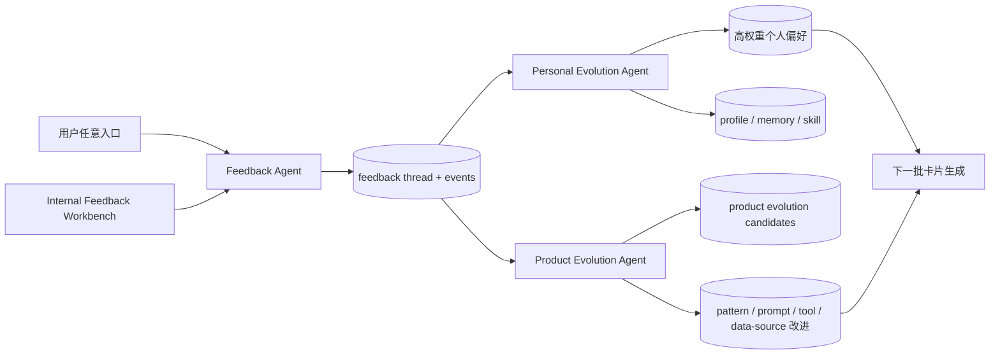

# Feedback Agent + Evolution Loop

## 结论

这次不是再做一个“反馈按钮”,也不是继续扩大旧的 1-10 分 reward dashboard。

目标是做一套完整的反馈进化回路:

1. 用户在任何地方都能唤起 **Feedback Agent**。
2. 用户用聊天方式告诉我们偏好、问题、卡片不准的原因。
3. 语音只是输入方式,和打字一样都会变成普通消息。
4. **Personal Evolution Agent** 把用户主动表达的偏好写成高权重个人偏好。
5. **Product Evolution Agent** 汇总全局反馈和点击率,产出产品/生成系统的改进候选。
6. `internal-reward-dashboard` 从“打分后台”转成内部 **Feedback Workbench**。



## 产品目标

用户体感上,这应该像截图里的竞品路线:

- 页面不是表单,而是一个轻量聊天页。
- 顶部能看到“反馈历史”。
- 中间告诉用户“我现在理解你的偏好是什么”。
- 底部是输入框,支持打字和语音输入。
- 用户说一句也可以走,也可以连续说几句。
- 系统能用很轻的方式回应“记住了”、“我会用于下一次更新”。

第一版要让用户明显感受到:

- “我可以随时告诉它我想要什么。”
- “它能记住我主动说过的偏好。”
- “下一批卡片真的会被这些偏好影响。”

## 命名

| 名字 | 职责 |
|---|---|
| **Feedback Agent** | 用户和内部人员的统一反馈对话入口。负责问清楚用户真正想表达什么。 |
| **Personal Evolution Agent** | 进化单个用户的偏好、画像、memory、skill。用户主动说的话权重最高。 |
| **Product Evolution Agent** | 进化整个产品和生成系统。看全局点击率、反馈主题和失败模式,产出改进候选。 |
| **Feedback Workbench** | `internal-reward-dashboard` 的新产品语义。工程目录暂时不要求改名。 |

## 非目标

- 第一版不做 GPT realtime voice。
- 第一版不把语音当成独立反馈类型。
- 第一版不继续把 1-10 reviewer score 当主流程。
- 第一版不让 Product Evolution Agent 自动改代码或自动改生产 prompt。
- 第一版不做完整 A/B 平台。
- 第一版不要求所有普通 UI 埋点都进入 evolution。UI 埋点可以记录,但被 agent 消费的反馈必须是明确信号。

## 核心定义

### Feedback 不等于埋点

| 类型 | 含义 | 是否进入 evolution |
|---|---|---|
| UI 埋点 | 页面浏览、hover、停留、普通点击等全量行为 | 默认不直接进入,只做分析底表 |
| 行为反馈 | card open、dismiss、action click、action complete | 进入,但权重低于用户明确表达 |
| 对话反馈 | 用户主动说“我喜欢 / 不喜欢 / 以后多推 / 以后少推” | 进入,权重最高 |
| 内部反馈 | 内部人员代用户或代产品补充判断 | 进入,但必须保留来源,不能伪装成用户原话 |

### 语音只是输入方式

语音输入最终产物仍然是一条 message:

```text
kind = message
input_method = speech_to_text
text = "我喜欢看 A 股的新闻"
```

打字输入:

```text
kind = message
input_method = typed
text = "我喜欢看 A 股的新闻"
```

agent 读的是 `text` 和上下文,不是读“语音反馈 / 文字反馈”两种业务类型。

### 用户主动说的话权重最高

用户主动对 Feedback Agent 说:

> 我喜欢看 A 股新闻。

这类显式偏好,权重要高于:

- 系统从点击行为猜出来的偏好。
- ambient / connector 数据推断出来的偏好。
- evaluator 的自评分。
- 内部人员的猜测。

## 产品体验设计

### 用户端入口

用户应该能在这些地方唤起同一个 Feedback Agent:

| 场景 | 打开时自动带什么上下文 |
|---|---|
| 全局入口 | 当前 route、最近一批 run、用户当前偏好摘要 |
| Now Feed / 卡片列表 | 当前 run id、这一批卡片摘要 |
| 卡片详情 | `card_id`、`run_id`、卡片正文、来源、intent、basket |
| 卡片执行 / chat | 当前 card chat thread、执行状态 |
| 主聊天 | 当前对话摘要 |
| 设置 / profile / control | 当前设置和 profile 摘要 |

卡片里打开时,用户不需要说“我指的是这张卡”。系统自动知道。

非卡片页面打开时,默认是全局反馈。

### 用户端反馈页

第一版页面结构:

```text
左上: 关闭
右上: 反馈历史

中间:
  标题: Tell me what matters most
  说明: 我目前理解你的偏好是...
  suggestion chips:
    - 我最近关心的是...
    - 以后少给我推...
    - 我想持续跟进...
    - 这类卡片不准,因为...

底部:
  输入框
  语音按钮
  发送按钮
```

对话行为:

- 用户说得清楚,Feedback Agent 直接确认。
- 用户说得模糊,Feedback Agent 最多追问一个关键问题。
- 用户可以连续补充多条。
- 用户可以查看历史反馈。

### Internal Feedback Workbench

`internal-reward-dashboard` 产品语义调整为 Feedback Workbench:

| 页面 | 第一版新增/调整 |
|---|---|
| `/runs` | 显示每批生成卡片数、点开卡片数、批次点击率。 |
| `/runs/:runId` | 显示这批卡的点击情况、卡片反馈数量、批次级反馈入口。 |
| `/cards/:cardId` | 显示单卡反馈 thread、行为事件、用户明确说过什么。 |
| `/personal-data` | 能看到用户明确偏好,和 profile / memory / signals 分开展示。 |
| 新反馈面板 | 内部人员可为某个用户、某张卡、某一批或全局补充反馈。 |

旧的 reviewer score / casebook 可以保留在现有页面,但不再是本计划第一版主流程。

## 指标定义

### 第一版主指标:批次点击率

```text
batch_open_rate = 当前 run 被点开的不同卡片数 / 当前 run 生成的卡片数
```

规则:

- 一批生成 10 张卡,用户点开 3 张,点击率是 30%。
- 同一张卡点开多次,分子只算 1。
- 分母来自该 run 实际生成并展示的卡片数。
- 可以额外保留 open count,但第一版主指标看 unique opened cards。

### 后续可扩展指标

这些不是第一版主目标,但数据设计要能支持:

- dismiss rate。
- action click rate。
- action complete rate。
- feedback thread rate。
- 用户主动偏好数量。
- explicit preference 命中后的下一批点击率变化。

## 当前系统状态

### 已有 feedback 表

当前已经有 `pai_feedback_events`:

| 字段 | 当前作用 |
|---|---|
| `kind` | `dismiss`、`card_action`、`text_feedback`、`card_chat_interest` 等。 |
| `action` | `confirm`、`modify`、`complete` 等。 |
| `intent_card_id` | 主要绑定卡片。 |
| `intent_key` / `basket` | 卡片归因辅助字段。 |
| `source` | 默认 `user_direct`,也可有 `agent_analysis`。 |
| `text` | 文本反馈。 |
| `metadata` | 扩展字段。 |
| `conversation_id` / `message_id` / `channel` | 可关联聊天。 |

当前 API:

- `POST /api/feedback`
- `GET /api/feedback`
- `GET /api/feedback/dismissed`
- `GET /api/feedback/completed`

当前问题:

- 没有 thread 概念。
- 主要围绕卡片,不适合全局随时反馈。
- `card_open` 现在写在 `pai_card_reward_events`,不在 feedback 主链路里。
- internal dashboard 主要读 feedback,还不是同源写 feedback。
- 1-10 score 历史设计会把新方向带回“打分后台”。

### 已有语音能力

前端已有通用语音输入:

- `VoiceProvider`
- `VoiceButton`
- `BrowserSpeechEngine`
- `GptTranscriptionEngine`

默认行为:

- 默认使用 Web Speech / `SpeechRecognition`。
- 不花 GPT 转写费用。
- 支持用户设置里的语言偏好。
- 没设置或 auto/mixed 时走中文优先的 `zh-CN`。
- GPT transcription 保留为可选能力,但不是第一版默认。

第一版应复用这套组件,不要重新做一套语音系统。

## 数据模型计划

### 新增 `pai_feedback_threads`

一次 Feedback Agent 对话就是一个 thread。

建议 migration:

```text
pinai-agents/db/migrations/0XX_pai_feedback_threads.sql
```

字段:

| 字段 | 类型 | 说明 |
|---|---|---|
| `user_id` | BIGINT | 被反馈的目标用户。 |
| `id` | TEXT | thread id。 |
| `target_type` | TEXT | `global` / `card` / `batch` / `surface`。 |
| `run_id` | TEXT NULL | 绑定批次时使用。 |
| `card_id` | TEXT NULL | 绑定卡片时使用。 |
| `target_ref` | JSONB | route、surface、card snapshot、context ids 等。 |
| `opened_from` | TEXT | `now_feed` / `card_detail` / `main_chat` / `internal_dashboard` 等。 |
| `actor_type` | TEXT | `end_user` / `internal_operator` / `agent`。 |
| `status` | TEXT | `open` / `resolved` / `archived`。 |
| `summary` | TEXT NULL | Feedback Agent 或 evolution 后写入的摘要。 |
| `created_at` | TIMESTAMPTZ | 创建时间。 |
| `updated_at` | TIMESTAMPTZ | 更新时间。 |

索引:

- `(user_id, updated_at DESC)`
- `(user_id, target_type, updated_at DESC)`
- `(user_id, run_id, updated_at DESC) WHERE run_id IS NOT NULL`
- `(user_id, card_id, updated_at DESC) WHERE card_id IS NOT NULL`

### 扩展 `pai_feedback_events`

保持现有表,做 additive 扩展,兼容旧写法。

新增字段:

| 字段 | 类型 | 说明 |
|---|---|---|
| `thread_id` | TEXT NULL | 关联 `pai_feedback_threads`。旧事件允许为空。 |
| `role` | TEXT NULL | `user` / `assistant` / `system`。 |
| `input_method` | TEXT NULL | `typed` / `speech_to_text` / `system`。 |
| `surface` | TEXT NULL | `frontend` / `internal_dashboard` / `agent`。 |
| `actor_type` | TEXT NULL | `end_user` / `internal_operator` / `agent`。 |
| `processed_at` | TIMESTAMPTZ NULL | 被 evolution 消费的时间。 |

事件语义:

| `kind` | 说明 |
|---|---|
| `message` | 用户或内部人员说的话。 |
| `agent_question` | Feedback Agent 的追问。 |
| `agent_ack` | Feedback Agent 的确认。 |
| `agent_summary` | Feedback Agent 对本 thread 的结构化摘要。 |
| `card_open` | 卡片被点开。 |
| `dismiss` | 用户明确 dismiss。 |
| `action_click` | 用户点击建议动作。 |
| `action_complete` | 建议动作完成。 |
| `text_feedback` | 旧兼容事件,逐步迁移到 `message`。 |
| `card_action` | 旧兼容事件,逐步映射到 action 类事件。 |

### 新增 `pai_preference_records`

这张表是“用户主动说出来的高权重偏好文件”。

建议 migration:

```text
pinai-agents/db/migrations/0XX_pai_preference_records.sql
```

字段:

| 字段 | 类型 | 说明 |
|---|---|---|
| `user_id` | BIGINT | 目标用户。 |
| `id` | TEXT | preference id。 |
| `statement` | TEXT | 归一化后的偏好正文。 |
| `scope` | TEXT | `global` / `card_generation` / `topic` / `language` / `workflow` / `source_preference`。 |
| `weight` | REAL | 默认高权重,例如 0.9。 |
| `confidence` | REAL | agent 对理解结果的信心。 |
| `evidence_thread_id` | TEXT | 来源 thread。 |
| `evidence_event_ids` | JSONB | 来源 message ids。 |
| `created_by` | TEXT | `feedback_agent` / `internal_operator` / `personal_evolution_agent`。 |
| `status` | TEXT | `active` / `superseded` / `archived`。 |
| `superseded_by` | TEXT NULL | 被新偏好替换时指向新 id。 |
| `created_at` | TIMESTAMPTZ | 创建时间。 |
| `updated_at` | TIMESTAMPTZ | 更新时间。 |

这张表和 `pai_profile` 的关系:

- `pai_preference_records` 是用户主动表达的偏好 ledger。
- `pai_profile` 是当前聚合画像。
- Personal Evolution Agent 可以从 preference records 更新 profile,但不要丢掉原始偏好证据。

### 新增 `pai_product_evolution_candidates`

Product Evolution Agent 的输出先进入候选队列,不直接改生产系统。

字段:

| 字段 | 类型 | 说明 |
|---|---|---|
| `id` | TEXT | candidate id。 |
| `kind` | TEXT | `pattern` / `prompt` / `tool` / `data_source` / `ranking` / `ui`。 |
| `title` | TEXT | 人能看懂的问题标题。 |
| `summary` | TEXT | 问题和建议。 |
| `evidence` | JSONB | run ids、card ids、feedback ids、metric snapshot。 |
| `status` | TEXT | `pending_review` / `accepted` / `rejected` / `shipped`。 |
| `created_at` | TIMESTAMPTZ | 创建时间。 |
| `reviewed_at` | TIMESTAMPTZ NULL | 人审时间。 |

如果候选是 pattern,可以后续接到现有 `pai_card_patterns.status='pending_review'` 流程。

### UI 埋点表

如果第一版顺手补埋点,建议单独建 `pai_ui_events`,不要塞进 feedback:

| 字段 | 说明 |
|---|---|
| `event_name` | `view_opened`、`button_clicked`、`composer_opened` 等。 |
| `surface` | 当前页面。 |
| `target_ref` | 目标对象。 |
| `metadata` | app version、device、route 等。 |

第一版 evolution 只消费明确 feedback,不消费全量 UI 埋点。

## API 计划

### UI API

新增或扩展:

| Method | Path | 用途 |
|---|---|---|
| `POST` | `/api/feedback/threads` | 创建或复用一个 feedback thread。 |
| `GET` | `/api/feedback/threads` | 列历史反馈。 |
| `GET` | `/api/feedback/threads/{thread_id}` | 取 thread + messages。 |
| `POST` | `/api/feedback/threads/{thread_id}/messages` | 写一条用户/内部人员 message。 |
| `POST` | `/api/feedback/threads/{thread_id}/resolve` | 标记 thread resolved,触发后续 evolution。 |
| `GET` | `/api/feedback/preferences` | 列用户显式偏好。 |
| `GET` | `/api/feedback/runs/{run_id}/metrics` | 返回该批 open rate 等指标。 |

现有 `POST /api/feedback` 保留,但内部实现可以自动:

- 没有 thread 时创建兼容 thread。
- `text_feedback` 映射为 `message`。
- `card_action` 映射为 action 类事件。

### Feedback Agent streaming API

建议前端通过 web 进程调用,web 再转 chat 进程,避免前端直接碰 chat 信任边界。

| Method | Path | 用途 |
|---|---|---|
| `POST` | `/api/feedback/threads/{thread_id}/agent` | 向 Feedback Agent 发消息并流式返回 ack / question。 |

后端落点:

```text
pinai-agents/src/pinai_agents/web/routes/ui/feedback.py
pinai-agents/src/pinai_agents/chat/routes/feedback.py
pinai-agents/src/pinai_agents/chat/agents/feedback.py
```

### Agent 工具

Feedback / evolution agents 需要这些工具:

| Tool | 用途 |
|---|---|
| `feedback_thread_get` | 读取当前 thread。 |
| `feedback_log` | 写 agent ack / summary。 |
| `preferences_add` | 写高权重显式偏好。 |
| `preferences_list` | 看已有显式偏好,避免重复。 |
| `profile_get` / `profile_upsert` | 读取和更新画像。 |
| `memory_add` / `memory_search` | 必要时写长期 memory。 |
| `skills_add` | 只有形成可执行流程时才写 skill。 |
| `cards_recent` | 结合近期卡片理解反馈。 |

## Agent 计划

### Feedback Agent

职责:

- 接住用户随时发来的反馈。
- 判断反馈目标:全局、卡片、批次、某个页面。
- 如果表达清楚,直接确认。
- 如果表达模糊,最多追问一个关键问题。
- 把对话整理成结构化 summary。

行为规则:

- 不要过度聊天。反馈场景要轻。
- 不要把内部人员输入伪装成用户原话。
- 不确定时问清楚,不要乱写偏好。
- 用户明确说“以后都用中文输出”这类强偏好,应直接写 preference candidate。
- 用户只是点开卡片,只能作为弱正信号。

### Personal Evolution Agent

触发方式:

- Feedback thread resolved。
- Thread idle 一段时间后自动触发。
- 每日批处理兜底未处理 thread。

输入:

- feedback thread + events。
- 当前 `pai_preference_records`。
- 当前 `pai_profile`、`pai_memory`、`pai_skill_index`。
- 如果绑定卡片,读取 card / run / sources / evaluation。

输出:

- 新增或 supersede `pai_preference_records`。
- 必要时更新 `pai_profile`。
- 必要时写 `pai_memory`。
- 只有可形成稳定执行流程时写 skill。
- 写 `pai_evolution_runs` 审计,记录 consumed feedback ids。

权重规则:

| 来源 | 默认权重 |
|---|---|
| 用户主动明确表达 | 最高 |
| 用户在卡片上下文中的明确表达 | 最高,并带 card evidence |
| 内部人员代录反馈 | 高,但来源必须可见 |
| card open | 弱正信号 |
| dismiss | 中等负信号 |
| agent 推断 | 弱信号 |

### Product Evolution Agent

触发方式:

- 每日或每周定时。
- 内部 dashboard 手动触发。

输入:

- 最近 runs 的 batch open rate。
- 低点击率 run。
- 经常被 dismiss 的卡片。
- 用户明确反馈的主题聚类。
- internal operator 补充的产品反馈。
- evaluator 和用户行为的分歧。

输出:

- `pai_product_evolution_candidates`。
- 可选 pattern candidate,进入现有 Pattern Studio pending review。
- prompt/tool/data-source/ranking/UI 改进建议。

第一版要求:

- 只产出候选,不自动改生产。
- 每条候选必须带证据。
- dashboard 能让人 review。

## 前端实施计划

### proactive-ai-frontend

新增组件:

```text
proactive-ai-frontend/src/components/feedback/FeedbackLauncher.tsx
proactive-ai-frontend/src/components/feedback/FeedbackAgentSheet.tsx
proactive-ai-frontend/src/components/feedback/FeedbackHistory.tsx
proactive-ai-frontend/src/components/feedback/FeedbackPreferenceSummary.tsx
proactive-ai-frontend/src/hooks/useFeedbackAgent.ts
proactive-ai-frontend/src/lib/feedbackApi.ts
```

复用:

```text
proactive-ai-frontend/src/components/voice/VoiceProvider.tsx
proactive-ai-frontend/src/components/voice/VoiceButton.tsx
proactive-ai-frontend/src/components/voice/BrowserSpeechEngine.ts
```

入口改造:

| 文件 | 改动 |
|---|---|
| `src/components/constellation/ConstellationLayout.tsx` | 加全局 Feedback Agent 入口。 |
| `src/components/CardDetailBody.tsx` | 旧 text feedback 输入替换/升级为同一个 Feedback Agent composer。 |
| `src/components/constellation/ChatDetailView.tsx` | 卡片执行和结果页接入同一个反馈入口。 |
| `src/components/main-chat/MainChatView.tsx` | 主聊天也能打开全局反馈入口。 |
| `src/components/constellation/ControlPanel.tsx` | 已有 request + voice 输入可迁移到 Feedback Agent 语义。 |
| `src/lib/api.ts` | `recordCardOpen` 后续改写统一 feedback event,保留旧 reward 写入兼容一段时间。 |

语音:

- 默认继续用 Web Speech。
- 默认中文优先。
- 不新增实时语音会话。
- 不保存原始音频。
- 只在 message metadata 里记录 `input_method='speech_to_text'`。

### internal-reward-dashboard

新增/调整:

```text
internal-reward-dashboard/src/routes/FeedbackWorkbenchView.tsx
internal-reward-dashboard/src/components/FeedbackComposer.tsx
internal-reward-dashboard/src/components/BatchOpenRate.tsx
internal-reward-dashboard/src/api/feedback.ts
```

页面改造:

| 文件 | 改动 |
|---|---|
| `src/routes/RunsView.tsx` | run list 增加 generated/opened/open rate。 |
| `src/routes/RunDetailView.tsx` | 增加 batch feedback threads,弱化 reviewer score 主视觉。 |
| `src/routes/CardView.tsx` | feedback events 改成 feedback thread 视图,支持内部补充反馈。 |
| `src/routes/PersonalDataView.tsx` | 显示 explicit preference records。 |
| `src/api/reward.ts` | 保留旧 API,新增 feedback API client,不要继续扩大 score 语义。 |

内部人员写入规则:

- `surface='internal_dashboard'`
- `actor_type='internal_operator'`
- 必须选择目标用户。
- 如果从 card 页面进入,自动带 card/run。
- 如果从 user 页面进入,默认 global。

## 后端实施计划

### Migration

新增 migration:

```text
pinai-agents/db/migrations/0XX_pai_feedback_threads_and_preferences.sql
```

内容:

- 新增 `pai_feedback_threads`。
- 扩展 `pai_feedback_events`。
- 新增 `pai_preference_records`。
- 新增 `pai_product_evolution_candidates`。
- 必要时新增 `pai_ui_events`。
- 给所有 per-user 表加 RLS。
- 加必要索引。

### Repository

新增/调整:

```text
pinai-agents/src/pinai_agents/web/db/repositories/feedback.py
pinai-agents/src/pinai_agents/web/db/repositories/preferences.py
pinai-agents/src/pinai_agents/web/db/repositories/product_evolution.py
```

`FeedbackRepository` 要支持:

- create/list/get thread。
- append message/event。
- list card / run / global threads。
- mark processed。
- legacy `log()` 兼容旧 `POST /api/feedback`。

### Routes

调整:

```text
pinai-agents/src/pinai_agents/web/routes/ui/feedback.py
pinai-agents/src/pinai_agents/web/routes/agent/feedback.py
```

新增:

```text
pinai-agents/src/pinai_agents/web/routes/ui/preferences.py
pinai-agents/src/pinai_agents/chat/routes/feedback.py
```

`reward_dashboard.py`:

- run/card 详情读取 feedback threads。
- run metrics 返回 open rate。
- 旧 `score` endpoint 保留兼容,但不要继续扩展成新反馈主入口。

### Chat agents

新增:

```text
pinai-agents/src/pinai_agents/chat/agents/feedback.py
pinai-agents/src/pinai_agents/chat/agents/personal_evolution.py
pinai-agents/src/pinai_agents/chat/agents/product_evolution.py
```

也可以先把 Personal/Product agent 放在现有 `dream/evolve/crystallize` 模式旁边,但 prompt 和触发器要独立,避免混淆:

- `crystallize`: 从普通 chat thread 沉淀 memory / skill。
- `personal_evolution`: 从明确 feedback thread 沉淀高权重偏好。
- `product_evolution`: 从全局反馈和指标产出产品改进候选。

### Scheduler

新增或复用 scheduler kind:

| kind | 用途 |
|---|---|
| `feedback.personal_evolve` | 单个 thread resolved / idle 后触发。 |
| `feedback.product_evolve` | 每日或每周聚合。 |

落点:

```text
pinai-agents/src/pinai_agents/web/scheduler/dispatcher.py
pinai-agents/src/pinai_agents/web/db/repositories/scheduled_tasks.py
pinai-agents/src/pinai_agents/chat/routes/run.py
```

`pai_evolution_runs.trigger_kind` 需要 additive 扩展:

- `feedback_personal`
- `feedback_product`

如果暂时不想改 enum,也可以第一版用 `manual` / `consolidation` 兼容,但最终应补清晰 trigger kind。

### SDK / agent tools

新增到 `pinai_sdk`:

```text
client.feedback.threads.*
client.feedback.messages.*
client.preferences.*
client.product_evolution.*
```

给 chat-side Code Mode agent 使用,不要直接连 DB。

## 迁移策略

第一版需要兼容旧数据:

1. 保留 `POST /api/feedback` 旧入口。
2. 老的 `text_feedback` 自动映射到一个 legacy thread。
3. 老的 `card_action` / `dismiss` 继续可读。
4. `card_open` 短期内继续写 `pai_card_reward_events`,同时新写一条 `pai_feedback_events(kind='card_open')`。
5. dashboard open rate 先同时兼容旧 reward ledger 和新 feedback event,避免数据断层。
6. 旧 1-10 reviewer score 保留展示,但不作为新 Feedback Workbench 的第一主流程。

## 分阶段实施

### Phase 1: 数据和兼容层

目标:

- thread / preference 表落地。
- 旧 `/api/feedback` 兼容新模型。
- card open rate 有统一查询口径。

验收:

- 老前端不改也能继续写 feedback。
- 新 API 能创建 thread、写 message、列历史。
- dashboard 能按 run 算出 `opened / generated / open_rate`。

### Phase 2: 用户端 Feedback Agent UI

目标:

- 用户在任意页面可唤起 Feedback Agent。
- 复用现有语音输入。
- 卡片上下文自动绑定。

验收:

- 在全局入口说“我喜欢看 A 股新闻”,写入 global thread。
- 在某张卡里说“这张卡不准”,写入 card thread,自动带 card id。
- 语音输入和打字输入都变成 message,仅 `input_method` 不同。

### Phase 3: Feedback Agent

目标:

- Agent 能确认清楚反馈。
- 模糊时能追问。
- 生成 thread summary。

验收:

- 用户说“以后少推这种”,agent 会问“是这个主题、这个来源,还是这个时机不合适?”
- 用户说“以后都用中文输出”,agent 直接确认。
- 每个 resolved thread 有 summary。

### Phase 4: Personal Evolution Agent

目标:

- 用户明确偏好写入高权重 preference。
- 同步更新 profile / memory / skill。

验收:

- “我喜欢看 A 股新闻”生成 active preference record。
- preference 有 evidence thread。
- 下一批生成能读到该偏好。
- evolution run 可追溯 consumed feedback ids。

### Phase 5: Internal Feedback Workbench

目标:

- dashboard 从分数复盘升级为反馈工作台。
- 内部人员可同源补反馈。

验收:

- `/runs` 显示每批点击率。
- `/cards/:cardId` 显示 feedback thread。
- 内部人员补一条反馈后,用户 feedback history 能看到来源是 internal dashboard。

### Phase 6: Product Evolution Agent

目标:

- 聚合全局反馈和点击率。
- 产出产品改进候选。

验收:

- 能生成“低点击卡类型”列表。
- 每个候选有 evidence。
- 候选进入 pending review,不自动上线。

## 产品验收标准

### 用户侧

必须满足:

- 用户在任意主页面都能打开 Feedback Agent。
- 用户可以打字反馈。
- 用户可以语音输入,默认走 Web Speech。
- 用户可以看到反馈历史。
- 用户在卡片里反馈时,不需要手动选择卡片。
- 用户在非卡片场景反馈时,系统按全局偏好处理。
- 用户明确表达的偏好会被系统确认。
- 下一批卡片能体现已记录的偏好。

示例验收:

| 用户说 | 期望体感 |
|---|---|
| “以后都用中文输出” | 系统回复“记住了”,后续卡片中文优先。 |
| “我喜欢看 A 股新闻” | 系统回复“记住了”,后续更容易出现 A 股相关卡。 |
| “这张卡不准” | 系统知道是哪张卡,必要时追问哪里不准。 |
| “最近别推工作类” | 系统记为近期偏好,后续减少工作类卡。 |

### Dashboard 侧

必须满足:

- 每个 run 能看到生成卡片数。
- 每个 run 能看到点开卡片数。
- 每个 run 能看到批次点击率。
- 每张卡能看到是否点开。
- 每张卡能看到关联 feedback threads。
- 能查看用户全局 feedback history。
- 内部人员能为目标用户补反馈。
- 内部补充反馈和用户反馈同源存储,但来源可区分。

### Agent 侧

必须满足:

- Feedback Agent 能追问模糊反馈。
- Feedback Agent 不把语音当业务类型。
- Personal Evolution Agent 能写高权重 preference。
- Product Evolution Agent 能产出带证据的改进候选。
- 所有写入 preference / product candidate 的动作都能追溯到原始 feedback。

### 指标侧

必须满足:

- 一批 10 张卡,点开 3 张,dashboard 显示 30%。
- 同一张卡打开多次,只算 1 张 opened card。
- open rate 口径在用户前端和 internal dashboard 一致。
- 旧 reward ledger 和新 feedback event 迁移期不会导致点击率重复计算。

## 技术验证命令

后端:

```bash
cd pinai-agents && uv run ruff check .
cd pinai-agents && uv run pytest tests/web/db/repositories/test_feedback_repo.py
cd pinai-agents && uv run pytest tests/web/routes/test_feedback.py
cd pinai-agents && uv run pytest tests/web/routes/test_reward_dashboard.py
cd pinai-agents && uv run pytest tests/chat/agents/
```

前端:

```bash
cd proactive-ai-frontend && npm run type-check
cd proactive-ai-frontend && npm test
```

Internal dashboard:

```bash
cd internal-reward-dashboard && npm run type-check
cd internal-reward-dashboard && npm test
cd internal-reward-dashboard && npm run build
```

手工验收:

```bash
make up
cd proactive-ai-frontend && npm run dev
cd internal-reward-dashboard && npm run dev -- --host 127.0.0.1 --port 3004
```

然后验证:

1. 前端打开 Feedback Agent。
2. 用语音输入一条中文偏好。
3. 用打字输入一条卡片反馈。
4. dashboard 查看对应 thread。
5. 触发 Personal Evolution Agent。
6. 查看 preference record。
7. 生成下一批卡,确认偏好进入上下文。

## 风险和决策

| 风险 | 决策 |
|---|---|
| 继续沿用 score 语义会跑偏 | 新计划把 score 降级为 legacy/debug,第一主线是 feedback thread + open rate。 |
| 所有反馈都绑卡片会跑偏 | target type 必须支持 `global`、`card`、`batch`、`surface`。 |
| 语音被设计成另一套反馈 | 明确语音只是 input_method。 |
| 用户随口一句被过度写入 profile | Feedback Agent 不确定时追问,Personal Evolution Agent 写入要保留 confidence。 |
| 内部人员反馈污染用户原话 | `actor_type` / `surface` 必须保留,展示时可见。 |
| Product Evolution 自动改生产造成风险 | 第一版只产出 pending review candidate。 |

## 和旧计划的关系

[Card Reward Infra + Internal Dashboard](./2026-05-13-card-reward-infra) 里的 reward ledger、casebook、trace artifact 仍然可以作为内部调试能力保留。

但本计划替代其中“用户反馈 = 0-10 分数 / reviewer score 是主流程”的产品方向:

- 新主指标是批次点击率。
- 新主对象是 feedback thread。
- 新主体验是 Feedback Agent。
- 新主学习对象是 explicit preference 和 evolution candidates。

## AI 实施索引

实现时按这个顺序读:

1. `docs/index.mdx`
2. `docs/modules/feedback.mdx`
3. `docs/modules/internal-reward-dashboard.mdx`
4. `docs/modules/memory.mdx`
5. 本 plan
6. 旧 reward plan 只作为兼容旧表/旧页面时参考

每个 implementation PR 都必须说明:

- 改的是哪个 phase。
- 影响用户哪段体验。
- 写入了哪些表。
- 如何验证产品验收标准。
- 是否仍兼容旧 `/api/feedback` 和旧 dashboard 数据。
