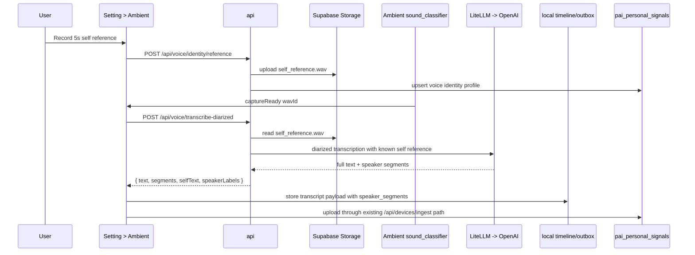

# Ambient Voice Identity + Speaker Diarization Implementation Plan

> **For agentic workers:** REQUIRED SUB-SKILL: Use superpowers:subagent-driven-development (recommended) or superpowers:executing-plans to implement this plan task-by-task. Steps use checkbox (`- [ ]`) syntax for tracking.

**Goal:** 在 Setting > Ambient 录入 2-10 秒本人参考音频，Ambient 转录时使用 OpenAI diarized transcription，把结果按 `self` / `speaker_1` / `speaker_2` 等 speaker label 保存到现有本地 timeline/outbox 和云端 `pai_personal_signals` 链路。

**Architecture:** 录入 UI 只负责采集、预览、上传本人 reference；后端把 reference 存到 Supabase Storage，并用一张用户级 profile 表记录是否启用。Ambient capture 仍走当前 `captureReady -> readCapture -> frontend -> /api/voice/* -> signal/outbox` 链路，只把普通 text response 扩展成 diarized result；识别结果不建新结果表，继续作为 transcript payload 存在本地和云端。

**Tech Stack:** React + Vite + Capacitor frontend, existing Web Audio WAV recorder, FastAPI, Postgres/yoyo migration, Supabase Storage, LiteLLM OpenAI-compatible `/audio/transcriptions`, OpenAI `gpt-4o-transcribe-diarize`.

---

## Codex Goal Prompt

可直接复制给新的 Codex goal：

```text
Implement docs/plans/2026-05-27-ambient-voice-identity-diarization.mdx.

Scope:
- Add Setting > Ambient > Voice identity UI for recording a 2-10s self voice reference.
- Store voice reference metadata server-side and upload the reference audio to Supabase Storage.
- Add a diarized transcription route using gpt-4o-transcribe-diarize through LiteLLM.
- Keep ordinary /voice/transcribe and chat voice input unchanged.
- Extend Ambient sound_classifier transcription payloads with speaker_segments, self_text, speaker_labels, and diarization status.
- Store recognition results through the existing local ambient timeline/outbox and cloud pai_personal_signals path.
- Prioritize web/browser validation first. Real microphone/person validation can be left for the user to perform on device after the UI and backend are ready.

Do not bypass LiteLLM unless the implementation proves LiteLLM cannot pass the OpenAI diarization fields and the user explicitly approves a direct OpenAI fallback.
```

## Decisions Locked

- UI entry: `Setting > Ambient`, not Debug, not Ambient timeline.
- Reference duration: OpenAI docs say known speaker reference clips are 2-10 seconds. UI target is 5 seconds, minimum save threshold is 2 seconds, hard max is 10 seconds.
- Known speaker name: send and store the user reference label as `self`.
- Other speakers: preserve model labels such as `speaker_1`, `speaker_2`. Do not collapse them to `other` unless the model gives no label.
- Language: reuse the existing `generationLanguage -> transcriptionLanguage` path. Pass `language` into diarized transcription where supported. Do not add prompt-based correction for this model unless current OpenAI docs confirm support.
- Result storage: keep current local + cloud storage path. Local timeline/outbox and uploaded `pai_personal_signals` payloads get richer speaker fields; no new table for per-transcript results.
- Fallback: if diarized transcription fails, Ambient still falls back to current plain `/voice/transcribe`, and payload must mark `diarization_status: "fallback_plain_text"`.

## OpenAI API Assumptions To Re-Verify Before Coding

Implementation must re-check current official OpenAI docs before coding the request body because audio API field names can drift.

Expected shape from current docs:

- Model: `gpt-4o-transcribe-diarize`
- Response format: `diarized_json`
- Endpoint: `/v1/audio/transcriptions`
- Not supported in Realtime API.
- Known speakers: `known_speaker_names` and `known_speaker_references`
- Reference clip duration: 2-10 seconds
- Max known speaker references: 4
- Diarized response contains speaker-labelled segments with timing and text.

If current docs conflict with this plan, update this plan section first, then implement the documented API shape.

## Target Data Flow



## Files And Responsibilities

Backend:

- Create `backend/db/migrations/057_pai_voice_identity_profiles.sql`
  - Owns the user-level self voice reference metadata.
- Create `backend/src/pinai_agents/web/db/repositories/voice_identity.py`
  - CRUD for the voice identity profile row.
- Modify `backend/src/pinai_agents/web/storage.py`
  - Add generic byte upload/download/delete helpers for user-owned non-device media.
- Modify `backend/src/pinai_agents/web/services/voice_transcription.py`
  - Add diarized transcription request/response parsing while preserving plain transcription.
- Modify `backend/src/pinai_agents/web/routes/ui/voice.py`
  - Add voice identity profile endpoints and `POST /api/voice/transcribe-diarized`.
- Modify `backend/src/pinai_agents/web/services/account_deletion.py` only if the new storage path is not already under the user's existing Storage prefix.

Frontend:

- Create `proactive-ai-frontend/src/components/voice/pcmRecorder.ts`
  - Extract reusable WAV recorder from `GptTranscriptionEngine.ts`.
- Modify `proactive-ai-frontend/src/components/voice/GptTranscriptionEngine.ts`
  - Use shared `createPcmRecorder`; behavior unchanged.
- Create `proactive-ai-frontend/src/services/voiceIdentityApi.ts`
  - Client helpers for profile read/upload/delete/toggle.
- Create `proactive-ai-frontend/src/components/VoiceIdentitySettings.tsx`
  - Setting > Ambient UI module.
- Modify `proactive-ai-frontend/src/components/constellation/AccountPanel.tsx`
  - Mount `VoiceIdentitySettings` in the Ambient sub-page after `AmbientSourceControlsPanel`.
- Modify `proactive-ai-frontend/src/services/ambient/capture-transcription.ts`
  - Call diarized route when voice identity is enabled and return structured result.
- Modify `proactive-ai-frontend/src/services/ambient/sources/sound-classifier.ts`
  - Persist speaker fields in transcript payload and keep fallback plain text behavior.
- Add or update tests beside the touched frontend files.

Docs:

- Modify `docs/modules/data-connectors.mdx`
  - Link this plan under related Ambient plans.
- Modify `docs/plans/README.mdx`
  - Add this plan to the AI Plans index.

## Data Contracts

### Backend voice identity profile

Migration table:

```sql
CREATE TABLE pai_voice_identity_profiles (
  user_id BIGINT PRIMARY KEY REFERENCES users(id) ON DELETE CASCADE,
  enabled BOOLEAN NOT NULL DEFAULT TRUE,
  speaker_name TEXT NOT NULL DEFAULT 'self',
  reference_storage_path TEXT NOT NULL,
  reference_mime TEXT NOT NULL DEFAULT 'audio/wav',
  reference_byte_len INTEGER NOT NULL,
  reference_duration_ms INTEGER NOT NULL,
  reference_sha256 TEXT NOT NULL,
  enrolled_at TIMESTAMPTZ NOT NULL DEFAULT NOW(),
  updated_at TIMESTAMPTZ NOT NULL DEFAULT NOW(),
  CHECK (speaker_name = 'self'),
  CHECK (reference_duration_ms BETWEEN 2000 AND 10000),
  CHECK (reference_byte_len > 0)
);
```

Storage path:

```text
{supabase_user_id}/voice_identity/self_reference.wav
```

This path stays under the existing user prefix, so account deletion should remove it through `delete_all_user_media()`.

### Frontend profile response

```ts
export interface VoiceIdentityProfile {
  enabled: boolean;
  enrolledAt: string | null;
  updatedAt: string | null;
  speakerName: "self";
  referenceDurationMs: number | null;
  referenceByteLen: number | null;
  referenceSha256?: string;
}
```

Do not return the reference audio body from `GET /api/voice/identity`.

### Diarized transcription result

```ts
export interface SpeakerSegment {
  speaker: string; // "self", "speaker_1", "speaker_2", or model-provided label
  text: string;
  startMs: number | null;
  endMs: number | null;
}

export interface AmbientCaptureTranscriptionResult {
  text: string;
  selfText: string;
  speakerLabels: string[];
  segments: SpeakerSegment[];
  provider: "cloud_diarize" | "cloud_whisper";
  diarizationStatus:
    | "matched_reference"
    | "diarized_without_reference"
    | "fallback_plain_text"
    | "disabled"
    | "not_enrolled";
}
```

### Ambient transcript payload extension

Extend the existing `session_summary` payload from `SoundClassifierSource.pushTranscript`:

```ts
{
  platform,
  wavId,
  burstId,
  captureSessionId,
  durationMs,
  provider,
  fallback,
  triggerSource,
  speaker_segments: [
    { speaker: "self", text: "I will call Raj tomorrow.", start_ms: 120, end_ms: 2400 },
    { speaker: "speaker_1", text: "Send me the deck.", start_ms: 2500, end_ms: 4200 }
  ],
  speaker_labels: ["self", "speaker_1"],
  self_text: "I will call Raj tomorrow.",
  diarization_model: "gpt-4o-transcribe-diarize",
  diarization_status: "matched_reference"
}
```

Rules:

- `summary` remains full transcript text for existing UI compatibility.
- `payload.self_text` is the only field downstream should treat as user-owned speech.
- non-`self` speaker text remains context, not user preference.
- If fallback plain text runs, set `speaker_segments=[]`, `speaker_labels=[]`, `self_text=""`, `diarization_status="fallback_plain_text"`.

## Tasks

### Task 1: Re-verify OpenAI + LiteLLM diarization support

**Files:**
- Inspect only first; no committed code required unless the probe script is useful.
- Optional create: `backend/scripts/probe_voice_diarization.py`

- [ ] Check current OpenAI docs for `gpt-4o-transcribe-diarize`, `diarized_json`, `known_speaker_names`, and `known_speaker_references`.
- [ ] Confirm whether LiteLLM passes these multipart/text fields through to OpenAI.
- [ ] If LiteLLM does not pass them through, stop and report the blocker. Do not bypass LiteLLM without user approval.
- [ ] Add `gpt-4o-transcribe-diarize` to the backend allowed transcription models only after the probe confirms the route can work.

Verification:

```bash
cd backend
uv run pytest tests/web/routes/test_voice_transcribe.py -q
```

Expected: existing plain transcription tests still pass.

### Task 2: Backend voice identity storage

**Files:**
- Create: `backend/db/migrations/057_pai_voice_identity_profiles.sql`
- Create: `backend/src/pinai_agents/web/db/repositories/voice_identity.py`
- Test: `backend/tests/web/db/test_voice_identity_repo.py`

- [ ] Add the migration exactly as defined in "Backend voice identity profile", using yoyo SQL style used by existing migrations.
- [ ] Implement repository methods:
  - `get_profile() -> VoiceIdentityProfileRow | None`
  - `upsert_profile(...) -> VoiceIdentityProfileRow`
  - `set_enabled(enabled: bool) -> VoiceIdentityProfileRow`
  - `delete_profile() -> None`
- [ ] Write DB tests for create, update, disable, delete, duration check, and user scoping.

Verification:

```bash
cd backend
uv run pytest tests/web/db/test_voice_identity_repo.py -q
```

Expected: new repository tests pass.

### Task 3: Generic user media storage helpers

**Files:**
- Modify: `backend/src/pinai_agents/web/storage.py`
- Test: `backend/tests/web/test_storage.py` or nearest existing storage test file

- [ ] Add `upload_user_media_bytes(supabase_user_id, storage_path, data, content_type)`.
- [ ] Add `download_media_bytes(storage_path)`.
- [ ] Add `delete_media(storage_path)`.
- [ ] Keep all paths bucket-relative and under `{supabase_user_id}/...`.
- [ ] Keep SDK calls inside `asyncio.to_thread`, matching existing storage style.

Verification:

```bash
cd backend
uv run pytest tests/web/test_storage.py -q
```

Expected: helper tests pass or are skipped cleanly when Supabase Storage is not configured.

### Task 4: Voice identity API

**Files:**
- Modify: `backend/src/pinai_agents/web/routes/ui/voice.py`
- Test: `backend/tests/web/routes/test_voice_identity_routes.py`

- [ ] Add `GET /api/voice/identity`.
- [ ] Add `POST /api/voice/identity/reference`.
- [ ] Add `POST /api/voice/identity` with `{ enabled: boolean }`.
- [ ] Add `DELETE /api/voice/identity/reference`.
- [ ] Validate uploaded audio:
  - content type starts with `audio/`
  - non-empty
  - max size uses existing voice audio size cap unless a smaller cap is chosen
  - WAV duration parses to 2000-10000 ms
- [ ] Store only metadata in DB response. Never return raw reference audio.

Verification:

```bash
cd backend
uv run pytest tests/web/routes/test_voice_identity_routes.py -q
```

Expected: route tests cover no-profile, upload, too-short reject, disable, delete.

### Task 5: Diarized transcription service and route

**Files:**
- Modify: `backend/src/pinai_agents/web/services/voice_transcription.py`
- Modify: `backend/src/pinai_agents/web/routes/ui/voice.py`
- Test: `backend/tests/web/routes/test_voice_transcribe.py`

- [ ] Add a structured parser that normalizes OpenAI diarized response segments into `{ speaker, text, start_ms, end_ms }`.
- [ ] Add `transcribe_audio_diarized(...)`.
- [ ] Add `POST /api/voice/transcribe-diarized`.
- [ ] Load the current user's enabled voice identity profile.
- [ ] If no enabled profile exists, return a typed response that lets frontend choose plain fallback. Prefer `409` with detail `voice identity not enrolled` over pretending diarization ran.
- [ ] Use the user's LiteLLM virtual key with `required_models={"gpt-4o-transcribe-diarize"}`.
- [ ] Pass the current language hint through the same normalization path as `/api/voice/transcribe`.

Verification:

```bash
cd backend
uv run pytest tests/web/routes/test_voice_transcribe.py tests/web/routes/test_voice_identity_routes.py -q
```

Expected: plain transcription remains unchanged; diarized route returns normalized speaker segments in mocked tests.

### Task 6: Shared frontend WAV recorder

**Files:**
- Create: `proactive-ai-frontend/src/components/voice/pcmRecorder.ts`
- Modify: `proactive-ai-frontend/src/components/voice/GptTranscriptionEngine.ts`
- Test: `proactive-ai-frontend/src/components/voice/GptTranscriptionEngine.test.ts` or a new `pcmRecorder.test.ts`

- [ ] Move `createPcmRecorder`, `encodeWav`, and helper functions out of `GptTranscriptionEngine.ts`.
- [ ] Keep `GptTranscriptionEngine` behavior unchanged.
- [ ] Export a small API:

```ts
export interface PcmRecorder {
  stop(): Promise<Blob>;
}

export async function createPcmRecorder(stream: MediaStream): Promise<PcmRecorder>;
```

Verification:

```bash
cd proactive-ai-frontend
npm test -- --run src/components/voice/GptTranscriptionEngine.test.ts
npm run type-check
```

Expected: existing voice input tests and type-check pass.

### Task 7: Voice identity frontend API client

**Files:**
- Create: `proactive-ai-frontend/src/services/voiceIdentityApi.ts`
- Test: `proactive-ai-frontend/src/services/voiceIdentityApi.test.ts`

- [ ] Implement `fetchVoiceIdentity()`.
- [ ] Implement `uploadVoiceIdentityReference(audio: Blob, durationMs: number)`.
- [ ] Implement `setVoiceIdentityEnabled(enabled: boolean)`.
- [ ] Implement `deleteVoiceIdentityReference()`.
- [ ] Use existing `proxyFetch` / `proxyPost` conventions.

Verification:

```bash
cd proactive-ai-frontend
npm test -- --run src/services/voiceIdentityApi.test.ts
```

Expected: client sends the expected methods, content type, and route paths.

### Task 8: Setting > Ambient Voice identity UI

**Files:**
- Create: `proactive-ai-frontend/src/components/VoiceIdentitySettings.tsx`
- Modify: `proactive-ai-frontend/src/components/constellation/AccountPanel.tsx`
- Test: `proactive-ai-frontend/src/components/VoiceIdentitySettings.test.tsx`

- [ ] Mount the module in `AmbientSubPage` immediately after `AmbientSourceControlsPanel`.
- [ ] UI states:
  - no profile: record CTA
  - recording: timer and stop
  - review: play, save, re-record
  - enrolled enabled: enabled toggle, enrolled time, duration, delete, re-record
  - enrolled disabled: show disabled state with enable action
  - error: permission/upload/validation message
- [ ] Recording rules:
  - show target 5 seconds
  - reject save below 2 seconds
  - auto-stop at 10 seconds
- [ ] Use concise copy. Do not present it as security-grade identity verification.

Web-first verification:

```bash
cd proactive-ai-frontend
npm test -- --run src/components/VoiceIdentitySettings.test.tsx
npm run type-check
npm run dev -- --host 127.0.0.1 --port 3003
```

Then use browser automation to open the local web app and verify:

- Setting tab opens.
- Ambient sub-page opens.
- Voice identity section is visible.
- With mocked or dev API state, no-profile/enrolled/disabled states render.
- Text and buttons do not overflow on mobile viewport width.

Manual microphone verification can wait for the user.

### Task 9: Ambient capture structured transcription client

**Files:**
- Modify: `proactive-ai-frontend/src/services/ambient/capture-transcription.ts`
- Test: `proactive-ai-frontend/src/services/ambient/capture-transcription.test.ts`

- [ ] Change `CaptureTranscriptionResult` to carry structured fields while preserving `text`.
- [ ] Attempt diarized transcription only when voice identity profile is enabled.
- [ ] If diarized route returns not-enrolled/disabled, call existing plain `transcribeVoiceAudio`.
- [ ] If diarized route fails for transient errors, call existing plain route and set `diarizationStatus="fallback_plain_text"`.
- [ ] Continue passing the language hint.

Verification:

```bash
cd proactive-ai-frontend
npm test -- --run src/services/ambient/capture-transcription.test.ts
```

Expected: enabled profile calls diarized route; not enrolled and failures fall back to plain route.

### Task 10: Persist speaker labels through Ambient existing path

**Files:**
- Modify: `proactive-ai-frontend/src/services/ambient/sources/sound-classifier.ts`
- Test: `proactive-ai-frontend/src/services/ambient/sources/sound-classifier.test.ts`
- May need test updates in timeline/outbox tests if payload snapshots assert exact shape.

- [ ] Store `speaker_segments`, `speaker_labels`, `self_text`, `diarization_model`, and `diarization_status` in the current transcript payload.
- [ ] Keep `summary` as the full transcript for compatibility.
- [ ] Keep dedupe key behavior unchanged.
- [ ] Preserve non-self speaker labels from model output.
- [ ] Do not write `other` unless the model returns no speaker label.

Verification:

```bash
cd proactive-ai-frontend
npm test -- --run src/services/ambient/sources/sound-classifier.test.ts src/services/ambient/outbox.test.ts src/services/ambient/sync-scheduler.test.ts
npm run type-check
```

Expected: Ambient transcript records include speaker payload fields and still upload through the existing outbox path.

### Task 11: Browser QA before real-device recording

**Files:**
- No source changes unless QA finds a UI issue.

- [ ] Start frontend dev server:

```bash
cd proactive-ai-frontend
npm run dev -- --host 127.0.0.1 --port 3003
```

- [ ] Use the Chrome plugin / Edge fast path to open `http://127.0.0.1:3003`.
- [ ] Navigate to `Setting > Ambient`.
- [ ] Verify Voice identity layout at mobile viewport and desktop viewport.
- [ ] Use mocked API responses if real backend auth blocks web QA.
- [ ] Confirm no text overflow, no nested-card visual issue, and buttons are reachable.

Expected: basic UI can be validated on web without waiting for real human audio.

### Task 12: Real-device/manual voice acceptance

**Files:**
- No source changes unless QA finds a bug.

Manual acceptance script for the user:

1. Open iOS app.
2. Go to `Setting > Ambient > Voice identity`.
3. Record this 5-second phrase: "This is my PIN AI voice identity sample."
4. Save it.
5. Turn Ambient on.
6. User says: "I need to follow up with Raj tomorrow."
7. Another person says: "Send me the deck."
8. Confirm Live/Ambient still shows readable transcript.
9. Inspect latest local/cloud transcript payload.

Expected payload:

```json
{
  "speaker_labels": ["self", "speaker_1"],
  "self_text": "I need to follow up with Raj tomorrow.",
  "diarization_status": "matched_reference"
}
```

If the model labels the other speaker differently, preserve that label. Do not normalize it to `other`.

Cloud DB check:

```sql
SELECT id, title, summary, payload->'speaker_segments', payload->>'self_text', payload->>'diarization_status'
FROM pai_personal_signals
WHERE user_id = $1
  AND kind = 'ambient.candidate_window'
  AND payload->>'window_type' = 'transcript_session'
ORDER BY latest_at DESC
LIMIT 5;
```

## Acceptance Criteria

- User can open `Setting > Ambient` and see a Voice identity module.
- User can record, preview, save, disable, delete, and re-record a self reference.
- Reference recordings under 2 seconds cannot be saved; recordings stop at 10 seconds.
- Plain chat voice input still uses the existing path and is unaffected.
- Ambient transcription uses diarized route when voice identity is enabled.
- `self` and non-self speaker labels are preserved in local and cloud payloads.
- `self_text` is available for downstream memory/preference logic.
- non-self speaker text is not treated as user-owned preference.
- Diarized route failure falls back to plain transcription without breaking Ambient.
- Frontend type-check, targeted frontend tests, backend ruff, and targeted backend tests pass.

## Verification Bundle

Run after implementation:

```bash
cd backend && uv run ruff check
cd backend && uv run pytest tests/web/routes/test_voice_transcribe.py tests/web/routes/test_voice_identity_routes.py tests/web/db/test_voice_identity_repo.py -q
cd proactive-ai-frontend && npm run type-check
cd proactive-ai-frontend && npm test -- --run src/components/VoiceIdentitySettings.test.tsx src/services/voiceIdentityApi.test.ts src/services/ambient/capture-transcription.test.ts src/services/ambient/sources/sound-classifier.test.ts
```

Browser QA:

```bash
cd proactive-ai-frontend && npm run dev -- --host 127.0.0.1 --port 3003
```

Open `http://127.0.0.1:3003`, verify `Setting > Ambient > Voice identity`.

Real recording QA is manual and can wait for the user.

## Risks

- LiteLLM may not pass `known_speaker_*` fields to OpenAI. Treat this as a blocker; do not bypass LiteLLM without explicit approval.
- Diarization labels can be probabilistic. Product copy must avoid claiming security-grade identity.
- Reference audio is sensitive. Do not log raw audio, base64, storage signed URLs, or SHA input.
- The model may label the same non-self speaker inconsistently across separate recordings. Store labels per transcript; do not create long-lived identities for other people in this iteration.
- Cost and latency will likely increase versus plain `gpt-4o-transcribe`; fallback keeps Ambient usable if diarization fails.
