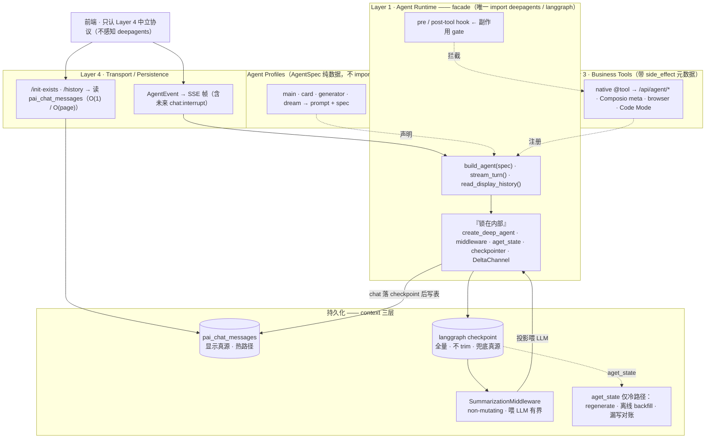
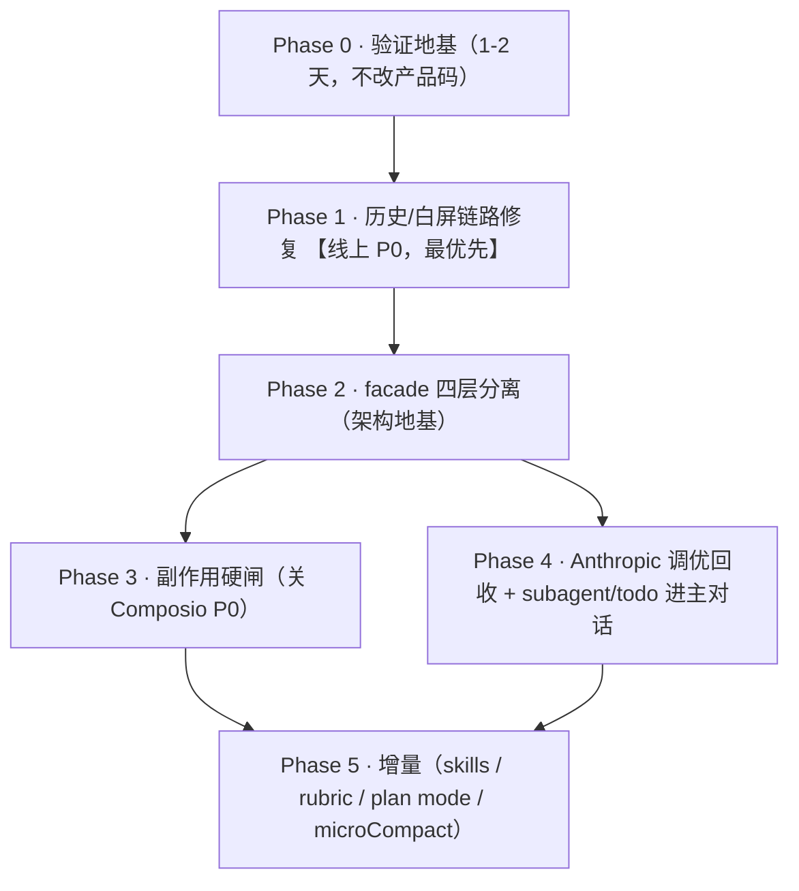

# Agent 架构重构研究

> **状态**：brainstorm 草稿（研究 + 讨论中，未拍板，不指导任何已落地代码）。本版已收口前两轮 review，结论自洽、无内部矛盾。
> **范围**：**只谈 agent 架构** —— agent loop / context 管理 / 工具表面 / subagent / 权限（副作用门）/ 流式 / 历史读取 / deepagents 用法。**不谈世界模型**（memory / profile / signals / skill / evolution 的统一）——单独开一篇。
> **对比基准**：Claude Code 反混淆源码（`others/claude-code-leak`，v2.1.88）+ deepagents `0.6.7` 安装源码逐文件精读 + langgraph-checkpoint-postgres 源码。
> **不考虑兼容**：目标是"最强架构 + 保留将来换掉 deepagents 的可能"。
> **前序 plans**：[deepagents 迁移评估](./2026-05-04-deepagents-migration)、[工具调用范式选型](./2026-05-04-tool-calling-paradigms)、[OpenClaw parity on DeepAgents](./2026-05-05-openclaw-parity-on-deepagents)。本文是它们落地半年后、基于 0.6.7 实际源码的一次架构复盘。

---

## 一、TL;DR

1. **deepagents 0.6.7 本质就是"Claude Code 设计理念的 LangChain 开源实现"** —— 薄内核 + 厚 harness、context economy、协议不变量（tool_use↔tool_result 配对）、subagent 上下文隔离、HITL 硬闸、Anthropic Agent Skills，全都内置了。

2. **pinai 现在是"用了 deepagents 的壳，但因为三个历史选择系统性绕开了它最值钱的部分"**：走 LiteLLM + `ChatOpenAI`（Anthropic 专属优化静默 no-op）、自加 `trim.py` 固定 12-turn 窗口（绕开且冲突于 summarization）、用 `propose_action` 软约束代替 `interrupt_on` 硬闸（因为 SSE 翻译不了 langgraph interrupt）。

3. **结论**：大多数我们以为要"自建"才能追平 Claude Code 的能力，deepagents 已经给了，问题是**没开 / 绕开 / 空转**。最强架构不是"推翻 deepagents 自建薄 loop"，而是**深用 deepagents + 用一层 facade 把它的内部类型锁住**，既吃满能力，又保留将来低成本换掉它的可能。

---

## 二、当前 agent 架构事实（源码佐证）

chat 进程跑 5 类 agent，全部是 `deepagents.create_deep_agent()` 的不同参数组合：

| Agent | 文件 | model | backend | checkpointer | tools | subagents | response_format | context 策略 |
|---|---|---|---|---|---|---|---|---|
| **main_chat** | `agents/main_chat.py:194` | LiteLLM sonnet-4-6（streaming） | Daytona/Local | ✅ Postgres | `ALL_TOOLS`（23 native） | `[_ECHO_PROBE]`（test-only） | 无 | 自加 `trim` 12 turns |
| **card_execution** | `agents/card_execution.py:234` | 同上 | 同上 | ✅ | `ALL_TOOLS + propose_action` | 默认 GP 自动加 | 无 | 无 trim |
| **generator** | `agents/generator.py:612` | sonnet-4-6（thinking 8000） | Daytona（5 agent 共享） | 无 | 默认 fs/execute | 4× `CompiledSubAgent` | `GeneratorOutput` + 各子 agent schema | 一次性 |
| **dream / evolve / crystallize** | `agents/{dream,evolve,crystallize}.py` | sonnet-4-6（thinking 4000-8000） | one-shot Daytona | 无 | 默认 fs/execute | 无 | 无 | 一次性 |

**关键链路**（`docs/modules/execution.mdx`）：
`前端 → web /api/chat-stream/send → chat_proxy 签 EdDSA run JWT → chat /agent/chat → session_key 前缀选 agent（card-thread-* → card_execution，否则 main_chat）→ agent.astream_events(v2) → langgraph_to_sse → SSE 帧`。

**钉死的事实**（行号为当前 worktree）：

1. **model 走 `ChatOpenAI` 子类，不是 `ChatAnthropic`**。`runtime/llm.py:65` `ChatLiteLLMReasoning(ChatOpenAI)`，`model="claude-sonnet-4-6"`（`config.py:211`），经 LiteLLM proxy（"LiteLLM is OpenAI-API-shaped"）。
2. **`trim.py` 故意绕开 deepagents summarization**。`runtime/trim.py:9-11` 原文："no dependency on deepagents' summarization, which isn't configurable: #2622"。每轮 send 后 `routes/chat.py:455` best-effort `trim_thread`，固定保留 `MAIN_CHAT_KEEP_TURNS=12`。
3. **显示历史已与 LLM context 分离**（migration `079_pai_chat_messages`）：前端 `/history`（`web/routes/ui/chat.py:280`）读 `pai_chat_messages` **分页**（`beforeId` cursor，O(page)），assistant turn 由 `ChatTurnRecorder` 边流边录、SSE 收尾 `_persist_turn` 写表。**只有 `exists`（`chat/routes/history.py:145`）和老 thread 首次 lazy-backfill 还走 `aget_state` 全量重建。**
4. **副作用确认是 prompt 软约束**。`tools/native/propose_action.py:18-21`："No interrupt() here on purpose ... dropped on the floor [in SSE]"。靠 prompt 引导 agent 自觉先 `propose_action` 再写。
5. **Composio 没有运行时 verb 闸**（已知 P0）：只有 prompt 规则 + session `tools=` allowlist，没有"DELETE/SEND 自动拒"硬拦截。

---

## 三、deepagents 0.6.7 是什么（认知纠正）

> 逐文件读 `0.6.7` 源码（`graph.py` 全文 + 各 middleware）后的事实。**0.5.6（主 checkout 残留旧 venv）和 0.6.7（uv.lock 锁定、当前依赖）差异巨大，以 0.6.7 为准。**

### 3.1 `create_deep_agent` 默认装配的 middleware 栈（`graph.py:712-771`）

| # | middleware | 默认状态 | 作用 |
|---|---|---|---|
| 1 | `TodoListMiddleware` | **默认就有** | `write_todos` 规划工具 |
| 2 | `SkillsMiddleware` | 需传 `skills=` | Anthropic Agent Skills（SKILL.md 渐进式披露） |
| 3 | `FilesystemMiddleware` | **默认（受保护，删不掉）** | ls/read/write/edit/glob/grep + `execute` + **大 tool result 自动落盘** + 路径权限 |
| 4 | `SubAgentMiddleware` | **默认**（自动加 general-purpose subagent → `task` 工具） | 子 agent 委派 + 上下文隔离 |
| 5 | `SummarizationMiddleware` | **默认** | context 压缩 + 被驱逐历史落盘 `/conversation_history/<thread>.md` + **non-mutating 投影** |
| 6 | `PatchToolCallsMiddleware` | **默认** | **补悬空 tool_call → tool_result 配对**（协议不变量防御） |
| 7 | `AsyncSubAgentMiddleware` | 需传 async subagent | 远端 LangGraph 后台 agent |
| 8 | *(用户 middleware)* | — | 插入点 |
| 9-10 | profile `extra_middleware` / `_ToolExclusionMiddleware` | 视 harness profile | 模型级附加 / 隐藏工具 |
| 11 | `AnthropicPromptCachingMiddleware` | **无条件挂**（非 Anthropic 模型 **no-op**） | prompt 缓存断点 |
| 12 | `MemoryMiddleware` | 需传 `memory=` | AGENTS.md always-loaded 持久上下文 |
| 13 | `HumanInTheLoopMiddleware` | 需传 `interrupt_on=` | **approve / edit / reject / respond 四态硬闸** |

另：`DeepAgentState`（`graph.py:63-66`）把 messages channel 设成 `DeltaChannel(_messages_delta_reducer, snapshot_frequency=50)`，把 checkpoint 增长从 **O(N²) 降到 O(N)**。

### 3.2 `create_deep_agent` 全能力 × pinai 用没用

| 能力 | deepagents 提供 | pinai 状态 |
|---|---|---|
| TodoList 规划（`write_todos`） | ✅ 默认 | ⚠️ 栈里有，prompt 不引导，等于没用 |
| Filesystem + `execute`（Code Mode） | ✅ 默认 | ✅ 用了（python_exec via Daytona） |
| **大 tool result 落盘**（>20000 token 自动 offload + 预览 + 可重读） | ✅ 默认 | ✅ 自动生效 |
| **悬空 tool_call 修补**（`PatchToolCalls`） | ✅ 默认 | ✅ 自动生效 |
| Summarization（压缩 + 落盘可重读 + non-mutating 投影） | ✅ 默认 | ⚠️ 默认装着，但被 `trim.py` 绕开且与之冲突 |
| subagent 上下文隔离 + 内置 general-purpose | ✅ 默认 | ⚠️ 只在 generator 用对；main/card 只有 test echo_probe |
| `response_format` 结构化输出 | ✅ | ✅ generator 用了 |
| Anthropic prompt caching | ✅ 默认 | ❌ **空转**（走 ChatOpenAI → no-op；pinai 自己用 extra_body 补） |
| **HarnessProfile 模型级调优** | ✅ 命中 model id 自动 | ❌ **大概率没命中**（ChatOpenAI 实例，provider≠anthropic；待验证） |
| **HITL `interrupt_on`**（运行时硬闸） | ✅ 需开 | ❌ 没用（propose_action 软闸替代） |
| **Skills**（SKILL.md，同 Claude Code） | ✅ 需开 | ❌ 没用 |
| **Memory（AGENTS.md）** | ✅ 需开 | ❌ 没用（pinai 有自己的 pai_memory，属世界模型） |
| **RubricMiddleware**（LLM-as-judge 自评闭环，beta） | ✅ 需开 | ❌ 没用（generator 的 evaluator 手搓） |
| 持久/路由 backend（Store/Composite/ContextHub） | ✅ 需开 | ❌ 没用 |
| `DeltaChannel` O(N) checkpoint | ✅ 默认 | ✅ 自动 |
| 自定义 harness profile（`register_harness_profile`） | ✅ | ❌ 没用 |

---

## 四、deepagents 在 pinai 的真实状态：已用 / 空转 / 没用

- **已用（吃到价值）**：Filesystem + `execute`、大 tool result 落盘、PatchToolCalls 配对、subagent（仅 generator）、`response_format`、`DeltaChannel`、079 显示分离。
- **空转（挂着没生效）**：`AnthropicPromptCachingMiddleware`（非 ChatAnthropic 直接 no-op，pinai 自己用 `extra_body` 补了缓存）；HarnessProfile 的 Anthropic 调优 suffix（`<investigate_before_answering>` 等，ChatOpenAI 实例大概率匹配不到）。
- **没用（完全没碰）**：HITL `interrupt_on`、Skills、Memory(AGENTS.md)、Rubric、Store/Composite/ContextHub backend、自定义 profile、TodoList 规划、async subagent。

---

## 五、三个系统性绕开 + 一个线上 P0

pinai 不是"没差距"，而是**用三个具体选择把 deepagents（≈Claude Code）的优势主动让掉了**，外加一个历史/白屏链路的 P0。

### 5.1 绕开一：LiteLLM + `ChatOpenAI` → Anthropic 专属优化全 miss
- **为什么**：LiteLLM 是 OpenAI-API 形状，统一多 provider 路由 + virtual key 计费 + trust boundary（master Anthropic key 只在 LiteLLM）。这些是对的产品/安全理由。
- **代价**：所有"检测到 ChatAnthropic 才生效"的精调全漏 —— caching middleware、harness profile 行为 suffix、summarization 的 token counter tuning（`chars_per_token=3.3`）。pinai 手动补了 caching 和 reasoning 透传，但**行为调优 suffix 没补**。
- **解**：(a) chat 用 `ChatAnthropic` 直连（要单独解决 virtual key 计费 + master key 隔离）；(b) 保留 LiteLLM，用 `register_harness_profile` 注册 pinai 的 model key，或把那几段 suffix 直接进 `_INSTRUCTIONS`。(b) 成本低、先做。

### 5.2 绕开二：`trim.py` 固定 12-turn 窗口 → 绕开且冲突于 summarization
- **为什么**：`trim.py` docstring 写明动机 —— 当时认为 summarization "不可配置（#2622）"，且固定小窗口让 `aget_state` 重建快、checkpoint blob 不爆。
- **核实后的事实（0.6.7）**：① deepagents 默认就装 `SummarizationMiddleware`，它 **non-mutating** —— 不改 `state["messages"]`，只在 `wrap_model_call` 时按私有 `_summarization_event`(cutoff_index) 投影出"喂给 LLM 的有效消息"，超阈值 summarize 后 offload 到 `/conversation_history/<thread>.md`（默认触发：有 profile 时 context 85%，无 profile `tokens=170000`；keep 默认最近 ~10%）。② 手动 `RemoveMessage`（trim 现在干的）改 `state["messages"]`，会和 `_summarization_event` 的 cutoff 错位 —— **两者不能混用**（源码确认）。
- **结论：删掉 trim**（不前置、不流尾、不再手动 `RemoveMessage`），working context 交 summarization。理由见 §8.2：一旦 §五-P0 把 `aget_state` 移出热路径，trim 唯一的"提速"动机就消失了，而它和 summarization 冲突 —— 留 summarization。

### 5.3 绕开三：`propose_action` 软闸 → 不用 `interrupt_on` 硬闸
- **为什么**：langgraph `interrupt()` 会中断执行、等 `Command(resume=...)`，**跟 SSE 流式不兼容**（interrupt 事件在 SSE 链路被丢）。pinai 发明"chat-turn 边界即暂停"：agent 调 `propose_action` 拿哨兵 → 自觉停 turn → 用户下条消息当普通 HumanMessage 回来。SSE 友好、UX 自然。
- **代价**：**软约束**。agent 不遵守 prompt（不先确认就 `COMPOSIO_MULTI_EXECUTE_TOOL` 发邮件/扣款）时**没有运行时拦截**。对代表用户花钱/发邮件的助理，这是 P0。`interrupt_on` 恰好是框架级硬闸，但用它要解决 SSE↔interrupt 桥接。详见 §8.3。

### 5.4 线上 P0：历史 / 白屏链路（dev 实测，已有对抗式验证 debug session 查到底）

> 根因来自 workflow `chat-history-slow-rootcause`（4 根因独立验证 + completeness critic）。critic 纠正了几处直觉误判，下面是纠正后的版本。

- **白屏主因是 `/init` 的 exists 无条件走 chat `aget_state`**（PR#14 只改 `/history`，没碰 exists），叠加**前端 mount 串行打两次 `/init`** + **全屏 spinner gate**（`historyLoaded` 未就绪整屏只渲染 spinner、连输入框都不渲染）把后端慢翻倍暴露成白屏。
- **`aget_state` 慢的根本是「最新 checkpoint 的 message 条数 + 反序列化体积」**，不是 1.25GB 历史 blob（`aget_tuple` 是单条带 join 的 SELECT，取 latest 一行，不 replay）。**清 blob 不提速**（指错方向）。本地实测 48.8s 含跨区网络 ~7x 放大，fly 同区约 6.86s。
- **backfill 不是「永久失败」**（critic 推翻）：表里 79 行同一时刻写入证明它曾在 thread 还小时成功过；问题是它**放在请求关键路径上**、对大 thread 有 15s 超时墙，失败被吞成空 list（`if backfilled:` 假 → 不写表）。
- **一处数据正确性 bug**：`_persist_turn` 在 web 的 SSE 收尾 finally 里被 `CancelledError` 静默回滚（同事务的 `message_count` 都没 +1）。根本问题是**持久化挂在 SSE 长请求收尾、依赖请求存活** —— 客户端中途断开就丢这一轮。
- **card thread 完全没被 PR 触及**：同样走 `aget_state`（13.7s/46msg），无快路径。

修复方案见 §11 Phase 1。

---

## 六、对照 Claude Code：差距重估

上一轮口头讨论列的 7 个"差距"，用 deepagents 0.6.7 真相重评，**大部分 deepagents 已覆盖，pinai 只是没开**：

| 上轮列的差距 | deepagents 真相 | 真正状态 |
|---|---|---|
| 协议不变量（tool_use↔tool_result 配对） | `PatchToolCallsMiddleware` 默认 | ✅ 已覆盖（自动） |
| 大 tool result 落盘 | `FilesystemMiddleware` 默认（20000 token 阈） | ✅ 已覆盖（自动） |
| context 投影 / 压缩可逆 | summarization non-mutating 投影 + 落盘可重读 | ✅ 框架有，但被 trim 绕开 |
| 权限分层 / 副作用硬闸 | `interrupt_on` HITL 四态决策 | ⚠️ 框架有，pinai 因 SSE 没用 |
| planning / todo | `TodoListMiddleware` 默认 | ⚠️ 框架有，prompt 没引导 |
| subagent 隔离工具噪音 | `SubAgentMiddleware` + 内置 GP | ⚠️ 框架有，main/card 没用 |
| prompt cache 是架构约束 | `AnthropicPromptCaching` + memory 放 cache 后 | ⚠️ middleware 空转，pinai 自己补了 |

**真正剩下的、deepagents 也没有的差距**（要自己想）：

1. **microCompact 等价层缺失**：Claude Code 有"按 `tool_use_id` 成对清旧工具结果、保留对话"的中间层；deepagents 只有"整段摘要"或"按单条体积落盘"，没有"按时间清旧工具结果"。
2. **压缩断路器是 reactive**：Claude Code 按 token 预算主动断路 + 连续失败熔断；deepagents 先调模型、catch `ContextOverflowError` 再回退。
3. **显示历史 vs LLM context 分离**：deepagents 不管显示，是 pinai 的活（已由 079 做掉，见 §5.4）。
4. **SSE 流式下的副作用硬闸**：deepagents HITL 假设非流式 interrupt/resume（§8.3）。
5. **subagent 只有 fresh、没有 fork**：Claude Code 有 fork（继承父 context + 共享 cache）；deepagents subagent 只有 fresh（剔除 `_EXCLUDED_STATE_KEYS`，只传 description）。
6. **工具粒度服务于"用户可 review"**：Claude Code "用 Read 不用 cat"。pinai 的 Code Mode（python_exec 在 sandbox）相反——用户看不到 sandbox 里干了什么（§8.4）。

---

## 七、用 / 不用 deepagents 的决策

诉求："希望用这个框架，但保留不用它的可能性。"

- **路 A：深用 deepagents（推荐）** —— 把"框架有、pinai 没开"的能力逐个打开。成本中等，大多是"配置 + 删 workaround"，不是重写。收益：deepagents 0.6.7 ≈ Claude Code 的 Python 实现，深用就直接吃到 Claude Code 级 harness。
- **路 B：脱离 deepagents 自建薄 loop** —— 成本高到不划算，要重写 PatchToolCalls 配对、大结果落盘、subagent 隔离、summarization 投影、DeltaChannel。只有当 reducer/state 模型成为无法 facade 隔离的硬约束时才值得，目前没到。
- **建议：路 A + facade 隔离**。"保留退出可能"的正确姿势**不是少用它**（那只会两头不到岸），而是**深用 + 不让业务代码直接依赖它的内部**：deepagents 内部类型（`aget_state` / middleware / `SubAgent` dict / DeltaChannel）只出现在一层 facade 内；将来换 runtime 只改 facade。具体见 §8。

---

## 八、目标架构：四层分离 + context 三层

让架构清晰、且保留"换掉 deepagents"的可能，核心是**一层 facade（Layer 1）把 deepagents 锁死**，并把 context 拆成"显示 / working / checkpoint"三层、让 `aget_state` 退出所有热路径。

### 8.1 四层分离（业务与框架解耦）

- **Layer 1 · Agent Runtime（facade）**：**唯一允许 import `deepagents` / `langgraph` 的地方**。把 `create_deep_agent` / middleware / `aget_state` / checkpointer / `astream_events` 全封进来，对外只暴露中立接口（`build_agent(spec)` / `stream_turn() → AgentEvent` / `read_display_history()` / pre·post-tool hook）。**铁律**：deepagents 内部类型不外泄到 Layer 2-4。现有 `runtime/llm.py`、`runtime/checkpoint.py`、`streaming.py`（langgraph→SSE 翻译）收进 `agent_runtime/`。
- **Layer 2 · Agent Profiles**：用 pinai 自己的 `AgentSpec`（纯 dataclass，不 import deepagents）声明每个 agent：prompt 段 / tool 集 / subagent / context 策略 / 副作用策略 / 是否持久化 / skills 开关。main·card·generator·dream 退化成 spec + 一段 prompt，**不再各自调 `create_deep_agent`**。对应支柱"一个内核 + profile 配置，收敛 5 类 agent"。
- **Layer 3 · Business Tools**：native `@tool`→`/api/agent/*`、Composio meta、browser、Code Mode。新增：每个工具声明 `side_effect` verb 元数据（供 Layer 1 gate 消费）。基本不动。
- **Layer 4 · Transport / Persistence**：中立 `AgentEvent` → SSE 帧；display history = `pai_chat_messages` 分页（已就位）。**前端只认这层，完全不感知 deepagents**。
- 横切：web `/api/agent/*`（业务数据访问，chat 不持 DB 凭证）本就是业务/框架分离的体现，保持。

**收益**：(1) 换 runtime 只改 Layer 1；(2) 副作用 gate、context 策略、能力开关集中在 Layer 1-2，不散落；(3) 前端稳定（只认 Layer 4 协议）。

### 8.2 context 三层（删 trim 的完整逻辑）

- **显示层 = `pai_chat_messages`**：前端 `/history`·`/init` exists 读这张表（O(page) / O(1) latest_id），**不碰 `aget_state`**。写入由 chat 进程在 turn 落 checkpoint 后写（见 §11 Phase 1），不再靠 web SSE finally。
- **working context = SummarizationMiddleware**：喂给 LLM 的有效消息由 deepagents 默认的 summarization 管（non-mutating 投影，超阈值压缩 + 落盘可重读）。**删掉 `trim.py`** —— 一旦 `aget_state` 退出热路径，trim 的"封顶提速"动机消失，而它和 summarization non-mutating 冲突；留 summarization。agent 健忘由 summarization 摘要 + `pai_memory` 召回补。**（Phase 0 验证补充：`create_deep_agent` 无 trigger/keep 入参，默认 summarization 命中 no-profile 分支 `tokens=170000`/`keep=6`、几乎不触发；删 trim 后须 `excluded_middleware` 移除默认 summarization + `middleware=` append 配好阈值的实例——这使"删 trim 交 summarization"成为需自定义 middleware 的 Phase 2 动作，Phase 1 不碰。）**
- **checkpoint = 全量兜底真源**：不 trim，`state["messages"]` 保全量。它退居冷路径，只在 regenerate / 离线 backfill / 漏写对账时 `aget_state`（低频、可慢）。额外好处：`pai_chat_messages` 万一漏写能从 checkpoint 对账补回，且消掉了"先迁移再启 trim"的易错部署顺序。
- 追平 Claude Code 的 microCompact（按 `tool_use_id` 清旧工具结果）是 trim 之上的**可选增量**（§11 Phase 5），须确认它不让 checkpoint message 数反弹。
- **Long-term memory**（pai_memory / profile / signals）属世界模型，本文不展开。

### 8.3 副作用硬闸（解决 SSE↔HITL 张力，含 Composio P0）

两条路二选一：
- **(a) 桥接 interrupt**：Layer 1 把 langgraph `interrupt` 翻成 `chat:interrupt` SSE 帧 → 前端确认 → `Command(resume=...)` 回灌。拿到 deepagents `interrupt_on` 的框架级硬闸（approve/edit/reject/respond），是正解，但要改 SSE 协议 + 前端 resume。
- **(b) 运行时 verb gate**：Layer 1 的 pre-tool hook 按工具 `side_effect` verb 分类（read 放行 / write·send·delete 必须带"已确认"标记才放行），agent 不走 propose_action 就拿不到标记 → 硬拒。改动小、SSE 不动，gate 逻辑自维护。
- 对应 Claude Code 的 deny→ask→allow 决策链。建议**先 (b) 关 P0，(a) 作为后续正解**。两条都需要先给工具补 `side_effect` 元数据（Layer 3）。

### 8.4 subagent + planning + Code Mode 边界

- **subagent 进主对话**：main/card 遇调研型子任务（读一堆 raw / 多源聚合 / 网页调查）spawn fresh subagent，只把结论带回主线程，raw 噪音不污染主 context。把 test-only `_ECHO_PROBE` 换成真实领域 subagent（research / browser / code）。对应 Claude Code subagent 第一性原理 = context economy。
- **planning 可观测**：card/复杂 main 任务用 `write_todos`（栈里已有，前端已有 TodoPanel 渲染），让用户看见"分几步、做到第几步"。
- **Code Mode 按"可 review"划线**：离线、用户不在场（generator/dream/evolve/crystallize）继续用 Code Mode（高效）；用户对话在场（main/card）倾向细粒度可 review 工具，或把 sandbox 关键步骤回传成 tool event。Composio meta（search→schema→execute）已经是 Claude Code deferred tools 的思路；23 个 native 全量注入可评估收敛成"按需发现"。

---

## 九、Claude Code 能力清单（媲美目标）

把 Claude Code 值得对齐的设计拆成 8 组（§10 逐条对照）：

**A. Loop 内核（薄）**：A1 单层 while-loop + 不可变 State 快照；A2 终止看 tool_use block，**不信 stop_reason**；A3 **协议不变量**（每个 tool_use 必配对 tool_result，异常路径补 synthetic）；A4 失败恢复（fallback 降级 / 流断补全 / prompt-too-long 三级）。

**B. Context 经济学**：B1 分层压缩（清僵尸→**按 tool_use_id 清旧工具结果(microCompact)**→投影→LLM 摘要）；B2 阈值数据校准 + 断路器；B3 大 result **落盘** + 可重读；B4 **显示历史与 LLM context 分离**；B5 prompt 提示"把后续要用的信息搬进回复"。

**C. 工具设计**：C1 统一 Tool 接口 + fail-closed（假定写/不安全）+ 声明 `isDestructive/checkPermissions`；C2 粒度服务于**用户可 review**（Read 不用 cat — CRITICAL）；C3 工具描述是 few-shot 教学；C4 **deferred tools / ToolSearch**；C5 并行按 concurrency-safe 自声明 + 保序 + sibling abort。

**D. Planning**：D1 **TodoWrite**（exactly one in_progress，完成判据诚实）；D2 **Plan mode**（只读探索→批准→执行 状态机）。

**E. Subagent**：E1 context 隔离（第一性原理 = 保护主窗口）；E2 fresh vs fork；E3 结果不可见 + 主 agent 转述；E4 background agent + 完成 notification；E5 内置类型（general-purpose / explore / plan / **verification**）。

**F. System Prompt**：F1 分段 + 静态/动态 boundary + 按 section 缓存；F2 **prompt cache 一等公民**；F3 行为规则具体 + measurement 驱动；F4 动态注入（env / git / CLAUDE.md / memory）；F5 **诚实性工程化**（faithfully report + verification + todo 完成判据三重防线）。

**G. 权限 / 交互**：G1 **分层决策链**（deny→ask→allow→hook→checkPermissions→interactive）；G2 权限 mode 状态机；G3 全链路流式；G4 "被拒后怎么办"写进 prompt。

**H. 工程扩展**：H1 harness 分层 + feature-flag 热插拔；H2 **Skills**；H3 **Hooks**；H4 MCP。

---

## 十、对照表：能力 × deepagents 0.6.7 × pinai 现状 × 落地动作

| 能力 | deepagents 0.6.7 | pinai 现状 | 落地动作 |
|---|---|---|---|
| A1 薄 loop + 快照 | langchain `create_agent` 内核 | ✅ 继承 | 无 |
| A2 不信 stop_reason | ✅ langchain 看 tool_calls | ✅ 继承 | 无 |
| A3 协议不变量 | ✅ `PatchToolCallsMiddleware` 默认 | ✅ 自动 | facade 加一处日志可观测 |
| A4 失败恢复 | 部分（retry/fallback 钩子） | ⚠️ 未显式配 | 后端：给 model 配 fallback + 流断恢复测试 |
| B1 分层压缩 | summarization（摘要+投影+落盘）；**无 microCompact** | ⚠️ trim 绕开且冲突 | **删 trim，交 summarization**（§11 P1）；microCompact 作可选增量（§11 P5） |
| B2 断路器 | reactive（catch `ContextOverflowError`） | ❌ | 后端：summarization 启用后加失败熔断 |
| B3 大结果落盘 | ✅ `FilesystemMiddleware`（20000 token 阈） | ✅ 自动 | 前端：tool result 卡片加"查看完整结果"入口 |
| B4 显示/context 分离 | 不管显示 | ✅ **079 已实现** | 后端：`exists` 也切 `pai_chat_messages.latest_id`（§11 P1） |
| B5 prompt 提示搬信息 | summarization prompt 内含 | ⚠️ 自定义 prompt 没这条 | 后端：prompt 加该条（profile suffix） |
| C1 fail-closed 元数据 | 工具可声明 `interrupt_on` / 权限 | ❌ native 无副作用元数据 | 后端：给工具补 `side_effect` verb（§11 P3） |
| C2 工具可 review | 中立 | ⚠️ Code Mode 用户看不到 | 后端：主对话 Code Mode 关键步骤回传 event（§11 P4） |
| C3 工具描述 few-shot | 中立 | ✅ 写得不错（Tier 路由 + 正反例） | 保持 |
| C4 deferred tools | 无框架级，可手动 | ⚠️ Composio meta 已是；23 native 全量注入 | 后端：评估长尾 native 收敛"按需发现" |
| C5 并行 + 保序 | ✅ | ✅ 继承 | 前端：并行 tool SSE 渲染分组（次要） |
| D1 TodoWrite | ✅ 默认 `write_todos` | ⚠️ prompt 不引导 | 后端 prompt 引导 + 前端 TodoPanel 接真（§11 P4） |
| D2 Plan mode | 无原生，可拼 | ❌ 业务无 | **预留接口**：AgentSpec 加 `plan_mode`（§11 P5） |
| E1/E2 subagent 隔离 | ✅ + 内置 GP；只有 fresh，**无 fork** | ⚠️ 仅 generator | 后端：main/card 加 research/browser subagent（§11 P4） |
| E3 结果不可见+转述 | ✅ 只回最后 AIMessage | ✅（generator 内） | 沿用 |
| E4 background agent | ✅ `AsyncSubAgentMiddleware` | ❌（pinai 后台走 `background_tasks`） | 不强求合并 |
| E5 verification subagent | ✅ `RubricMiddleware`（beta） | ⚠️ generator 手搓 evaluator | 后端：generator 评估换 Rubric（§11 P5） |
| F1/F2 prompt 分段 + cache | ✅ 装配 + `AnthropicPromptCaching`（非 Anthropic no-op） | ⚠️ caching 空转，自己补了 | 后端：确认 cache 命中；稳定/易变边界归位（§11 P4） |
| F3 行为规则 | ✅ `BASE_AGENT_PROMPT` 含 | ⚠️ 自定义 prompt 覆盖了 BASE | 后端：核对不冲突，补缺的规则 |
| F4 动态注入 | ✅ `memory=` / env | ⚠️ 有 turn_context；无 env/persona 统一注入 | 后端：persona/env 归一（部分属世界模型） |
| F5 诚实性三重防线 | ✅ prompt + Rubric | ⚠️ 只有 prompt | 后端：关键链路加 verifier（§11 P5） |
| G1 权限决策链 | ✅ HITL 四态 + 路径权限 | ❌ propose_action 软闸 | 后端：interrupt 桥接 / verb gate（§11 P3） |
| G2 权限 mode | ✅ interrupt_on 粒度 | ❌ | 随 G1（plan/normal mode 入 AgentSpec） |
| G3 流式 | ✅ astream_events | ✅ langgraph_to_sse | facade 收敛翻译层（§11 P2） |
| G4 被拒怎么办 | prompt | ⚠️ 没写 | 后端：prompt 补"被拒/失败别原样重试" |
| H1 feature-flag 热插拔 | middleware 增删 + `excluded_middleware` | ❌ | 随 facade：AgentSpec flag 开关能力（§11 P2） |
| H2 Skills | ✅ `SkillsMiddleware` | ❌ | **预留接口**：AgentSpec 加 `skills=`（§11 P5） |
| H3 Hooks | langgraph middleware 即钩子 | ❌ 业务无 | 预留：facade 暴露 pre/post-tool hook |
| H4 MCP | langchain MCP adapter | ❌（Composio 覆盖） | 暂不需要 |

---

## 十一、分阶段落地方案（前后端）

按"低风险高 ROI 先做 + 依赖顺序"排，每阶段可独立验证、独立上线。

### Phase 0 — 验证地基（不改产品代码）
实测三个事实，决定后续分支：① 0.6.7 summarization 的 `trigger/keep` 默认行为是否够用（无 profile 170k 触发对 main chat 是否合理、要不要配低）；② 拉 LangSmith trace 看 chat 实际 system prompt 有没有 Anthropic 调优 suffix + 看 `cache_read` 确认缓存生效（确认 HarnessProfile 命不命中）；③ langgraph `interrupt` 在 `astream_events(v2)` 下能否被捕获翻译成 SSE 帧、`Command(resume=...)` 能否接回（决定 §8.3 走 a 还是 b）。**产出**：三个 yes/no 写回 §12。

### Phase 1 — 历史 / 白屏链路修复（线上 P0，最优先，独立可上线）

> **实施拆分（Phase 0 workflow 蓝图细化）**：
> - **PR-0 前置**：对齐本地 venv 到 deepagents 0.6.7（主 checkout 当前 0.5.6，见 §12 待拍板）。
> - **PR-1 后端止血**（纯 web 进程、无 schema 变更、不依赖 deepagents 版本，先部署）：`web/routes/ui/chat.py` 三处 + `chat_proxy.py` timeout。
> - **PR-2 前端止血**（后于 PR-1）：`MainChat.tsx` + `useProactiveChatRuntime.ts`（消第二次 `/init`）+ `MainChatView.tsx`（去全屏 spinner gate）。
> - **Phase 1 完全不碰 trim / summarization / 副作用门**（验证 1：删 trim 需自定义 middleware，属 Phase 2；验证 3：verb gate 属 Phase 3，正交）。

根因见 §5.4。方案分止血 + 根治两步：

**止血（单独一个 PR，让白屏消失 + 止住"新消息不入库"）**：
- **后端**：① `/init` 的 exists 对 main thread 改读 `ChatMessagesRepository.latest_id is not None`（O(1)，复用已开 `user_scoped_tx`），不再打 chat、不 `aget_state`；card 保留 `call_chat_exists`。② backfill 超时不再被吞成空 list（用可分辨失败信号，下次重试而非当成空）。
- **前端**：① 合并两次 `/init` 成一次（`MainChat.tsx` 不自己打，交 `useProactiveChatRuntime` 统一 init）；② 去掉整屏 spinner gate，先渲染 `Thread` 骨架 + `ChatComposer`，用户立刻能输入。

**根治（移除请求路径对 `aget_state` 的依赖 + 换可靠写入点）**：
1. **热路径全脱离 `aget_state`**：exists + history 读 `pai_chat_messages`（核心）。
2. **不 trim**：删 `trim.py`，working context 交 summarization；checkpoint 保全量当兜底真源（§8.2）。
3. **持久化换可靠写入点**：由 **chat 进程在 turn 落 checkpoint 后写 `pai_chat_messages`**（chat 最可靠地知道"一轮完成"且手握完整 messages；trust boundary 上用 service-role / set app.user_id 写 web 拥有的 pai_* 表，与离线脚本同范式），**不再依赖 web SSE finally**。漏写可从 checkpoint 对账补回。
4. **离线迁移存量**：新增 `scripts/backfill_chat_messages.py`（chat 进程上下文，唯一能 `aget_state`；离线无 15s 超时约束）把存量 thread 灌进 `pai_chat_messages`；加 migration `080` 的 `messages_backfilled_at` 幂等标记，可重入。`/history` 去 lazy backfill，只做 O(page) 分页读。
5. **blob 清理暂不做**：`adelete_thread` 是整 thread 全删，langgraph 没有"删旧 checkpoint 保留最新"的 API；手写 SQL 清孤儿 blob 复杂且危险。不 trim 后 blob 膨胀更明显，但纯磁盘成本、不影响白屏/功能，需要时单列独立谨慎任务。
6. **card thread**：同样走"读表 + 不 trim + 交 summarization"，本 phase 一并覆盖。

**部署顺序**：先把离线 backfill 在 dev/prod 跑完（写满 `pai_chat_messages`），再把 `/history` + exists 切到读表（否则切了表却没数据会显示空历史）。建议两个 release：release1 上 migration 080 + 离线脚本并跑完；release2 上 init/history/send 改造（不含 trim —— 删 trim 无需排序约束）。

**验证**：dev 部署后真实账号实测白屏消失 + web 日志确认 `/init` 不再 `call_chat_exists(main)`、`/history` 不再 `aget_state`；发新消息确认入库。**docker healthy ≠ 功能对**：依赖真实 Supabase 数据 + 大 thread，本地只验启动/类型/表读路径。

### Phase 2 — 业务/框架 facade 分层（架构地基）
- **后端**：建 `agent_runtime/`（Layer 1），把 `create_deep_agent` / `aget_state` / langgraph→SSE 翻译 / checkpointer 收进去，对外出中立 `AgentEvent` + `build_agent(spec)` + `stream_turn`；`agents/*.py` 瘦成 `AgentSpec`（Layer 2）；routes 改调 facade，**不再直接碰 `aget_state` / deepagents 类型**。
- **前端**：无（Layer 4 协议不变）。
- **验证**：grep 确认 `deepagents` / `aget_state` import 只出现在 `agent_runtime/`；全链路回归。纯重构、无行为变化，用现有 chat 测试套件守。

### Phase 3 — 副作用硬闸（关 Composio P0）
- 二选一（Phase 0③ 定）：**(a) interrupt 桥接** / **(b) 运行时 verb gate**（详见 §8.3）。两条都先给 native 工具 + Composio meta 补 `side_effect` 元数据。
- **前端**：(a) 处理 `chat:interrupt` 帧 → 确认面板 → resume；(b) 复用现有 propose_action 渲染，后端 gate 兜底。
- **验证**：构造"agent 不确认直接发邮件"用例，确认被硬拒。建议先 (b) 关 P0，(a) 作为后续正解。

### Phase 4 — Anthropic 调优回收 + 主对话能力补齐
- **后端**：① 拿回 Anthropic harness 调优（`register_harness_profile` 或 suffix 进 prompt；确认缓存命中）。② main/card 加真实 research/browser subagent（fresh），删 test-only `_ECHO_PROBE`。③ card/复杂任务 prompt 引导 `write_todos`。
- **前端**：① TodoPanel 接真（`write_todos` SSE args 已能带出）。② subagent 子任务流按 subagent 维度渲染（`SubagentTransformer` 的 typed handle / trigger_call_id）。
- **验证**：trace 看 suffix 生效 + 并行工具增多；复杂任务主 context 不被 raw 噪音灌满。**风险**：subagent 滥用 → prompt + description 门槛控。

### Phase 5 — 增量对齐（按需）
- ① **Skills**：AgentSpec 加 `skills=` 源，专项工作流（订机票/整理周报）做成 SKILL.md 按需加载。② **Rubric verifier**：generator 手搓 evaluator 换 `RubricMiddleware`。③ **Plan mode**（业务暂无 → 预留接口）：AgentSpec 加 `plan_mode`（只读探索→propose 计划→批准→执行）。④ **microCompact 自建层**（若 summarization 太粗）。
- 都是增量，不阻塞主线；Rubric 是 beta，先小范围验证。

---

## 十二、Phase 0 验证结论 + 待拍板

**Phase 0 已验证**（2026-06-01 workflow `phase0-verify-phase1-blueprint`，三项全 CONFIRMED，含 venv 实跑实验）：

1. **summarization 不能直接配 trigger/keep** —— `create_deep_agent` 无相关入参，默认 `create_summarization_middleware(model,backend)` 写死。pinai 的 ChatLiteLLM 无 model profile → 命中 no-profile 分支 `trigger=('tokens',170000)`、`keep=('messages',6)`，170k 几乎永不触发。要"删 trim 交 summarization"必须 `excluded_middleware` 删默认的 + `middleware=` append 配好阈值的 `SummarizationMiddleware`。**→ 这是需自定义 middleware 的 Phase 2 根治动作，Phase 1 完全不碰 trim/summarization。**
2. **HarnessProfile 确认没命中** —— 传 model 实例时 `graph.py:517` `_model_spec=None`，pinai `ls_provider=openai`，deepagents 只给 `anthropic:claude-sonnet-*` 注册带 suffix 的 profile；调优 suffix 永远落不到 system prompt，`AnthropicPromptCachingMiddleware` 对非 ChatAnthropic 也 no-op。**→ 要加调优 suffix 直接写进 `_INSTRUCTIONS`（Option B），不靠 harness profile（Phase 4）。**
3. **SSE↔interrupt 桥接可行但成本高** —— 实测 langgraph `interrupt` 在 `astream_events(v2)` 以 `on_chain_stream` chunk 的 `__interrupt__` 元组出现、`Command(resume=)` 能重入；但 pinai `streaming.py:313-315` 丢弃所有 `on_chain_*`，(a) 桥接要新写整条 SSE 中断帧 + 前端 resume 链路。**→ 副作用门先走 (b) verb gate（复用现成 propose_action UX、零前端），(a) 留 Phase 2/后续。**

**仍待你拍板**：
1. **本地 venv**：当前 worktree 借用主 checkout 的 `.venv` 是 deepagents **0.5.6**，而 lock 要求 **0.6.7** —— 本地验证 chat 行为 + 跑 mypy（已是硬 CI gate）前必须对齐。给本 worktree 建独立 venv（不影响别人）/ `uv sync` 升主 venv（影响所有借用它的 worktree）？
2. **副作用门是否并入 Phase 1**：它与白屏/入库正交。建议独立 PR（verb gate，零前端）；要不要和 Phase 1 同批上线？
3. **模型接入**（Phase 4）：是否为吃回 Anthropic 调优上 `ChatAnthropic` 直连，还是 Option B 手动补 suffix。
4. **_persist_turn 止血降级**：接受"老 thread 首轮 backfill+send 极小重复写 race"、Phase 2 用"chat 落 checkpoint 后写表"根治？（蓝图建议接受）

---

## 相关

- 模块事实：[`docs/modules/execution.mdx`](../modules/execution)（chat-stream 链路、Tier 工具政策、Composio 副作用现状）。
- 前序设计：[deepagents 迁移评估](./2026-05-04-deepagents-migration)、[工具调用范式选型](./2026-05-04-tool-calling-paradigms)、[OpenClaw parity](./2026-05-05-openclaw-parity-on-deepagents)。
- 世界模型（本文显式不展开）：[Memory Architecture](./memory-architecture)。
