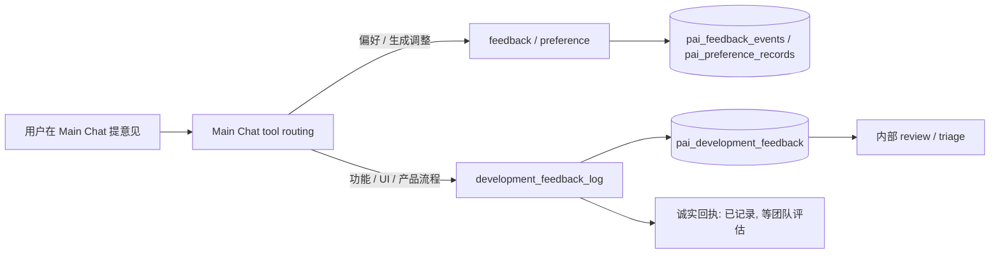

# Development Feedback Collection

## 状态

实施中。

## 结论

Main Chat 需要一条独立的开发建议链路，承接用户提出的产品功能、界面、流程改进诉求。

这条链路不替代现有 feedback。`pai_feedback_events` / `pai_preference_records` 继续处理“这个用户以后想要什么”；`pai_development_feedback` 处理“产品团队要不要改系统”。



## 问题

用户在 Main Chat 里可能会说：

- “这里能不能加一个按钮？”
- “这个页面手机上太难点了。”
- “能不能支持导出？”
- “我想要一个设置项控制这个功能。”

这些不是普通反馈，也不是用户偏好。混进现有 feedback 会有两个问题：

- agent / generator 可能误把产品需求当成个人生成偏好。
- 团队很难系统性看到“用户想让产品改什么”。

## 目标

- 用户说出不可即时完成的产品开发诉求时，系统能记录下来。
- 用户收到明确回执，知道这是开发建议，不是 agent 已经完成的动作。
- 产品/开发团队后续能按用户、页面、类别、状态筛选这些建议。
- 不污染现有 card feedback、chat thumbs、preference 学习链路。

## 非目标

- 第一版不自动创建 GitHub issue。
- 第一版不承诺用户“会开发”或“什么时候上线”。
- 第一版不做复杂自然语言分类模型。
- 第一版不把开发建议写入 `pai_preference_records`。
- 第一版不新增前端表单，仍允许用户直接在 Main Chat 里说。

## 数据结构

新增表：`pai_development_feedback`。

| 字段 | 含义 |
|---|---|
| `user_id` | 当前系统内部用户 ID。 |
| `supabase_user_id` | 冗余的 Supabase UUID，便于跨环境排查。 |
| `id` | `df_...` 开发建议 ID。 |
| `text` | 用户原文。 |
| `summary` | 可选短摘要，便于 review 列表扫描。 |
| `category` | `ui` / `feature` / `bug_like` / `workflow` / `settings` / `other`。 |
| `surface` | `main_chat` / `card_detail` / `settings` / `ambient` / `unknown`。 |
| `status` | `new` / `reviewed` / `planned` / `closed`。 |
| `source` | `user` / `internal_operator` / `agent`。 |
| `conversation_id` / `message_id` | 来源 chat 上下文。 |
| `dedupe_key` | 服务端生成的去重键，避免重试 / regenerate 重复写同一条。 |
| `metadata` | JSONB，存页面、card id、viewport、run id 等上下文。 |

`category` 只做 review 分流，不参与 agent 个性化。

## 当前实现入口

| 层 | 入口 |
|---|---|
| Schema | `pinai-agents/db/migrations/080_pai_development_feedback.sql` |
| Repository | `pinai-agents/src/pinai_agents/web/db/repositories/development_feedback.py` |
| 用户 route | `POST /api/development-feedback` |
| Agent route | `POST /api/agent/development-feedback/log` |
| Main Chat tool | `development_feedback_log` |
| Main Chat fast path | `/api/chat-stream/send` 对明显 UI / 功能诉求先写库并返回短回执 |
| Main Chat prompt | `pinai-agents/src/pinai_agents/chat/agents/main_chat.py` |

## 分类规则

应进入开发建议：

- 明确要求增加、删除、修改产品功能或 UI。
- 明确说现有界面不好用、难点、看不懂、缺入口。
- 要求产品支持一个现在没有的固定能力，例如导出、批量操作、设置项。

应继续进入现有 feedback / preference：

- 用户评价某张卡是否有用。
- 用户要求以后少推、多推、不要推某类内容。
- 用户要求下一次生成更短、更长、换语言、换格式。

不能确定时，优先当普通聊天处理，不静默写长期 preference。

## 用户回复契约

识别为开发建议后，assistant 必须诚实：

> 这个属于产品开发建议，我已经记录下来给团队评估。当前我还不能直接改 App 界面，但可以先帮你用现有功能绕一下。

不能回复：

- “我已经加好了。”
- “下次界面会自动变成这样。”
- “我会马上开发。”

## 验证方式

```bash
cd pinai-agents && uv run pytest tests/web/db/repositories/test_development_feedback_repo.py tests/web/routes/test_development_feedback.py
cd pinai-agents && TAVILY_API_KEY=dummy uv run pytest tests/chat/test_native_tools.py tests/chat/agents/test_main_chat_development_feedback.py
cd pinai-agents && uv run ruff check .
cd pinai-agents && uv run mypy src
```

DB 速查：

```sql
SELECT category, surface, status, count(*)
FROM pai_development_feedback
GROUP BY category, surface, status
ORDER BY category, surface, status;

SELECT text, summary, category, surface, status, created_at
FROM pai_development_feedback
ORDER BY created_at DESC
LIMIT 20;
```
