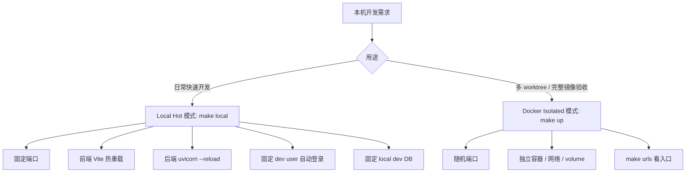
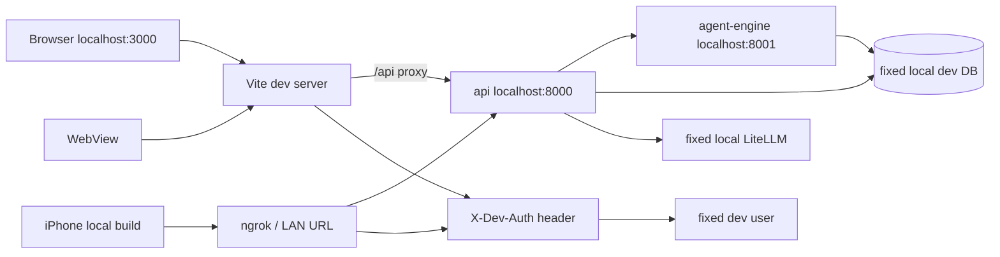

# Local Hot Development Mode

> 日期：2026-06-05
> 状态：已实现第一版
> 读者：改本地开发入口、auth dev bypass、Vite/uvicorn 启动脚本、真机本地调试流程前必读。

## 结论

新增一条日常开发入口：`make local`。

它只服务单机长期开发，不替代现有 `make up / make urls` 的 Docker worktree 隔离模式。



最终目标：

- 日常测试长期打开 `http://localhost:3000`。
- AI 改前端后 Vite 热更新。
- AI 改后端后 uvicorn 自动 reload。
- 浏览器 / WebView / 真机本地构建默认使用同一个 dev user。
- 本机 local 模式使用同一份固定 dev DB，不因为 worktree / 容器重建变成空库。
- 现有 worktree Docker 隔离方案完全保留，继续用于并行验证和完整镜像验收。

## 背景

当前 `make up` 是为多 worktree 并行设计的。Makefile 用 worktree 路径 hash 生成 `COMPOSE_PROJECT_NAME`，Docker Compose 端口不绑定固定 host port，数据库 volume 也跟 project 隔离。

这个设计适合同事和多个 AI session 并行：

- 不抢 `3000 / 8000 / 5432`。
- 不共享数据库。
- 不共享容器网络。
- 一棵 worktree 出问题不影响另一棵。

但它不适合作为长期日常开发入口：

- 前端是 build 后放进 nginx 的静态包，不热加载。
- 后端是镜像内 uvicorn，不带 `--reload`。
- 每次 force recreate 后 Docker 可能重新分配 host 端口。
- 每个 isolated DB 可能是空库，真实调试数据不连续。
- 浏览器 / WebView / 真机每次都要重新处理登录状态。

## 目标

### G1：固定入口

Local 模式固定使用：

| 服务 | 地址 |
|---|---|
| Frontend | `http://localhost:3000` |
| api | `http://localhost:8000` |
| agent-engine | `http://localhost:8001` |
| Postgres | 固定本地 dev DB 地址 |
| LiteLLM | 固定本地 LiteLLM 地址 |

### G2：热重载

- 前端：`cd proactive-ai-frontend && npm run dev`。
- 后端 web：`uv run uvicorn pinai_agents.web.asgi:app --reload --port 8000`。
- 后端 chat：`uv run uvicorn pinai_agents.chat.asgi:app --reload --port 8001`。

### G3：固定 dev user

Local 模式默认不走 Supabase OAuth。

前端在 local dev flag 下：

- `useAuth()` 返回固定 fake session/user。
- API client 自动带 dev auth header。
- 登录页不阻塞主产品页面。

后端只在 `DEPLOY_ENV=dev` 且显式 header 存在时接受：

```text
X-Dev-Auth: pinai-local-dev-user
```

并映射到固定 deterministic user：

```text
supabase_user_id = 00000000-0000-0000-0000-00000000d0d0
email = dev-user@local.invalid
```

### G4：固定本地数据

Local 模式的所有入口共用同一份 dev DB：

- 浏览器。
- WebView。
- iOS 真机通过 ngrok / LAN 回连。
- Android 真机通过 ngrok / LAN 回连。
- 后端 scheduler / generator / chat。

这样本地数据不会因为切 worktree 或重建 Docker 容器变空。

### G5：不影响现有方案

现有命令语义不变：

| 命令 | 保留语义 |
|---|---|
| `make up` | Docker isolated 全栈启动，随机端口，按 worktree 隔离。 |
| `make urls` | 打印当前 Docker group 的随机端口。 |
| `make restart` | 重建并重启 Docker api / agent-engine。 |
| `make restart-frontend` | 重建并重启 Docker frontend。 |
| `make ios` / `make android` | 仍保留当前 Docker/ngrok 驱动流程，后续可新增 local 变体。 |

## 非目标

- 不删除 Docker worktree 隔离模式。
- 不把 test/prod auth 改成 dev bypass。
- 不让 dev bypass 在 `DEPLOY_ENV != dev` 时生效。
- 不要求所有同事都改用 local 模式。
- 第一版不做复杂多用户切换。
- 第一版不迁移线上数据到本地。
- 第一版不承诺完全无 Docker；可以先让 app 本机跑，DB / LiteLLM 用固定本地依赖。若要完全无 Docker，再单独做本机 Postgres + pgvector + LiteLLM 安装脚本。

## 推荐架构

### 两条开发路径共存

| 模式 | 命令 | 适合场景 | 端口 | 数据 | 登录 |
|---|---|---|---|---|---|
| Local Hot | `make local` | 单机日常开发、AI 快速改代码、真机快速验证 | 固定 | 固定 local dev DB | 固定 dev user |
| Docker Isolated | `make up` | 多 worktree 并行、完整 Docker 验收、CI 形态验证 | 随机 | worktree 独立 DB volume | 原 Supabase 逻辑 |

### Local Hot 数据流



## 实施计划

### Phase 1：明确 dev auth 单一入口

后端当前已有 dashboard 专用 dev bypass：

- `backend/src/pinai_agents/web/auth/deps.py`
- header：`X-Dev-Auth: pinai-dev-reviewer`
- user：`dev-reviewer@local.invalid`

第一步把它整理成主产品也能使用的 local dev bypass，但保持更安全的边界：

- 只在 `DEPLOY_ENV=dev` 生效。
- header 必须显式存在。
- header value 用主产品 local 标识：`pinai-local-dev-user`。
- 原 dashboard reviewer header 可兼容保留，避免影响内部 dashboard 本地测试。
- 所有日志只打印 bypass active，不打印 secret。

建议新增常量：

```python
_DEV_AUTH_LOCAL_USER_HEADER_VALUE = "pinai-local-dev-user"
_DEV_AUTH_LOCAL_USER_EMAIL = "dev-user@local.invalid"
_DEV_AUTH_LOCAL_USER_SUB = "00000000-0000-0000-0000-00000000d0d0"
```

验证：

```bash
cd backend && uv run pytest tests/web/auth
cd backend && uv run pytest tests/web/routes
cd backend && uv run ruff check src/pinai_agents/web/auth
```

### Phase 2：前端 local dev 自动身份

新增 local dev flag，例如：

```text
VITE_PIN_LOCAL_DEV_AUTH=1
```

前端行为：

- `useAuth()` 在该 flag 下返回 fake user/session。
- 登录按钮不再阻塞页面。
- `authHeaders()` 在该 flag 下不读 Supabase session，改为返回：

```ts
{ "X-Dev-Auth": "pinai-local-dev-user" }
```

保留现有 Supabase OAuth：

- flag 未开启时完全走原逻辑。
- production build 不默认开启。
- native prod/test 不开启。

建议改动入口：

| 文件 | 用途 |
|---|---|
| `proactive-ai-frontend/src/lib/dev-auth.ts` | local dev auth 常量与 flag 判断。 |
| `proactive-ai-frontend/src/hooks/useAuth.ts` | local flag 下返回 fake user/session。 |
| `proactive-ai-frontend/src/lib/api.ts` | local flag 下附加 `X-Dev-Auth`。 |
| `proactive-ai-frontend/src/lib/devices.ts` | 如有直接读取 token 的设备注册逻辑，同步支持 local header 或走统一 api helper。 |

验证：

```bash
cd proactive-ai-frontend && npm run type-check
cd proactive-ai-frontend && npm test -- src/hooks/useAuth.test.ts src/lib/api.test.ts
```

### Phase 3：新增 `make local`

`make local` 负责启动日常开发入口。

推荐先采用“app 本机跑，依赖固定化”的折中版本：

1. 确保 env 已解密。
2. 确保固定 local DB / LiteLLM 可用。
3. 启动 api reload。
4. 启动 agent-engine reload。
5. 启动 Vite dev server。
6. 打印固定地址。

示例输出：

```text
Local Hot mode:
  Frontend: http://localhost:3000
  Web API:  http://localhost:8000
  Chat API: http://localhost:8001
  Auth:     X-Dev-Auth pinai-local-dev-user
  DB:       fixed local dev database
```

进程管理可以用最小方案：

- 第一版使用 foreground + 清晰说明，或者用 `scripts/local_dev.sh` 启动三个进程并 trap cleanup。
- 不引入复杂 supervisor。
- 不改变 Docker isolated 命令。

建议文件：

| 文件 | 用途 |
|---|---|
| `Makefile` | 新增 `local` / `local-stop` / `local-status`。 |
| `scripts/local_dev.sh` | 启动 web/chat/Vite，处理信号。 |
| `scripts/local_env.sh` | 汇总 local 模式 env，如固定端口、dev auth flag、DB URL。 |

验证：

```bash
make local
curl -s http://localhost:8000/health
curl -s http://localhost:8001/health
open http://localhost:3000
```

### Phase 4：固定 local DB 策略

这里有两个可选实现，推荐先做 A。

#### A. 固定依赖容器，app 不走 Docker

只为 local 模式提供固定依赖：

- Postgres / pgvector。
- LiteLLM。

app 进程全部跑在本机。

优点：

- 改代码热重载。
- DB 稳定。
- 初次设置成本低。
- 仍能复用现有 Docker 镜像提供 pgvector / LiteLLM。

缺点：

- 不是“完全无 Docker”。
- 依赖容器如果坏了仍要看 Docker。

#### B. 完全本机化依赖

本机安装：

- Postgres + pgvector。
- LiteLLM Python package 或固定本机服务。

优点：

- 完全不依赖 Docker。
- 最符合纯 local 体验。

缺点：

- 初次安装和版本漂移成本更高。
- pgvector / LiteLLM 版本管理更难。

推荐：先 A，跑顺后再评估 B。

### Phase 5：真机 local 变体

现有 `make ios` / `make android` 保留 Docker/ngrok 流程。

新增可选 local 变体：

```bash
make ios-local
make android-local
```

行为：

- 不重建 Docker frontend。
- 以 `VITE_PIN_LOCAL_DEV_AUTH=1` build Capacitor。
- `VITE_PIN_API_URL` 指向 local mode 的 ngrok / LAN URL。
- 真机和浏览器使用同一 dev user、同一 local DB。

注意：

- iOS 硬规则不变：不新增 bundle id / target / scheme 来绕签名。
- 仍优先覆盖当前 canonical app，保留现有数据。

## 安全边界

Dev auth bypass 必须满足：

- 只在 `DEPLOY_ENV=dev` 生效。
- test/prod/fly 不接受。
- 不读取 Supabase secret 来伪造真实 Supabase session。
- 不把 dev header 写入生产构建默认值。
- 前端只在 `VITE_PIN_LOCAL_DEV_AUTH=1` 时自动带 header。
- 文档明确这是本地开发身份，不是生产登录替代。

## 成功标准

- `make local` 后，浏览器长期使用 `http://localhost:3000`。
- 改 `proactive-ai-frontend/src/**` 后页面热更新，不需要 `make restart-frontend`。
- 改 `backend/src/**` 后后端 reload，不需要 `make restart`。
- 刷新页面后仍是固定 dev user，不出现 OAuth 登录页。
- 浏览器和真机写入同一份 local dev DB。
- 现有 `make up && make urls` 仍能按 worktree 隔离启动。
- 现有 `internal-reward-dashboard` dev bypass 不被破坏。

## 验证清单

Local Hot：

```bash
make local
curl -s http://localhost:8000/health
curl -s http://localhost:8001/health
open http://localhost:3000
```

前端：

```bash
cd proactive-ai-frontend && npm run type-check
cd proactive-ai-frontend && npm test
```

后端：

```bash
cd backend && uv run ruff check
cd backend && uv run mypy src
cd backend && uv run pytest tests/web/auth tests/web/routes
```

Docker isolated 回归：

```bash
make up
make urls
make restart
make restart-frontend
```

手工确认：

- `make urls` 仍显示随机 Docker 端口。
- `make local` 仍显示固定端口。
- local dev header 打到 test/prod 后端时返回 401，而不是登录成功。
