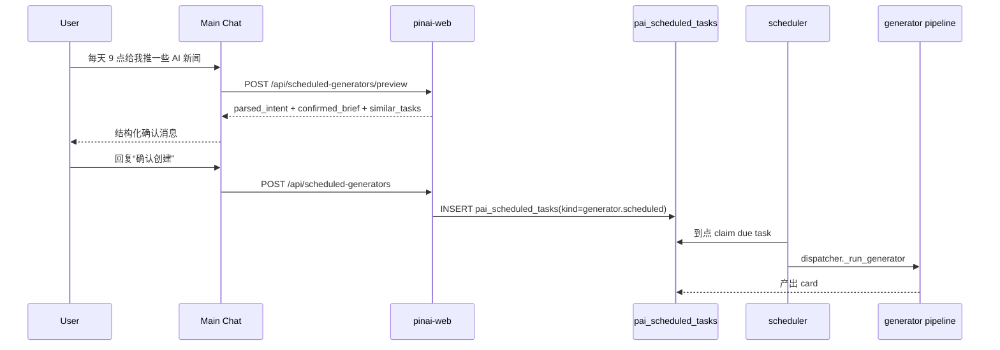

# Scheduled Generator Cron Jobs

## 状态

design 草案。本文记录已确认的产品和系统设计方向,不表示代码已经实现。

## 结论

用户可以在 Main Chat 里用自然语言创建定时生成卡片的任务,例如“每天 9 点给我推一些 AI 新闻”。

系统先在 Main Chat 里展示结构化确认消息,包含任务预览、confirmed brief 和相似任务提醒。用户回复确认后,后端把任务写入现有 `pai_scheduled_tasks` 表。到点后,现有 scheduler 触发 `generator.scheduled`,并复用现有 dispatcher `_run_generator` 和现有 generator pipeline 产出卡片。

这不是新建 cron 系统,而是在现有 Background Tasks / scheduler / `pai_scheduled_tasks` / `tick_loop` / dispatcher 上新增一个用户可创建、可管理的 generator kind。

## 已确认决策

| 决策点 | 结论 |
|---|---|
| 用户入口 | Main Chat 自然语言输入。 |
| 执行方式 | 必须复用现有 generator pipeline,不把 Main Chat agent 当到点执行器。 |
| scheduler kind | 新增 `generator.scheduled`。 |
| 与 `generator.auto` 的关系 | `generator.auto` 继续表示系统默认自动生成;`generator.scheduled` 表示用户明确创建的定时生成任务。 |
| scheduler 接入 | 复用现有 Background Tasks / `pai_scheduled_tasks` / `tick_loop` / dispatcher,不新建 cron 系统。 |
| dispatcher 执行 | `generator.scheduled` 到点后复用现有 dispatcher `_run_generator` 和现有 generator pipeline。 |
| 用户管理 API | 新增 `/api/scheduled-generators/*`,专门管理用户创建的 `generator.scheduled`。 |
| timezone 来源 | 使用创建任务时的设备当前 timezone,不优先使用 profile timezone。 |
| timezone 保存方式 | 创建时保存一次,后续不自动跟随设备 timezone 变化。 |
| 创建前交互 | 必须先让用户确认,不能静默创建 recurring task。 |
| 意图解析分工 | Main Chat agent 识别“这是定时生成任务”;`/api/scheduled-generators/preview` 标准化解析并生成 brief 草稿。 |
| 确认 UI | Main Chat 里展示结构化确认消息;第一版不依赖 action button。 |
| 存储位置 | 直接写现有 `pai_scheduled_tasks` 一张表,第一版不新建 `pai_user_scheduled_generators`。 |
| payload 内容 | 保存 `original_request` + `parsed_intent` + `confirmed_brief`。 |
| brief 缺信息时 | 默认生成 brief 给用户确认;只有特别模糊时才追问一个关键问题。 |
| 创建成功反馈 | Main Chat 显示“已创建...”成功消息,并提供取消操作处理刚刚误确认。 |
| 管理入口 | Settings > Preferences 新增 Scheduled Tasks / Cron Jobs 模块。 |
| 管理模块能力 | 列出用户创建的 `generator.scheduled` cron job;用类似 Auto Dreaming 的 switch 启用/暂停,并支持删除。 |
| scheduled card 标记 | 轻量标记来源,例如 “Scheduled · AI 新闻”。 |
| 重复任务处理 | preview 和 create 都检查相似任务;正常流程只让用户确认一次。 |

## 系统链路



### Main Chat 的职责

- 识别用户是否在创建 scheduled generator intent。
- 调用 preview API 获取结构化结果。
- 展示结构化确认消息。
- 根据用户回复“确认创建”或“取消”继续流程。
- 不直接写 `pai_scheduled_tasks`。

第一版不要求 Main Chat 一定有 action button。用户通过回复完成确认/取消;如果后续 chat UI 支持 button 或 quick action chips,可以作为增强。

### Scheduled generator API 的职责

`/api/scheduled-generators/*` 是用户管理 `generator.scheduled` 的薄 API 层。它不是新的 cron 系统,也不替代 `/api/tasks/*`。

| API | 用途 |
|---|---|
| `POST /api/scheduled-generators/preview` | 根据用户原话和设备 timezone 生成 `parsed_intent` + `confirmed_brief` 草稿,并返回 `similar_tasks`。 |
| `GET /api/scheduled-generators` | Settings > Preferences 列出当前用户创建的 `generator.scheduled` 任务;默认不返回 archived。 |
| `POST /api/scheduled-generators` | 用户回复确认后创建任务;可带 `duplicate_ack=true` 和 `similar_task_ids_seen`。 |
| `POST /api/scheduled-generators/{taskId}/pause` | 暂停任务,对应 `status = paused`。 |
| `POST /api/scheduled-generators/{taskId}/resume` | 恢复任务,对应 `status = active`。 |
| `DELETE /api/scheduled-generators/{taskId}` | 删除任务,对应 `status = archived`;不物理删除。 |

这个 API 只暴露用户可管理的 `generator.scheduled`,不暴露所有 scheduler kind。

### Scheduler / generator 的职责

- `generator.scheduled` 加入现有 generator kind 执行路径。
- 到点后由现有 `tick_loop` claim task。
- dispatcher 必须走现有 `_run_generator`。
- generator pipeline 继续负责 context builder、memory/profile/signals/context 读取、卡片生成和持久化。

## Payload 设计

`pai_scheduled_tasks.payload` 第一版包含三层信息:

```json
{
  "source": "main_chat",
  "original_request": "每天 9 点给我推一些 AI 新闻",
  "parsed_intent": {
    "frequency": "daily",
    "local_time": "09:00",
    "timezone": "America/Los_Angeles",
    "topic": "AI 新闻",
    "output_type": "card"
  },
  "confirmed_brief": {
    "topic": "AI 新闻",
    "time_window": "过去 24 小时",
    "content_focus": ["重要产品发布", "模型进展", "行业动态"],
    "style": "简洁,可快速浏览",
    "exclusions": ["过旧新闻", "无来源的传闻", "泛泛而谈的总结"]
  }
}
```

| 字段 | 作用 |
|---|---|
| `original_request` | 保留用户原话,用于 debug 和以后重新解释。 |
| `parsed_intent` | 保存调度和路由所需字段,例如时间、频率、timezone、主题、产出类型。 |
| `confirmed_brief` | 保存用户确认过的生成标准,让 generator 每次按同一张小票执行。 |

confirmed brief 是用户确认过的生成说明书。它像厨房里的小票:用户说“每天 9 点给我推 AI 新闻”是口头订单,系统把它整理成小票,用户确认后,以后每天都按这张小票出餐。

第一版 confirmed brief 包含:

- 新闻范围,例如 AI 新闻。
- 时间窗口,例如过去 24 小时。
- 内容重点,例如产品发布、模型进展、行业动态。
- 风格,例如简洁、可快速浏览。
- 排除项,例如不要过旧新闻、不要无来源传闻。

## 相似任务处理

同一用户创建多个类似任务时,第一版做提醒,不做硬性去重。

### Preview 阶段

`POST /api/scheduled-generators/preview` 返回 `similar_tasks`。当系统发现已有相近 `generator.scheduled` 任务时,Main Chat 的结构化确认消息里提示用户:

```text
你已经有一个类似任务:每天 9 点生成 AI 新闻卡片。仍然创建新任务吗?
```

第一版重复判断使用轻量规则:

- 同一用户。
- 同为 `generator.scheduled`。
- `parsed_intent.frequency` 相同。
- `parsed_intent.local_time` 相同或非常接近。
- `confirmed_brief.topic` / `parsed_intent.topic` 相同或明显相近。

### Create 阶段

用户回复继续创建时,create 请求带:

- `duplicate_ack=true`:表示用户已经同意相似任务风险。
- `similar_task_ids_seen`:表示 preview 阶段已经展示给用户看的相似任务 id 列表。

create 阶段再做一次相似任务检查,作为 race condition 兜底:

- 如果 create 发现的相似任务都在 `similar_task_ids_seen` 里,且收到 `duplicate_ack=true`,直接创建,不要再问用户第二次。
- 如果 create 发现新的、preview 没展示过的相似任务,返回需要重新确认的结果,让 Main Chat 再展示一次结构化确认消息。

不做硬性去重,因为相近任务不一定重复。例如用户可能同时需要 “AI 产品新闻” 和 “AI 研究论文”。

## 前端交互

### Main Chat

preview 返回后,Main Chat 展示结构化确认消息。它不是最终生成的 card,也不是 NowFeed card。

结构化确认消息同时展示:

- 任务预览。
- confirmed brief。
- 相似任务提醒。
- 用户可回复的确认方式,例如“确认创建”或“取消”。

创建成功后,Main Chat 显示:

```text
已创建:每天 9 点生成 AI 新闻卡片。
```

同时提供取消操作,用于处理刚刚误确认的情况。第一版可以通过用户回复“取消这个任务”完成,不要求必须有 button。

### Settings > Preferences

Settings > Preferences 新增 Scheduled Tasks / Cron Jobs 模块。它只展示用户创建的 `generator.scheduled` 任务,不展示系统自己的 `generator.auto`。

每个任务至少显示:

- 标题,例如 “AI 新闻卡片”。
- 频率,例如 daily。
- 时间,例如 09:00。
- timezone,例如 America/Los_Angeles。
- 状态,例如 active / paused。

每个任务至少支持:

- 启用 / 暂停:使用类似 Auto Dreaming 的 switch,对应 `pai_scheduled_tasks.status = active / paused`。
- 删除:对应 `pai_scheduled_tasks.status = archived`。

启用 / 暂停交互参考现有 `AutoDreamingSettings`:

- 使用 `role="switch"` 的 toggle。
- ON 表示 `active`,OFF 表示 `paused`。
- 请求进行中 disabled,避免连续点击。
- 成功后给轻量状态反馈,失败时显示错误。

### Scheduled card 标记

`generator.scheduled` 产出的 card 和普通 generator card 使用同一套卡片 UI,但需要轻量标记来源。

第一版推荐显示:

```text
Scheduled · AI 新闻
```

第一版不做:

- 不做专门的 scheduled card 详情页。
- 不显示完整任务配置。
- 不显示下次运行时间。
- 不用明显大 badge 抢占卡片主体内容。

## Scope Boundary

In scope:

- 复用现有 Background Tasks / scheduler / `pai_scheduled_tasks` / `tick_loop` / dispatcher。
- 新增 `/api/scheduled-generators/*` 给用户创建和管理 `generator.scheduled`,供 Main Chat 和 Settings 复用。
- API 只负责用户确认后的 preview、创建、列表、暂停、恢复、删除。
- `generator.scheduled` 到点后复用现有 generator pipeline。
- `generator.scheduled` 到点后复用现有 dispatcher `_run_generator`。
- scheduled task 把 `confirmed_brief` 和 `parsed_intent` 作为输入传进现有 generator。
- 验证 scheduled generate 和手动 generate 一样能拿到现有 memory / profile / signals / context。

Out of scope:

- 不新建 cron job 系统。
- 不新建独立 cron 模块替代现有 Background Tasks。
- 不新建 memory retrieval 逻辑。
- 不重写 generate pipeline。
- 不调整 memory 权重或召回策略。
- 不把 scheduled card 做成另一套独立生成系统。
- 第一版不做复杂字段编辑器。
- 第一版不做任务质量 feedback loop。
- 第一版不新建专门的 scheduled generator 表。
- 第一版不让 Main Chat agent 到点直接执行用户请求。
- 第一版不改 prompt、时间或 confirmed brief。

## 错误处理

| 场景 | 第一版处理 |
|---|---|
| 用户原话特别模糊 | Main Chat 追问一个关键问题,而不是直接创建。 |
| preview 发现相似任务 | 结构化确认消息展示 `similar_tasks`,用户回复确认后带 `duplicate_ack=true` + `similar_task_ids_seen`。 |
| create 发现新的相似任务 | 返回需要重新确认的结果,Main Chat 再展示一次结构化确认消息。 |
| pause / resume 失败 | Settings switch 回到原状态并显示错误。 |
| delete 失败 | 保持任务可见并显示错误。 |
| scheduler 执行失败 | 复用现有 scheduled task retry / run status 机制。 |

## 验证方式

验证分 5 层,重点证明第一版复用现有 scheduler 和 generator pipeline,没有新建另一套执行链路。

| 层 | 要证明什么 | 验证方式 |
|---|---|---|
| preview API | 能把用户原话变成 `parsed_intent`、`confirmed_brief`、`similar_tasks`。 | 单元测试:输入“每天 9 点 AI 新闻” + timezone,断言返回结构正确。 |
| create API | 能写入 `pai_scheduled_tasks`,且 `kind = generator.scheduled`。 | API 测试:调用 create 后查 DB,确认 `kind` / `status` / `timezone` / `payload`。 |
| duplicate 兜底 | preview / create 都检查相似任务,且 `similar_task_ids_seen` 生效。 | API 测试:已有相似任务时 preview 返回;create 带 seen 直接过,未带 seen 或出现新相似任务则要求重新确认。 |
| scheduler 执行 | 到点后走现有 `tick_loop` + dispatcher + `_run_generator`。 | scheduler 测试:插入 due `generator.scheduled` task,跑 `run_tick_once`,断言 dispatcher 走 generator 路径。 |
| 前端交互 | Main Chat 结构化确认消息、Settings switch、删除、scheduled card 轻量标记可用。 | 前端测试 + 手动 smoke test。 |

核心验收标准:

```text
generator.scheduled 到点执行时,必须走现有 dispatcher._run_generator。
不能新增另一套 scheduled generator runner。
```

memory / context 验证边界:

```text
scheduled generate 与手动 generate 使用同一条 generator pipeline。
本任务只验证它能走到同一 context builder。
不新增或调整 memory retrieval 逻辑。
```
