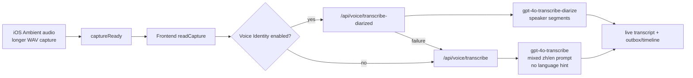

# Ambient Mixed Chinese-English Transcription Quality Implementation Plan

> **For agentic workers:** REQUIRED SUB-SKILL: Use superpowers:subagent-driven-development (recommended) or superpowers:executing-plans to implement this plan task-by-task. Steps use checkbox (`- [ ]`) syntax for tracking.

**Goal:** 提升 Ambient timeline / live transcript 在中英混说用户上的转录准确率,同时保留 Voice Identity 的 `self` / speaker attribution 价值。

**Architecture:** iOS Ambient 仍然先保存 WAV capture,前端仍然走 `captureReady -> /api/voice/transcribe-diarized|transcribe -> live transcript + outbox`。本计划只改三层:端侧切片更长、Ambient 云转录默认不固定语言、普通 `gpt-4o-transcribe` 请求加中英混合 prompt + 术语表;diarize 路径保持优先,不因为 prompt 不支持而降级。

**Tech Stack:** React + Vite + Capacitor Ambient plugin, Swift iOS audio capture, FastAPI, LiteLLM OpenAI-compatible `/audio/transcriptions`, OpenAI `gpt-4o-transcribe` / `gpt-4o-transcribe-diarize`, Vitest, pytest.

---

## Decisions Locked

- Primary user language mode: early users are expected to speak mixed Mandarin Chinese and English.
- Preserve diarize first: if Voice Identity is enabled, `gpt-4o-transcribe-diarize` remains the first attempt because identifying `self` is product-critical.
- Do not add prompt to diarize in this plan: current OpenAI diarized transcription does not support `prompt`.
- Plain fallback gets prompt: only ordinary `gpt-4o-transcribe` receives the mixed-language prompt and glossary.
- Ambient default language is auto/mixed: Ambient cloud transcription should omit the OpenAI `language` parameter by default so the model can detect Chinese and English inside the same capture.
- Do not change Main Chat voice default in this plan. `VoiceProvider` can keep browser-native `SpeechRecognition`; this plan is only for Ambient timeline/live transcript.
- Prefer transcript quality over sub-second freshness: increase capture window size even if live transcript appears a few seconds later.

## Target Data Flow



## Files And Responsibilities

- Modify `proactive-ai-frontend/src/services/ambient/sources/sound-classifier.ts`
  - Increase Ambient capture window constants.
  - Stop passing an OpenAI language hint for Ambient cloud transcription by default.
- Modify `proactive-ai-frontend/src/services/ambient/capture-transcription.ts`
  - Keep diarize-first behavior unchanged.
  - Forward `undefined` language to both diarized and plain paths when Ambient is in mixed/auto mode.
- Modify `proactive-ai-frontend/src/services/ambient/sources/sound-classifier.test.ts`
  - Verify longer capture config.
  - Verify Ambient cloud transcription is called without a fixed OpenAI language by default.
- Modify `proactive-ai-frontend/src/services/ambient/capture-transcription.test.ts`
  - Verify no `language` query is sent in the default Ambient path.
  - Verify diarize failure still falls back to plain transcription.
- Modify `pinai-agents/src/pinai_agents/web/services/voice_transcription.py`
  - Add a single constant for the mixed-language prompt.
  - Send `prompt` for ordinary `gpt-4o-transcribe` requests.
  - Keep diarized request body unchanged.
- Modify `pinai-agents/tests/web/routes/test_voice_transcribe.py`
  - Verify `/api/voice/transcribe` sends `prompt`.
  - Verify `/api/voice/transcribe-diarized` does not send `prompt`.

## Transcription Prompt

Use this exact prompt for ordinary `gpt-4o-transcribe`:

```text
The audio may contain mixed Mandarin Chinese and English. Transcribe exactly what is spoken. Keep English words, product names, acronyms, and technical terms in English. Use Simplified Chinese for Chinese speech. Do not translate between languages.

Common terms may include: Claude Code, Codex, ChatGPT, GPT, OpenAI, Gemini, Cursor, Supabase, LiteLLM, Composio, LangSmith, Daytona, Fly.io, Vercel, GitHub, pull request, PR, commit, branch, merge, rebase, deploy, Docker, Xcode, iOS, Android, Ambient, PIN AI, Proactive AI.
```

## Capture Parameters

Change `LIVE_AUDIO_CONFIG` in `sound-classifier.ts`:

| Field | Current | New | Why |
|---|---:|---:|---|
| `preRollMs` | 2000 | 2000 | Keep the useful lead-in before VAD fires. |
| `postRollMs` | 2500 | 5000 | Avoid cutting a sentence during short pauses. |
| `maxBurstMs` | 12000 | 30000 | Preserve more context for mixed-language speech. |
| `minBurstMs` | 600 | 1000 | Avoid uploading tiny fragments. |
| `sessionSilenceGapMs` | 30000 | 30000 | Keep session rotation behavior stable. |
| `maxSessionDurationMs` | 300000 | 300000 | Keep session cap stable. |

## Tasks

### Task 1: Ambient Capture Window

**Files:**
- Modify: `proactive-ai-frontend/src/services/ambient/sources/sound-classifier.ts`
- Modify: `proactive-ai-frontend/src/services/ambient/sources/sound-classifier.test.ts`

- [ ] **Step 1: Update the existing config assertion first**

In `sound-classifier.test.ts`, update the existing configure expectation so it expects:

```ts
expect(ambientAiMock.audio.configure).toHaveBeenCalledWith({
  recognitionLocale: "zh-CN",
  preRollMs: 2000,
  postRollMs: 5000,
  maxBurstMs: 30000,
  minBurstMs: 1000,
  sessionSilenceGapMs: 30000,
  maxSessionDurationMs: 300000,
});
```

Run:

```bash
cd proactive-ai-frontend && npm test -- --run src/services/ambient/sources/sound-classifier.test.ts
```

Expected before implementation: FAIL because the current values are `2500 / 12000 / 600`.

- [ ] **Step 2: Update `LIVE_AUDIO_CONFIG`**

In `sound-classifier.ts`, change:

```ts
const LIVE_AUDIO_CONFIG = {
  preRollMs: 2_000,
  postRollMs: 5_000,
  maxBurstMs: 30_000,
  minBurstMs: 1_000,
  sessionSilenceGapMs: 30_000,
  maxSessionDurationMs: 5 * 60_000,
} as const;
```

- [ ] **Step 3: Verify the capture config test passes**

Run:

```bash
cd proactive-ai-frontend && npm test -- --run src/services/ambient/sources/sound-classifier.test.ts
```

Expected: PASS.

### Task 2: Ambient Mixed/Auto Language

**Files:**
- Modify: `proactive-ai-frontend/src/services/ambient/sources/sound-classifier.ts`
- Modify: `proactive-ai-frontend/src/services/ambient/sources/sound-classifier.test.ts`
- Modify: `proactive-ai-frontend/src/services/ambient/capture-transcription.test.ts`

- [ ] **Step 1: Update tests so Ambient cloud transcription no longer receives `zh` / `en` by default**

In `sound-classifier.test.ts`, update tests that currently expect:

```ts
expect(captureTranscriptionMock.transcribeAmbientCapture).toHaveBeenCalledWith(
  expect.objectContaining({ wavId: "wav-cloud" }),
  "zh",
);
```

to:

```ts
expect(captureTranscriptionMock.transcribeAmbientCapture).toHaveBeenCalledWith(
  expect.objectContaining({ wavId: "wav-cloud" }),
  undefined,
);
```

For the existing test named like `uses user language preference for native recognition and cloud transcription`, rename it to:

```ts
test("uses user language preference for native recognition but leaves cloud transcription mixed", async () => {
  // existing setup
  expect(ambientAiMock.audio.configure).toHaveBeenCalledWith(
    expect.objectContaining({ recognitionLocale: "en-US" }),
  );
  expect(captureTranscriptionMock.transcribeAmbientCapture).toHaveBeenCalledWith(
    expect.anything(),
    undefined,
  );
});
```

Run:

```bash
cd proactive-ai-frontend && npm test -- --run src/services/ambient/sources/sound-classifier.test.ts
```

Expected before implementation: FAIL because `transcriptionLanguage()` still returns `zh` or `en`.

- [ ] **Step 2: Change Ambient cloud language to mixed/auto**

In `sound-classifier.ts`, keep `voiceLanguage()` for native `recognitionLocale`, but change the cloud language helper:

```ts
private transcriptionLanguage(): string | undefined {
  return undefined;
}
```

Keep this helper rather than deleting it so a future explicit `transcriptionMode` setting can route through one place.

- [ ] **Step 3: Verify Ambient language tests pass**

Run:

```bash
cd proactive-ai-frontend && npm test -- --run src/services/ambient/sources/sound-classifier.test.ts src/services/ambient/capture-transcription.test.ts
```

Expected: PASS.

### Task 3: Plain Transcription Prompt

**Files:**
- Modify: `pinai-agents/src/pinai_agents/web/services/voice_transcription.py`
- Modify: `pinai-agents/tests/web/routes/test_voice_transcribe.py`

- [ ] **Step 1: Add tests for prompt behavior**

In `test_voice_transcribe.py`, extend the mocked `httpx.AsyncClient.post` capture so the ordinary transcription test asserts:

```python
assert captured["data"]["model"] == "gpt-4o-transcribe"
assert captured["data"]["response_format"] == "json"
assert "prompt" in captured["data"]
assert "mixed Mandarin Chinese and English" in captured["data"]["prompt"]
assert "Claude Code" in captured["data"]["prompt"]
assert "Codex" in captured["data"]["prompt"]
assert "Do not translate between languages" in captured["data"]["prompt"]
```

In the diarized transcription test, assert:

```python
assert captured["data"]["model"] == "gpt-4o-transcribe-diarize"
assert "prompt" not in captured["data"]
```

Run:

```bash
cd pinai-agents && uv run pytest tests/web/routes/test_voice_transcribe.py -q
```

Expected before implementation: FAIL because ordinary transcription does not send `prompt`.

- [ ] **Step 2: Add the prompt constant**

In `voice_transcription.py`, add near the model constants:

```python
MIXED_ZH_EN_TRANSCRIPTION_PROMPT = (
    "The audio may contain mixed Mandarin Chinese and English. Transcribe exactly what is spoken. "
    "Keep English words, product names, acronyms, and technical terms in English. "
    "Use Simplified Chinese for Chinese speech. Do not translate between languages.\n\n"
    "Common terms may include: Claude Code, Codex, ChatGPT, GPT, OpenAI, Gemini, Cursor, "
    "Supabase, LiteLLM, Composio, LangSmith, Daytona, Fly.io, Vercel, GitHub, pull request, "
    "PR, commit, branch, merge, rebase, deploy, Docker, Xcode, iOS, Android, Ambient, "
    "PIN AI, Proactive AI."
)
```

- [ ] **Step 3: Send prompt for ordinary transcription only**

Change ordinary `transcribe_audio` request data from:

```python
data = {"model": model, "response_format": "json"}
```

to:

```python
data = {
    "model": model,
    "response_format": "json",
    "prompt": MIXED_ZH_EN_TRANSCRIPTION_PROMPT,
}
```

Do not add `prompt` to `transcribe_audio_diarized`.

- [ ] **Step 4: Verify backend tests pass**

Run:

```bash
cd pinai-agents && uv run pytest tests/web/routes/test_voice_transcribe.py -q
```

Expected: PASS.

### Task 4: End-to-End Local Verification

**Files:**
- No production code changes.

- [ ] **Step 1: Run focused frontend tests**

Run:

```bash
cd proactive-ai-frontend && npm test -- --run src/services/ambient/sources/sound-classifier.test.ts src/services/ambient/capture-transcription.test.ts src/components/voice/language.test.ts
```

Expected: PASS.

- [ ] **Step 2: Run frontend type-check**

Run:

```bash
cd proactive-ai-frontend && npm run type-check
```

Expected: PASS.

- [ ] **Step 3: Run focused backend tests**

Run:

```bash
cd pinai-agents && uv run pytest tests/web/routes/test_voice_transcribe.py -q
```

Expected: PASS.

- [ ] **Step 4: Run backend static checks if backend code changed**

Run:

```bash
cd pinai-agents && uv run ruff check src tests/web/routes/test_voice_transcribe.py && uv run mypy src
```

Expected: PASS.

### Task 5: Real Audio Acceptance Check

**Files:**
- No required code changes.

- [ ] **Step 1: Install or run the app through the normal mobile path**

For iPhone verification, use the repo entrypoint and preserve the canonical app bundle:

```bash
make ios
```

Expected: app is built/synced for the existing bundle id; no new bundle id is introduced.

- [ ] **Step 2: Capture three Ambient examples**

Use the same physical environment and capture:

1. A mostly Chinese sentence with one English product name.
2. A mostly English sentence with one Chinese phrase.
3. A naturally mixed sentence containing at least two glossary terms, for example `Claude Code`, `Codex`, `Supabase`, or `LiteLLM`.

- [ ] **Step 3: Compare product-visible output**

Acceptance criteria:

- Live transcript appears later than before but does not split ordinary short pauses into separate fragments.
- English technical terms remain in English in ordinary fallback transcripts.
- Chinese speech remains Simplified Chinese.
- Voice Identity enabled captures still show `self` / speaker labels when diarize succeeds.
- If diarize fails, fallback transcript still appears and uses the mixed-language prompt.

## Out Of Scope

- No new transcription settings UI in this plan.
- No LLM post-correction pass for diarized segments in this plan.
- No direct OpenAI bypass; keep LiteLLM as the route.
- No schema or migration changes.
- No changes to Main Chat voice input.

## Risk Notes

- Longer captures increase transcription latency and request size. The new `maxBurstMs=30000` remains safely below the existing 25 MB backend upload cap for typical mono 16-bit WAV.
- Omitting `language` may slightly reduce accuracy for strictly single-language speech, but the target users are mixed Chinese-English speakers.
- Diarized transcription can still mis-hear technical terms because it cannot receive `prompt`; preserving `self` is intentionally prioritized over promptability.

## Rollback Plan

- Revert `LIVE_AUDIO_CONFIG` to `postRollMs=2500`, `maxBurstMs=12000`, `minBurstMs=600` if live latency is unacceptable.
- Revert `transcriptionLanguage()` to return `this.voiceLanguage().openai` if auto language detection performs worse in real audio.
- Remove `prompt` from ordinary `transcribe_audio` request data if LiteLLM or OpenAI rejects the field.
