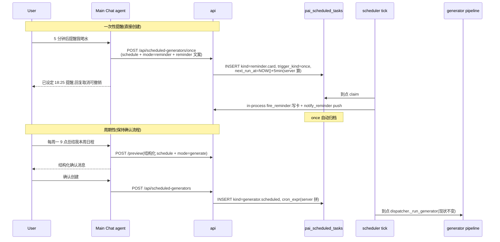

# Scheduled Tasks:一次性 / 分钟级 / 纯提醒

## 状态

design 已定稿并实施(2026-06-09)。实施拆解见 `2026-06-09-scheduled-tasks-once-interval-reminder-implementation.mdx`;本地 e2e 验收进行中。前置:`2026-06-07-scheduled-generator-cron-jobs.mdx`(PR #65,已 merge)。

## 背景

PR #65 上线后真机验证暴露的缺口(用户实测对话):

- "提醒我 5 分钟后喝水" → agent 拒绝:不支持一次性任务。
- "5 分钟后推送喝水的卡片" → 拒绝:只支持周期性(每天/每周)。
- "可以每 5 分钟提醒我喝水吗" → 拒绝:不支持分钟级间隔。

勘探结论:这些限制全部来自**表面层**(preview 正则硬编码 daily、chat 工具输入、prompt 教学),调度层 `pai_scheduled_tasks` + tick loop 对 `once` / `interval_seconds` / `cron_expr` 三种触发原生支持(`connector.init` once、`proactive.tick` 60s interval 都在生产跑)。

## 结论

用户可以在 Main Chat 用自然语言创建三种触发 × 两种执行模式的定时任务,产出统一为卡片(NowFeed + 推送通知):

| 用户说 | 触发 | 执行模式 | 到点发生什么 |
|---|---|---|---|
| "5 分钟后提醒我喝水" | once | reminder | web 进程直接写一张提醒卡 + 推送,不跑 LLM |
| "每 5 分钟提醒我喝水" | interval | reminder | 同上,每次间隔到点 |
| "每天 9 点推 AI 新闻" | cron | generate | 现有 generator pipeline(PR #65 现状) |
| "明天早上 9 点给我一份周日程总结" | once | generate | generator pipeline 跑一次后归档 |

继续复用现有 Background Tasks / scheduler / `pai_scheduled_tasks` / dispatcher,**调度层零改动**。这与 OpenClaw / Claude Code / K8s CronJob 的统一模式一致:一个触发层 + per-kind 执行语义,不为新场景另建 cron 系统。

## 已确认决策

| 决策点 | 结论 |
|---|---|
| 产出形态 | 统一是卡片。提醒、内容任务到点都出一张卡(NowFeed + push),不做"只推送不落卡"。 |
| 执行模式 | 两种:`reminder`(创建时定好标题+文案,到点直接写卡,零 LLM)/ `generate`(现有 generator pipeline)。创建时由 main chat agent 分类。 |
| kind 布局 | 新增 **`reminder.card`** kind 承载 reminder 模式;`generator.scheduled` 承载 generate 模式。不用单 kind + payload mode 二次分流(保持「一种执行语义 = 一个 kind」的 dispatcher 约定)。 |
| 触发形态 | 三种全开:`once`(一次性)/ `interval`(最小间隔见护栏)/ `cron`(daily + weekly)。两个 kind 都支持三种触发。 |
| 意图解析分工 | **agent 解析语言,server 计算时间**。agent 传结构化 schedule 意图(`in_minutes` / `at_local` / `every_seconds` / `frequency`+`local_time`+`days_of_week`),server 校验并算出 `next_run_at` / `cron_expr` / `interval_seconds`。理由:chat agent 运行时没有当前时间/时区注入(已验证),LLM 算时间不可靠;服务端正则 `_parse_request` 退役。 |
| cron 表达式 | agent 不直写 cron,server 从结构化字段拼(防 LLM 笔误)。 |
| 创建交互 | **一次性任务直接创建**(回复"已设定 + 可撤销"),无 preview/确认轮;周期性任务保持 PR #65 的 preview → 用户回复确认 → create。 |
| 相似任务检查 | 只对周期性任务执行;一次性任务跳过(便宜、短命,提示反而烦人)。 |
| 推送文案 | 提醒卡推送直接显示提醒内容("该喝水了"),不用"新卡片生成"模板;且**不受** `notify_new_cards` 开关约束(用户显式要求的提醒 ≠ 系统广播)。 |
| timezone | 沿用 PR #65:创建时设备时区,保存后不跟随设备变化。once 任务在创建时就换算成绝对 UTC 时刻。 |
| 管理入口 | 沿用 Settings > Preferences > Scheduled Tasks,管理两个 kind 的并集。创建仍只走 chat。 |

## 系统链路



## 触发模型

agent 调工具时传的 `schedule` 结构(三选一),server 映射到现有表字段:

```jsonc
{ "type": "once",     "in_minutes": 5 }                      // 相对时间,server 用自己的钟算
{ "type": "once",     "at_local": "2026-06-10T15:00" }       // 绝对本地时间,按任务 timezone 换算 UTC
{ "type": "interval", "every_seconds": 300 }
{ "type": "cron",     "frequency": "daily",  "local_time": "09:00" }
{ "type": "cron",     "frequency": "weekly", "local_time": "09:00", "days_of_week": [1] }  // ISO 编号,1=周一 7=周日
```

| schedule.type | trigger_kind | 表字段 | next_run_at |
|---|---|---|---|
| once | `once` | — | server 算出的绝对 UTC 时刻 |
| interval | `schedule` | `interval_seconds` | NOW() + every_seconds |
| cron | `schedule` | `cron_expr`(server 拼) | `next_fire()` 现有逻辑 |

调度语义沿用现状(勘探已验证):once 到点即归档、失败 30s/2min/10min 退避重试最多 3 次后归档;interval 以上次执行时间为锚往后推;cron 走 croniter + timezone 换算。

## 两个 kind

| | `reminder.card`(新) | `generator.scheduled`(扩展) |
|---|---|---|
| 到点动作 | web 进程 in-process 直接写卡 + 推送 | HTTP 调 chat `/agent/generate`(现状) |
| LLM | 无 | 每次一轮 |
| lease | 60s(默认) | 600s(现状) |
| card fanout(卡片对话预跑) | **跳过** | 现状(limit 2) |
| 推送 | `notify_reminder`(文案=提醒内容) | `notify_new_cards`(现状) |
| 卡片角标 | `Scheduled · <label>`(复用 sourceKind/sourceLabel) | 同左(现状) |

### reminder 执行路径(新增 `web/services/reminder_cards.py`)

dispatcher 加一条 kind 路由分支 → `fire_reminder(task, run_id)`:

1. 从 `payload.reminder` 取标题+文案,mint 唯一 card id,构造卡片 dict(带 `sourceKind="scheduled"` / `sourceLabel`)。
2. 复用现有卡片落库路径:把 `web/routes/ui/generate.py:persist_generator_run`(写 `pai_pipeline_runs.final_cards`)抽成可共享的 service 函数后调用,`trigger="reminder"`。每次 fire mint 新 run_id(避免 ON CONFLICT 覆盖)。
3. 调 `notify_reminder`(`push_notifier` 新增的薄函数,deep_link `app://cards`),不调 card fanout。
4. 走正常 per-run ledger(`insert_run` / `complete_run`),`/api/tasks` 状态投影自动可用。

## Payload 设计

`parsed_intent` 升级为 v2(`schedule` 结构化字段取代 frequency/local_time 平铺;保留 `original_request` 作 debug):

```jsonc
// kind=reminder.card
{
  "source": "main_chat",
  "original_request": "每 5 分钟提醒我喝水",
  "parsed_intent": { "schedule": { "type": "interval", "every_seconds": 300 }, "timezone": "Asia/Shanghai" },
  "reminder": { "title": "💧 喝水提醒", "message": "该喝水了" },
  "trigger": "reminder"
}

// kind=generator.scheduled(在 PR #65 payload 上加 schedule 结构)
{
  "source": "main_chat",
  "original_request": "每周一 9 点总结我本周日程",
  "parsed_intent": { "schedule": { "type": "cron", "frequency": "weekly", "local_time": "09:00", "days_of_week": [1] }, "timezone": "Asia/Shanghai", "topic": "本周日程总结" },
  "confirmed_brief": { ... 现状不变 ... },
  "cards_to_generate": 1,
  "trigger": "scheduled"
}
```

`semantic_signature` / `preview_id` / `task_id` 推导沿用现有确定性 hash 思路,输入换成结构化 schedule 字段;once 任务不参与相似检查,task_id 直接 mint(uuid),不需要 preview 锚点。

## 工具层(7 个)

保留 PR #65 的 6 个工具名(改名连累 prompt + 测试),扩展输入 + 新增 1 个:

| 工具 | 变化 |
|---|---|
| `scheduled_generator_preview` | 输入结构化:`schedule` + `mode`(reminder/generate)+ `reminder`(mode=reminder 必填)+ `topic`。仅周期性任务需要。 |
| `scheduled_generator_create` | 同样结构化;仅周期性,仍必须等用户回复确认;409 requiresConfirmation 契约不变。 |
| **`scheduled_generator_create_once`(新)** | 一次性任务直接创建:无 preview、无确认轮、无相似检查。输入与 preview 同构(`schedule` 限 type=once + `mode` + `reminder`/`topic`)。返回触发时间 + 撤销提示。 |
| `scheduled_generator_list` | 返回两个 kind 并集 + 新字段(triggerKind / scheduleLabel)。 |
| `scheduled_generator_pause` / `resume` / `delete` | 按两个 kind 并集查找,其余不变。 |

mode → kind 映射在 server 做(`reminder → reminder.card`,`generate → generator.scheduled`),agent 不接触 kind 字符串。

## Prompt 教学(main_chat.py tool_routing 段重写)

教 agent 四件事:

1. **识别**:定时类请求分一次性("5 分钟后"/"明天 3 点")和周期性("每 5 分钟"/"每天 9 点"/"每周一"),都接,不再拒绝。
2. **分类**:固定文案提醒 → `mode=reminder`(agent 自己写好标题+文案);要新内容 → `mode=generate`。
3. **分流**:一次性 → `create_once` 直接建;周期性 → preview → 用户确认 → create。
4. **时间纪律**:相对时间只传 `in_minutes`,不要自己算绝对时间(agent 没有钟);绝对时间传 `at_local` + timezone。

## API 形状

| API | 变化 |
|---|---|
| `POST /api/scheduled-generators/preview` | 请求体加 `schedule` / `mode` / `reminder`;服务端正则 `_parse_request` 退役(唯一调用方是 agent 工具,同仓同部署,无兼容包袱)。 |
| `POST /api/scheduled-generators` | 同上;仅周期性;相似检查 / duplicate_ack 契约不变。 |
| **`POST /api/scheduled-generators/once`(新)** | 直接创建,契约独立(不掺和 preview/confirm 语义)。 |
| `GET /api/scheduled-generators` | 查两个 kind 并集;序列化补 `triggerKind` / `intervalSeconds`,新增 server 渲染的 **`scheduleLabel`**("每天 09:00" / "每 5 分钟" / "一次 · 6月10日 15:00"),前端直接显示。 |
| pause / resume / delete | 按 kind 并集操作。 |

## 失败与暂停语义

- once 失败:现有退避重试(30s/2min/10min × 3)后归档,`last_error` 可查。提醒最坏迟到约 12 分钟后放弃。
- recurring 失败:跳过本次、下次照常(现状),`attempts` 记录、成功清零。
- **once 暂停→恢复(修 bug)**:原定时间未到 → 保留原 `next_run_at`;已过 → `next_run_at=NOW()` 立即补发(用户要的提醒还没发生过,补发优于作废)。现状 resume 会把 once 算成 `next_run_at=NULL` 永久僵尸。

## 护栏(config.py 新增,可调)

| 护栏 | 默认值 | 理由 |
|---|---|---|
| reminder 类最小触发间隔 | 60s | 与 proactive 心跳下限一致 |
| generate 类最小触发间隔 | 30min | 一轮生成 lease 600s,太密会重叠且烧钱 |
| 每用户最大活跃任务数(两 kind 合计,status≠archived) | 20 | 防失控 |
| once 触发时间范围 | (NOW, NOW+370d] | 防解析出离谱时间 |

cron 同样按"相邻两次触发的间隔"套对应 kind 的最小间隔(防 `* * * * *` 级别的 cron 绕过 interval 护栏)。校验全部在 service 层 create 入口做。

## 顺手修的 3 个 bug(勘探发现,属本设计范围)

1. `create_scheduled_generator` 写死 `trigger_kind='schedule'`(scheduled_generators.py:171)→ 按 schedule.type 参数化。
2. once 任务 resume 后 `next_run_at=NULL` 永久僵尸(resume 调 `next_fire('once')` 返回 None)→ 按上节规则修。
3. `serialize_task` 不返回 `trigger_kind` / `interval_seconds` → 补齐 + `scheduleLabel`。

## 前端

| 位置 | 改动 |
|---|---|
| `lib/api.ts` | 类型补新字段(schedule / mode / reminder / triggerKind / scheduleLabel)。 |
| `account/ScheduledTasksSettings.tsx` | 副标题显示 `scheduleLabel`(替代现在的 frequency·localTime·timezone 拼接);once 任务触发后自动归档、从列表消失(现有 include_archived=false 行为,符合预期)。 |
| 卡片角标 | 零改动(`sourceKind/sourceLabel` 现成)。 |
| 推送接收 | 零改动(APNs 链路现成,后端换文案)。 |

## Scope Boundary

In scope:

- 新 kind `reminder.card` + in-process fire_reminder handler + `notify_reminder` 推送。
- `generator.scheduled` 触发形态扩展(once / interval / weekly cron)。
- 工具结构化传参 + `create_once` 工具/端点 + prompt 重写。
- 管理 API 扩成两 kind 并集 + `scheduleLabel`。
- 护栏 4 项 + 3 个 bug 修复。
- 把 `persist_generator_run` 抽成共享 service 函数(reminder 复用)。

Out of scope:

- 不新建 cron 系统、不动 tick loop / claim / lease / retry 机制。
- 不做到点跑任意 agent 动作(产出统一是卡片,用户已拍板)。
- 不做提醒 snooze / 智能合并 / 自然语言改写 / 结束条件("提醒到我说停")。
- 不做 Settings 里创建任务(创建只走 chat)。
- 不让 agent 直写 cron 表达式。
- 不动 generator pipeline 本身。
- 不给 chat agent prompt 注入当前时间(server 算时间已绕开;注入是独立改动,需要时另立 plan)。

## 错误处理

| 场景 | 处理 |
|---|---|
| schedule 结构非法 / 超护栏 | create 入口 422,带可读原因;agent 把原因转述给用户(如"生成类任务最小间隔 30 分钟")。 |
| 用户原话模糊(没有时间) | agent 追问一个关键问题,不猜。 |
| once 到点执行失败 | 退避重试 ×3 后归档,Settings 里 `last_run_status=failed` 可见。 |
| 周期任务连续失败 | 保持 active 跳过本次(现状),不永久关闭。 |
| 误创建 | once:回复"取消"→ delete;recurring:确认流程本身兜底 + 创建成功消息附撤销提示(现状)。 |

## 验证方式

| 层 | 验证什么 |
|---|---|
| 单元(service) | schedule 结构 → 表字段映射(once/interval/cron × reminder/generate 6 组合);护栏拒绝;resume-once 规则;scheduleLabel 渲染。 |
| scheduler | 插到期 `reminder.card` 跑 `run_tick_once` → 断言卡片落进 `pai_pipeline_runs.final_cards` + 任务归档 + push 调用;interval 任务 next_run_at 正确前推。 |
| 路由 | `/once` 直接创建;preview/create 带 mode=reminder;两 kind 并集 list/pause/resume/delete。 |
| chat 工具 / prompt | 工具 schema 测试 + prompt 路由测试(扩展现有测试文件)。 |
| 前端 | type-check + ScheduledTasksSettings 渲染测试(scheduleLabel)。 |
| 端到端(本地真栈) | 聊天说"1 分钟后提醒我喝水" → 1 分钟后 NowFeed 出卡 + 日志见 push(本地 APNs 是 logging stub);"每天 9 点推 AI 新闻"回归不破。 |

核心验收标准:

```text
reminder.card 到点必须由 web 进程 in-process 写卡,全程零 LLM 调用。
generator.scheduled 到点仍走现有 dispatcher._run_generator,pipeline 零改动。
调度层(tick loop / claim / lease / retry)零改动。
```
