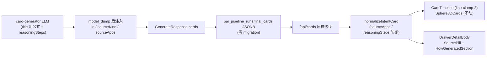

# Card 标题动作先行 + Drawer Sources / How I reasoned 结构化

状态:已定稿(设计获用户批准,待实施)。

设计稿参照:`Edge-AI-HQ/proactive-pin-ai-c7be7ecc` 分支 `refactor/split-constellation-layout`(本地 clone:`~/code/PIN AI/proactive-pin-ai-design`)。

## 背景:三个问题与根因

| 问题 | 根因 | 证据位置 |
|---|---|---|
| 标题过长、事实先行,列表里截断成乱句 | 生成 prompt 公式就是"具体事实/数字/时间 + 利害 + 行动",≤80 字符宽限到 schema 120 截断 | `chat/agents/generator.py` `_CARD_GENERATOR_PROMPT` card_quality_rules;`shared/api_models.py` `GeneratedCard.title` |
| Drawer Sources 显示乱码 | `sources[]` 是给 evaluator 做 grounding 审计的逐字引文(`"world id=world_…, title=…"`),前端直接渲染,且 `parseSources` 按逗号把单条引文切碎成多个 pill | `api_models.py` `GeneratedCard.sources`;`proactive-ai-frontend/src/components/card/CardDrawerBody.tsx` `parseSources`;`components/now/card-model.ts` line2 拼接 |
| How I reasoned 只有一句没营养的话 | 后端没有 per-card 推理数据;前端 "How generated" 一句话是客户端关键词启发式拼的,不来自 LLM | `CardDrawerBody.tsx` `howGenerated`/`reasonSentence`;run 级 `GeneratorOutput.reasoning` 是 Python 拼接且不落库 |

公共事实:卡片本体存 `pai_pipeline_runs.final_cards` JSONB(自由 dict,camelCase),`/api/cards` 原样透传给前端。**新增卡面字段不需要 db migration**。

## 已拍板决策(用户确认)

1. **标题:2 行方案** — 标题 = 做什么 + 短原因,前端 Tasks 列表 `line-clamp-2`。
2. **How I reasoned:LLM 生成 + 引用约束** — 生成卡片的同一次 LLM 调用输出分步推理,grounding 复用 evaluator 审计。
3. Sources app 信息 **Python 确定性派生**,LLM 不参与(随设计推荐采纳)。
4. 不回填旧卡,前端做降级(卡片每日重新生成,自然淘汰)。

## A. 标题

### 后端(`chat/agents/generator.py`)

- `_CARD_GENERATOR_PROMPT` 的 title 规则改为:
  - 公式:**动作开头**(「我能帮你做什么 / 我已经做了什么」的祈使/陈述短句)+ ` — ` + 短原因(具体事实/数字/时间),总长 ≤70 字符。
  - 明确禁止以新闻事实、数字罗列开头;`title_strategy.example` 仍作风格校准但服从动作先行结构。
  - 例:`Review your tech concentration — chip stocks fell 3% for a 2nd day`。
- evaluator prompt 里审 title 的措辞(pattern_grounding 维度对 `title_strategy` 公式的描述)同步改为动作先行公式,避免生成与评分互相打架。
- 三条搭车正向优化(2026-06-11 用户确认追加):(1) title 规则附 GOOD/BAD 对照例,含一条 zh-Hans 例,钉死公式的中文形态;(2) whyNow 规则补"必须提供标题触发短句之外的上下文,禁止复述标题"(新公式下标题已带触发原因,防两者重复);(3) evaluator `<calibration>` 加对**所有卡**生效的动作先行检查——fact-first 标题把 actionability 封顶 6 分并写进 feedback(原本只有 pattern 命中卡才审标题公式)。
- **不动**:连接器引导卡 title 规则(≤60、outcome-led,本来就是动作先行);`GeneratedCard.title` schema `max_length=120`(留作截断安全网);语言跟随用户语言的 `{lang_clause}` 机制。

### 前端(`proactive-ai-frontend`)

- `components/tasks/CardTimeline.tsx` 标题 `truncate`(单行)→ `line-clamp-2`。
- **不动**:球面卡 `line-clamp-3`(`Sphere3DCards.tsx`)、drawer 标题不截断、Tasks 副标题结构(`N operations · 动作 label`)。

## B. Sources → app chip

### 后端:新字段 `sourceApps`(确定性派生,LLM 不参与)

- 派生位置:`generator.py` 内(source index 只在 `run_generator` 作用域可得),在卡片 `model_dump(by_alias=True)` 成 dict 后注入 key。与 `id` / `sourceKind`(在 `chat/transport/routes/generate.py` 注入)同属"dump 后 dict 注入"层,但发生在 generator 侧。**不要加进 `GeneratedCard` schema**——那是 LLM 结构化输出 schema,加进去 LLM 会试图自己填。
- 派生规则:对卡片 `sources[]` 的每条 citation,在 source index(`_build_source_index` 产物,citation 字符串与 record 一一对应)反查 `source_type`,映射成 app slug:

  | source_type | app slug | 备注 |
  |---|---|---|
  | gmail | `gmail` | |
  | gcal | `gcal` | |
  | connected_raw 的 key(slack/notion/…) | 原样 | toolkit 名即 slug |
  | world | `web` | 公网新闻/网页 |
  | signal | `device` | 当前 personal signal 均为 device ambient(sound/transcript/motion);未来 signal 带 app 来源再细化 |
  | memory / profile / goal / preference | 同名 | 内部层 |

- citation 反查失配兜底(LLM 复制时改写了字符串):按 citation 前缀正则(`signal id=` / `memory id=` / `gmail message id=` / `gcal event id=` / `world id=` / `profile id=` / `goal id=` / `preference id=`)推断 source_type。
- 结果去重保序,字段形态 `sourceApps: list[str]`(可为空)。
- `web/services/reminder_cards.py` 手工卡:`sourceApps=[]`(drawer 的 `Scheduled · label` 分支已绕开 Sources 区块)。
- **不动**:`sources[]` 字段的格式与用途(evaluator grounding hard-fail、`_auto_consume_world_signals` 正则消费都依赖它)。

### 前端

- `packages/core/src/domain/intent-card.ts`:`IntentCard` 加 `sourceApps: string[]`,`normalizeIntentCard` 用 `toStringArray` 防御,缺省 `[]`。
- 从设计稿 port:`SourcePill` + `SectionLabel`(设计仓 `src/components/CardDrawerDetail.tsx`)+ `brandSvg` 8 个内联品牌 SVG(设计仓 `src/components/ChatDetailView.tsx:11-82`)。
- slug → 展示映射(确定性查表,替换现有关键词猜测):`gmail`→Gmail logo、`gcal`→Calendar logo、`slack`/`notion`/`gdrive`/`gdocs`/`gsheets`/`linear`→各自 logo;`web`→Globe 图标 "Web"、`memory`→Brain "Memory"、`device`→Smartphone "Phone"、`profile`→"Profile";未知 slug→首字母 chip(设计稿 fallback 行为)。
- **展示层一律吃结构化 `sourceApps`,`line2` 不再承载 sources 数据**:
  - drawer(`CardDrawerBody.tsx`)Sources 区块改为接 `sourceApps` prop,废除从 `line2` 反向 `parseSources`;
  - chat 侧镜像 drawer(`ChatDetailView` 的第二份 `parseSources`)同样换成结构化;
  - `CardTimeline.tsx` 无 primaryAction 时的副标题 fallback(`card.sources.join(" · ")` 裸引文泄漏)改用 `sourceApps` 的可读 label;
  - `card-model.ts` 的 `line2 = "Sources: …"` 拼接分支删除(scheduled 分支保留)。
- 旧卡降级:`sourceApps` 缺失时,前端从 `sources[]` citation 前缀推断层级 chip(同上前缀→slug 映射的轻量客户端版),不再裸渲染引文。

## C. How I reasoned → 分步真实推理

### 后端

- `shared/api_models.py` 新增:

  ```python
  class ReasoningStep(_AgentModel):
      label: Literal["observed", "cross_referenced", "pattern_matched", "flagged", "decided"]
      detail: str = Field(min_length=1, max_length=200)
  ```

  `GeneratedCard` 加 `reasoning_steps: list[ReasoningStep] = Field(default_factory=list)`(camelCase 出口 `reasoningSteps`)。这次**要**进 LLM 输出 schema——内容就是要 LLM 写的。`default_factory=list` 保证旧 artifact 回放不挂。
- `_CARD_GENERATOR_PROMPT` 加规则:2-4 步;首步通常 `observed`,末步通常 `decided`;每步 detail 必须指向 `sources[]` 已引用的具体条目,禁止引用 sources 之外的数据;属于 user-visible text,语言跟随 `{lang_clause}`。
- evaluator prompt 扩一条:`reasoningSteps` 引用 sources 之外的数据 = grounding violation(复用现有 hard-fail 机制)。
- 落库/透传:随 final_cards JSONB 自动持久化,`/api/cards` 自动透传,零额外改动。

### 前端

- `intent-card.ts`:`IntentCard` 加 `reasoningSteps: { label: string; detail: string }[]`,normalize 防御(非法项丢弃),缺省 `[]`。
- 从设计稿 port `HowGeneratedSection`(设计仓 `CardDrawerDetail.tsx:189-240`):Brain 图标 + "How I reasoned · N steps" header,默认收起,framer-motion 高度动画展开,编号圆 badge + label 大写 + detail 正文(依赖 framer-motion / lucide-react,线上仓已有)。
- label 枚举 → 显示文案:`observed`→"Observed"、`cross_referenced`→"Cross-referenced"、`pattern_matched`→"Pattern matched"、`flagged`→"Flagged"、`decided`→"Decided"。
- 替换 `CardDrawerBody.tsx` 现有 "How generated" 一句话区块,删除 `howGenerated` chips 启发式与 `reasonSentence`。
- `reasoningSteps` 为空(旧卡 / 提醒卡)→ 区块整体隐藏(与设计稿组件行为一致)。
- chat 侧镜像 drawer 共用 `DrawerDetailBody`,自动生效。

## D. 数据流总览



## E. 明确不做的事

- 不回填旧卡、不写任何 db migration。
- 不动 `sources[]` 的格式、用途、审计链路。
- 不动 drawer 其他区块与整体布局(只动 Sources / How I reasoned 两块 + 标题展示)。
- 不动连接器引导卡的标题规则、球面卡 clamp、drawer 标题。
- 不加新前端依赖(framer-motion / lucide-react 已在用)。
- 不处理 evaluator 第六维 `pattern_grounding` 的落库(表无列,独立话题)。

## F. 验证方式

| 改动 | 验证 |
|---|---|
| 后端 prompt / schema / 派生 | `uv run ruff check` + `uv run mypy src` + 单测;`make tunnel-up` 后真跑一次 generate,检查 final_cards JSON:标题动作开头 ≤70 字符、`sourceApps` 命中预期 slug、`reasoningSteps` 2-4 步且引用真实 sources |
| sourceApps 派生 | 纯函数单测:citation+index → slug 列表;改写 citation 走前缀兜底;空/未知前缀丢弃 |
| ReasoningStep schema | 单测:label 枚举校验、detail 超长截断(`_clip_overlong_strings`)、缺字段默认 `[]` |
| 前端 normalize / 组件 | `npm run type-check` + vitest:normalize 缺字段降级、slug→brand 映射、steps 空隐藏区块 |
| UI 效果 | 用户 iPhone 真机验收(按 proactive-frontend skill 流程出 build) |

## 风险与观察点

- **LLM 标题超 70 字符**:evaluator 措辞校准 + schema 120 截断兜底;上线后用 LangSmith 抽查 trace。
- **citation 反查失配率**:前缀兜底覆盖;若 LLM 大量改写引文,grounding hard-fail 本身会把卡打回。
- **推理步骤编故事**:evaluator grounding violation 扩展项压制;detail ≤200 字符限制叙事空间。

## 实施时同步更新的文档

- `docs/modules/generation.mdx`:title 公式、`sourceApps` / `reasoningSteps` 字段。
- `docs/modules/execution.mdx`:drawer Sources / How I reasoned 渲染来源。
