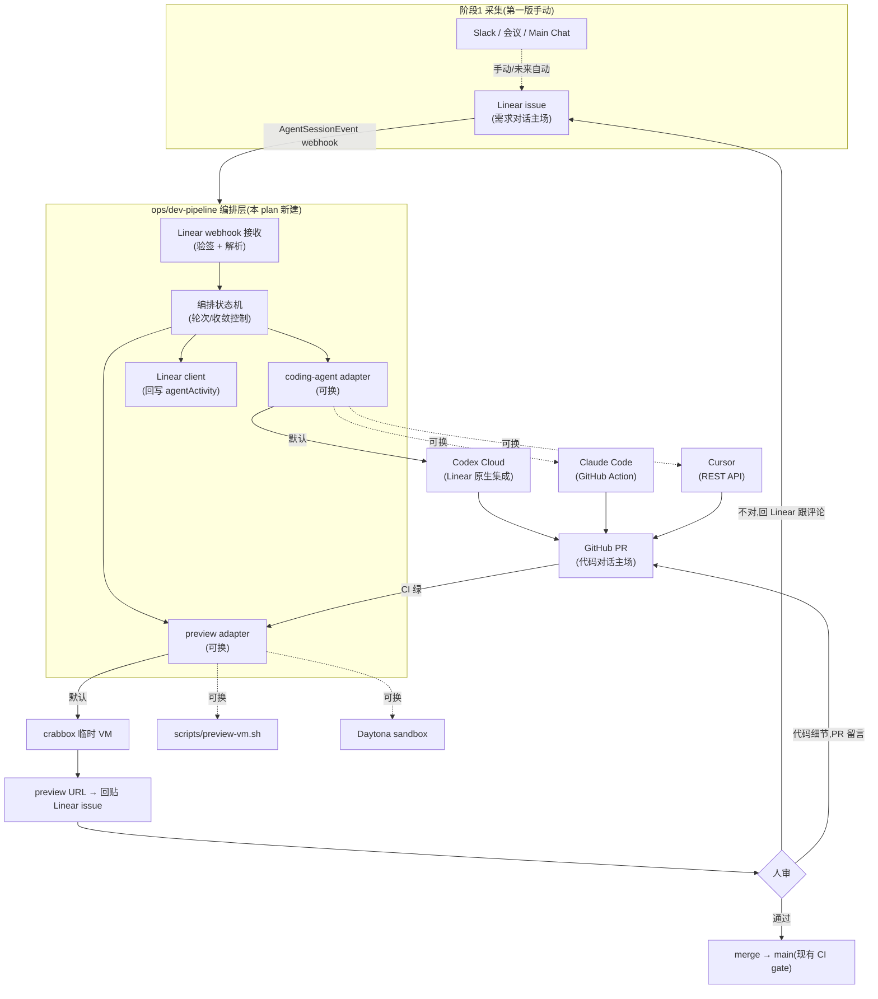

# AI Dev Pipeline

## 状态

已实施，但实现期间架构有两处定型偏离，**当前事实以 [`ops/dev-pipeline/README.md`](../../ops/dev-pipeline/README.md) 为准**；本 plan 以下正文保留设计调研与决策过程（含被推翻的方案），不再逐字反映落地代码。

### 实现现状（2026-06-15 收口）

落地的是一个 **Linear-side agent**：在 Linear 里以 app 身份接需求 → planner 读代码出 plan → 等人回「ok」→ delegate 给 Codex 实现 → 人 @「部署」时按需起 Fly preview。两处偏离原 plan：

- **preview 用 Fly.io 临时 app，不用 crabbox / preview-vm**。每个 PR 一个 `pinai-pr-<N>.fly.dev`（`.github/workflows/preview.yml` 起、`preview-cleanup.yml` 在 PR 关闭时销毁），复用团队已有的 Fly 基建，按需触发、空闲缩零。crabbox / `scripts/preview-vm.sh` / `local_vm` adapter / AWS EC2 那套**全部废弃删除**。
- **没有后台编排引擎 / 状态机 / 轮询**。原设计的 `engine.py` + `state_machine.py`（轮次/墙钟收敛刹车）+ run 追踪表实现后发现与"人主动驱动"的最终形态冲突——Codex 自己迭代、人在 Linear 里决定下一步，不需要后台自动收敛循环——**已整体删除**。coding-agent 也不再走 adapter 抽象（`agents/`），service 直接 `issueUpdate(delegateId=<codex>)` 触发（实测唯一可靠方式）。

下面正文里出现的 `engine` / `state_machine` / `crabbox` / `preview-vm` / `CodingAgentAdapter` / `PreviewAdapter` / M0–M8 里程碑、收敛刹车、AWS/crabbox 工具链说明，均为**已被推翻的历史设计**，仅作背景，不要据此改代码。

## 结论

做一条内部研发流水线，把「会议/聊天里冒出的需求」一路自动推到「老板能点开的 preview 链接」：

```
需求采集 → Linear issue（需求对话主场）→ coding agent 出 PR → CI + preview → 人审 → 反复改 → merge
```

三个定型决策（已基于官方文档调研，引用见文末）：

1. **需求总线和人审界面用 Linear**，不自建网页、不用 GitHub Issue 管需求。Linear 有一等公民的 **Agent API**（assign / @mention agent → `AgentSessionEvent` webhook → agent 用 `agentActivityCreate` 回写 issue），agent 不占席位。
2. **coding agent 默认用 Codex Cloud**（官方有 Codex-for-Linear 集成），但**做成可替换 adapter**——Cursor / Claude Code / Copilot 都能换，Linear 这层不用动。
3. **preview 用 crabbox**（开源 MIT，多 provider 租临时 VM）或仓内现成的 `scripts/preview-vm.sh`。**coding agent 出 PR，preview 只负责把 PR 跑成链接，两者解耦。**

核心难点不是「能不能反复改」——Codex/Cursor/Claude + Linear AgentSession 已经内建对话式反复改。难点是**编排层要管好两件事：① 对话主场放对位置（需求级在 Linear、代码级在 PR）② 收敛**（有轮次/时间上限，到顶甩给人，不让 agent 烧钱空转）。

## 背景与定位

这是一条**内部 dogfood 工具**：先用它来开发我们自己这套系统，验证可行后再考虑沉淀成 Personali 的产品能力。因此：

- 它**不进** `pinai-agents`（产品后端）和 `proactive-ai-frontend`（用户前端），避免污染产品代码和 trust boundary。
- 新建独立服务目录 `ops/dev-pipeline/`，定位同 `internal-reward-dashboard`（内部工具）一类。
- 它消费的是已有零件，不重造：Linear（总线）、Codex/Claude（已有 agent）、crabbox（开源）、仓内 `preview-vm.sh`、`pai_development_feedback`（已有的开发建议表，见 [`2026-06-04-development-feedback-collection`](./2026-06-04-development-feedback-collection)）。

## 目标 / 非目标

**目标**
- 一条需求从 Linear issue 进来，能自动触发 coding agent 出 PR，CI 绿后自动出 preview 链接回贴 issue。
- 支持**对话式反复改**：人在 Linear thread 或 PR 上留言，agent 续上下文改一版。
- coding agent 和 preview backend 都是可替换 adapter，换一个 provider 不动编排主干。
- 有**收敛机制**：轮次/时间上限，到顶把现状甩给人。
- 关键路径可观测：每次状态变更在 Linear issue 留痕。

**非目标（第一版不做）**
- 不做实时会议转写采集（那是 ambient 分支的活，单独推进；第一版需求靠手动建 Linear issue 或从 Slack 手动喂）。
- 不自建需求管理网页（Linear 评论区够用）。
- 不做多租户 preview host（一 session 一 VM，沿用 preview-vm 分支结论）。
- 不追求 preview 的外部 SaaS 完全隔离（第一版可共享 dev，但**必须显式标注风险**，见「安全与隔离」）。
- 不接生产部署（这条流水线只产 PR + preview，merge 仍走现有 `main` + CI gate）。

## 架构



## 各层选型与可替换性

| 层 | 默认 | 可替换为 | 替换成本 |
|---|---|---|---|
| 需求总线 / 人审 | **Linear** AgentSession | GitHub Issue / 自建网页 | 高（编排重写）——所以定死 Linear |
| coding agent | **Codex Cloud**（Linear 原生 assign/@mention） | Cursor（REST `POST /v1/agents`）、Claude Code（GitHub Action `@claude`，会在同 PR branch 迭代推 commit）、Copilot（assign issue REST/GraphQL） | 低——换一个 adapter |
| 代码 / CI | **GitHub**（Linear magic word 自动关联 issue↔branch↔PR） | —— | 定死 |
| preview | **crabbox**（开源 MIT、aws/hetzner/gcp/azure/daytona/e2b 40+ provider） | 仓内 `preview-vm.sh`、Daytona（已在用） | 低——换一个 adapter |

**抽象出两个接口**，是这条流水线弹性的关键：

```python
class CodingAgentAdapter(Protocol):
    def dispatch(self, issue: LinearIssue, repo: str, base: str) -> AgentRunHandle: ...
    def follow_up(self, handle: AgentRunHandle, instruction: str) -> AgentRunHandle: ...
    def status(self, handle: AgentRunHandle) -> AgentRunStatus: ...   # 含 pr_url / state

class PreviewAdapter(Protocol):
    def up(self, pr_branch: str) -> PreviewHandle: ...      # 返回 url
    def refresh(self, handle: PreviewHandle) -> PreviewHandle: ...  # 新 commit 后刷新
    def down(self, handle: PreviewHandle) -> None: ...
```

## 反复改 loop 的设计（核心）

迭代发生在**两个对话主场**，编排层要把消息路由到对的地方：

**第 1 层：需求级对话 = Linear AgentSession（同一 thread 续 session）**
- assign issue / @agent → 建 AgentSession（状态机：`pending`/`active`/`awaitingInput`/`complete`/`error`/`stale`）。`awaitingInput` = agent 缺信息主动弹问。
- 人在同一 issue 回评论 → Codex 官方原话「follow up in the thread to continue the same session」，续上下文继续改。
- 编排层职责：把 issue 的需求方向类反馈转成 agent 的 follow-up。

**第 2 层：代码级对话 = GitHub PR（评论 → agent 推新 commit 到同 branch）**
- agent 出 PR，CI 跑、人 review。
- PR 留言 / `@codex fix the P1 issue`（或 Claude Action / `@copilot`）→ agent 以 PR 为上下文起新 task，把修复 commit **推回同一 branch**。
- web 版 Codex/Claude 还能自动盯 CI：check 挂了自己修一版。

**收敛控制（编排层硬逻辑，呼应 AGENTS.md「测试-修复最多 2 轮」）**
- 每条 issue 维护 `round` 计数和 `deadline`。
- 触顶（默认轮次上限 + 墙钟上限）→ 状态切 `escalated`，停止自动 follow-up，在 Linear 留一条 activity：现象 + 已尝试 + 当前怀疑点，等人。
- 失败分类：CI 失败、agent 报错、preview 起不来——分别有不同的重试/升级策略。

**preview 随轮次刷新**
- 反复改 → branch 一直动，preview 不能只起一次。
- 默认：preview 绑 PR branch，监听 push 重跑 `PreviewAdapter.refresh()`（preview-vm 实测热启 ~1 分钟）。
- 成本控制：preview VM 必须有 `--ttl` + `--idle-timeout`（crabbox 原生支持），收敛/merge 后 `down()`。

## 代码落点与模块拆分

新建 `ops/dev-pipeline/`（Python + FastAPI，对齐团队后端 idiom；Linear 走 GraphQL via httpx，crabbox/codex/gh 走 subprocess）：

```
ops/dev-pipeline/
  pyproject.toml                 # uv 管理，独立于 pinai-agents
  src/dev_pipeline/
    config.py                    # pydantic-settings，所有 env 从这里读
    app.py                       # FastAPI: /webhook/linear, /healthz
    linear/
      webhook.py                 # 验签(HMAC-SHA256 Linear-Signature) + 解析 AgentSessionEvent / Issue / Comment
      client.py                  # GraphQL: agentActivityCreate / issueCreate / commentCreate / assign
      models.py                  # AgentSession / AgentActivity / Issue pydantic 模型
    orchestrator/
      state_machine.py           # issue 生命周期 + 轮次/收敛 + 失败分类
      store.py                   # 编排状态持久化(SQLite 起步,够内部用)
    agents/
      base.py                    # CodingAgentAdapter Protocol
      codex_linear.py            # 默认: 通过 Linear assign 给 Codex agent(无需 Codex cred 给本服务)
      claude_action.py           # 可换: 触发 Claude Code GitHub Action(@claude / workflow_dispatch)
      cursor_api.py              # 可换: Cursor REST(stub,留接口)
    preview/
      base.py                    # PreviewAdapter Protocol
      crabbox.py                 # 默认: shell crabbox warmup/run/stop
      local_vm.py                # 可换: 复用 scripts/preview-vm.sh
    github/
      client.py                  # gh CLI / REST: PR 状态、CI 结果、review 评论
  tests/                         # 全链路用 mock/fixture，不依赖 live 账号
  README.md
```

把 preview-vm 分支（`origin/codex/preview-vm-session`）的 `scripts/preview-vm.sh` / `Makefile` target / `docker-compose.preview.yml` 一并 cherry-pick 进来当 `local_vm` adapter 的后端，并补上它留下的两个洞（secret 注入、独立 Supabase，见下）。

## 编排状态机（issue 生命周期）

```
new → dispatched → pr_open → ci_running → ci_pass → preview_up → awaiting_human
                                       ↘ ci_fail ──(round<max)──> revising → pr_open
awaiting_human ──人留言──> revising → ...
任意态 ──(round≥max 或 超时)──> escalated(停自动,等人)
awaiting_human ──人批准──> merged → preview_down → done
```

每次转移：在 Linear issue 发一条 `agentActivity`（thought/action/response）+ 写 `store`。

## 数据结构

编排状态用 SQLite（`ops/dev-pipeline/`，内部工具够用，不进 Supabase）：

- `pipeline_runs`：`linear_issue_id`、`agent_kind`、`pr_url`、`preview_url`、`state`、`round`、`deadline`、`created_at`、`updated_at`。
- `pipeline_events`：`run_id`、`from_state`、`to_state`、`detail`、`created_at`（审计 + 可观测）。

不碰 `pai_*` schema，不写 Supabase migration。

## 分阶段实施（含「整晚自动跑」可达性标注）

标注规则：🟢 = 无需 live 外部账号即可建+单测；🟡 = 需要凭证才能端到端验证（整晚跑只能建骨架 + mock 测试，真链路等人）。

- **M0 🟢 服务骨架**：`ops/dev-pipeline/` + FastAPI `/healthz` + config + uv 工程 + CI lint/type/test。cherry-pick preview-vm 分支脚本进来。
- **M1 🟢 Linear webhook + client**：验签、解析 AgentSessionEvent/Issue/Comment；GraphQL client（agentActivityCreate/issueCreate/assign）。全部对 fixture 单测（用 Linear 官方 payload 样例）。
- **M2 🟢 编排状态机**：生命周期 + 轮次/收敛 + 失败分类 + SQLite store。纯逻辑，全 mock 单测。
- **M3 🟢 adapter 接口 + 默认实现骨架**：`CodingAgentAdapter` / `PreviewAdapter` Protocol；`codex_linear`（调 Linear assign）、`crabbox`（shell 命令拼装，可 dry-run 单测）。
- **M4 🟡 真链路联调 A：Linear ↔ 编排**：需要 Linear OAuth app + webhook 接通。验证「assign issue → webhook → 编排回写 activity」。
- **M5 🟡 真链路联调 B：出 PR**：需要 coding agent 接通（Codex-for-Linear 或 Claude Action）。验证「issue → PR」。
- **M6 🟡 真链路联调 C：preview**：需要 crabbox + 云 provider creds（或 Daytona）。验证「PR → preview URL 回贴」。
- **M7 🟡 反复改闭环**：验证「人留言 → agent 改 → preview 刷新 → 收敛/升级」。
- **M8 🟡 preview 隔离加固**：独立 Supabase/Composio + secret 注入（preview-vm 分支两个洞）。

**整晚自动跑的现实边界**：M0–M3（🟢）可以一晚跑完——完整服务骨架、Linear/编排/adapter 代码 + 全 mock 单测 + 通过 lint/type/test，产出一个能 review 的 PR。M4 起（🟡）需要 live 凭证和你在场点真实流程，**不适合无人值守**（涉及真建 issue、真起 VM、真花钱）。所以我会把整晚目标定在「交付 M0–M3 的可 review PR + 一份 M4+ 的联调 checklist」。

## 验收用例（self-runnable acceptance cases）

**验收定义**：不是「代码能站起来」，是**这条流水线能把几个真实形态的需求自动跑通到 preview**。这些 case 本身是交付物的一部分——编排在 `ops/dev-pipeline/tests/acceptance/`，每个 case 有客观 pass 判据，我能一条命令跑。

每个 case 都在 **sandbox repo 的独立 branch** 上跑，不碰主仓、不碰产品线。流程都是同一条：建 Linear issue → 编排触发 agent → PR → CI → preview → 客观断言。

| Case | 形态 | 需求示例 | 客观 pass 判据 |
|---|---|---|---|
| **A 前端单改** | 只动前端 | "在 Now 页加一个『刷新』按钮" | PR 只 diff 前端文件；`npm run type-check` + `npm test` 绿；preview DOM 里能查到该 button 文本/`data-testid` |
| **B 前后端联动** | 前端 + 后端 | "加一个语音对话入口：前端一个麦克风按钮，后端一个 `/voice/echo` endpoint 把文本回显" | PR 同时 diff 前端 + `pinai-agents`；前后端 type-check/test 绿；preview 里点按钮能打到新 endpoint 拿到回显（用 browser tool 或 curl 断言） |
| **C 反复改闭环** | 故意一次不过 | 一个**第一版必然 CI 挂**的需求（如 prompt 里要求改但留个明显 type error），看 agent 能不能据 CI 失败自己改第二版 | 至少发生 1 轮 `ci_fail → revising → ci_pass`；最终 CI 绿；编排 `pipeline_events` 里能查到这次转移 |
| **D 收敛/升级** | 故意不可完成 | 一个欠定义/做不到的需求（如"接入一个不存在的第三方 SDK"） | 到轮次上限后状态切 `escalated`；Linear issue 上有一条 activity 写明现象+尝试+怀疑点；**没有**无限 retry 烧钱 |

**为什么是这 4 个**：A 验「最常见的纯前端改」、B 验「跨前后端、preview 真能联动验证」、C 验「对话式反复改真能收敛到绿」、D 验「不收敛时安全刹车」。A/B 验能力，C/D 验**这条流水线敢不敢交给它自动跑一晚**。

**断言怎么做**：preview 起来后用 browser tool（你们 chat 进程已有 Browserbase/Daytona browser）或 `curl` 对 preview URL 做断言，不靠人眼看截图。每个 case 一个 pytest，跑完输出 pass/fail + 证据（PR URL、CI 结论、preview URL、断言结果）回贴到那条 Linear issue。

**和分阶段的关系**：A/B = M5–M6 的验收 gate，C = M7 的，D = M2 收敛逻辑 + M7 的。🟢 阶段（整晚跑）先把这 4 个 case 的 **harness 和断言逻辑写好 + 用 mock 跑通**；真账号到位后（M4+）一条命令对 sandbox repo 实跑，全绿才算这条流水线验收通过。

## 我需要的凭证（按解锁范围分组）

> 这台机器现状：`codex` CLI 已装（0.139.0，**登录状态未知**）、`gh` 已登录为 `smile-pinai`、`crabbox`/`aws`/`uv`/`cloudflared` 未装、所有 API key env 为空。

**整晚跑 M0–M3 实际不需要任何新凭证**（纯建代码 + mock 测试，gh 已登录够用）。下面是把流水线真正跑通（M4+）需要的，按优先级：

**P0 — 不给就只能停在骨架：**
1. **Linear**
   - 一个 **personal API key**（workspace `edge-ai-hq`，Settings → API → Personal API keys）——让我能读 workspace、建测试 issue、跑 GraphQL。最快起步。
   - 一个 **OAuth application**（client id + secret + webhook signing secret），scope 勾 `app:assignable` + `app:mentionable`，开 webhook——这是 agent `actor=app` 的前提，**需要你这个 workspace admin 去建**，建好把三个值给我（或放进 env）。

**P1 — 决定 coding agent 走哪条：**
2. 二选一（或都给，做成可切换）：
   - **走 Codex（默认，推荐先这条）**：你在 Linear workspace 装好 **"Codex for Linear"**（admin 操作）+ Codex 里连好 GitHub + 为目标 repo 建好 environment。这条**不用把 Codex 凭证给我**，编排层只负责 assign issue 给 Codex agent。我只需要你确认「装好了 + 哪个 repo」。
   - **走 Claude Code（可换 adapter）**：一个 **`ANTHROPIC_API_KEY`**（放目标 repo 的 GitHub Actions secret + 给我一份建/测 adapter）。这条是纯 API、最适合我自己程序化驱动。
3. **目标 repo 确认**：流水线先拿哪个 repo 练手？建议**先别拿 `PIN-AI-ASSISTANT` 本仓**，开一个 sandbox repo（比如 `edge-ai-hq/dev-pipeline-sandbox`）跑通再说，避免 agent 在主仓乱开 PR。

**P2 — preview 真起 VM 才需要：**
4. **crabbox + AWS**（CLI 已装 v0.30.0，2026-06-13 实测就绪）。
   - **不需要 broker**：官方文档明确 AWS 可 **direct 模式**——`crabbox doctor --provider aws` 实测 `auth=ready control_plane=ready api=list`，直接用本地 `aws login` 凭证打 EC2 API，无 coordinator。（之前 plan 说要 broker 是错的；broker 只在多用户/托管租约时才需要。）
   - **必须固定小机型**：AWS 账号 **EC2 vCPU 配额仅 5**（`limit_vcpus=5`），crabbox 默认 class `beast`=c7a.48xlarge(192 vCPU) 会被拒。`CrabboxPreview` 已固定 `--type t3.large`(2 vCPU，= 2026-05-28 实测规格) + `--market on-demand`。要更大机型需向 AWS 申请配额。
   - **region**：crabbox 无 `--region` flag，走 AWS 环境变量；adapter 注入 `AWS_REGION=us-east-1`。
   - **省钱替代**：Daytona（crabbox 有 daytona provider）仍是 fallback，但 AWS direct 已通，默认走 AWS。
5. **boot 全栈 preview 要的 dev secrets**：dotenvx 的 **`DOTENV_PRIVATE_KEY_DEV`**（解密 `.env.dev`）。M0–M7 大多不需要真 boot 全栈，这个可以等 M6 再给。

**P3 — 加固阶段才需要（可最后给）：**
6. preview 隔离用的**独立 Supabase project** keys（M8）；不给就第一版共享 dev，我会在 preview 页显著标注「会污染 dev 数据」。

**给的方式**：P0/P1 的 key 你可以贴给我，我写进 `ops/dev-pipeline/.env`（gitignore，不 commit）；或者你自己放进这台机器的 env / 一个文件告诉我路径。`codex` 如果要我程序化驱动，需要你在这台机器跑一次 `! codex login`（交互登录）。

## 凭证现状（2026-06-13 已就位，密钥本体在 `.env`）

> **安全红线**：所有 key/secret 只存 `ops/dev-pipeline/.env`（gitignored，已验证 `git check-ignore` 忽略），**绝不写进本文件或任何提交物**。下面只记非密钥的操作标识符 + 「放在哪」。整晚自动跑：读本节 + `.env` 即可，不缺东西。

**本机工具链（已装/已登录）**：`codex` 0.139（ChatGPT 已登录）、`gh`（`smile-pinai` 已登录）、`crabbox` 0.30.0、`aws` 2.35、`cloudflared` 2026.6、`uv` 0.11、`docker`/`node`/`python3`。

**AWS**（preview 算力）：账号 `832253125089`、region `us-east-1`，经 `aws login` 拿临时凭证、EC2 权限实测可用。⚠️ 临时凭证会过期 + 是 root 账号 key——**整晚跑那晚先 `aws login` 刷新**，后续换 IAM user。

**Linear**：org `Edge AI HQ`（urlKey `edge-ai-hq`）、team key **`EDG`**（issue 编号 `EDG-123`、GitHub magic word 用它）、账号 `smile@pinai.io`。
- 密钥（在 `.env`）：`LINEAR_API_KEY`（personal）、OAuth app `proactive-ai-dev` 的 `LINEAR_OAUTH_CLIENT_ID` / `LINEAR_OAUTH_CLIENT_SECRET` / `LINEAR_WEBHOOK_SECRET`。
- **回调/ webhook URL 配置**：`oauthApplicationUpdate` 的 input 支持 `redirectUris` / `webhookUrl` / `webhookEnabled` / `webhookResourceTypes`（已 introspect 验证）。**但** personal API key 缺 `oauth:create` scope，实测 `oauthApplications` 查询返回 403 —— 所以自助配置需要一个带 oauth scope 的 token；否则走 Linear UI 手动粘两个字段。`scripts/wire_linear.py` 做成双模式：有 scope 自动调 API，没有就打印要粘的精确值。详见 `ops/dev-pipeline/MORNING.md`。

**target repo**：`Edge-AI-HQ/PIN-AI-ASSISTANT`（默认分支 `main`）——**用本仓，不用 sandbox**。护栏：agent 只在 `dev-pipeline/*` 前缀分支开 PR、打 `dev-pipeline` label、**绝不 auto-merge**。

**preview tunnel**：默认 cloudflare quick tunnel（零凭证，已实测能建 HTTPS URL；自 curl 偶发不稳是 trycloudflare 已知现象，外部访问正常）。更稳选项 ngrok 固定子域（需 `DOTENV_PRIVATE_KEY_DEV` 解密 `.env.dev` 里的 `NGROK_AUTHTOKEN`）。

**仍 pending（M6+ 才要，不阻塞整晚 M0–M3）**：`DOTENV_PRIVATE_KEY_DEV`（boot 全栈 preview / 用 ngrok 时）、独立 Supabase project（M8 preview 隔离）。

## 安全与隔离

- **trust boundary 不受影响**：`ops/dev-pipeline/` 是独立服务，不 import `pinai_agents.web/chat`，不持有产品 master credentials。它自己的凭证（Linear/Anthropic/AWS）是另一套，只服务这条流水线。
- **preview 外部 SaaS 污染**（preview-vm 分支留的 1 号洞）：第一版若共享 dev，老板在 preview 上登录/连 Gmail 会污染 dev 的 Auth/Composio/Stripe。M8 给独立 Supabase project + Composio namespace 前缀 + Stripe test mode 解决。**在那之前 preview 页必须显著标注。**
- **secret 注入**（2 号洞）：preview VM 的 `.env.keys` 走一次性环境变量注入（base64 写入 + `chmod 600`，不打印、不进 git、随 VM 销毁），照搬 preview-vm 分支 docstring 的做法。
- **agent 不能直接 merge**：所有 PR 仍走 `main` 的 CI gate + 人审 merge（AGENTS.md 硬规则）。编排层只到「出 PR + preview」，不碰 merge。
- **目标 repo 隔离**：先用 sandbox repo，避免 agent 在主仓乱开 PR。

## 风险与未决问题

1. **Linear Agent API 是 Developer Preview**，可能变。措施：pin SDK/schema 版本，webhook 解析做防御。
2. **Codex 无公开 REST 触发**：只能靠 Linear 原生集成或 `codex cloud exec` CLI shell-out。若要完全程序化控制，Claude/Cursor 的 REST API 更顺——这也是做成 adapter 的原因。
3. **反复改不收敛烧钱**：靠轮次/墙钟上限 + escalate 兜底。需要你拍上限默认值（建议轮次 3、墙钟 30 分钟）。
4. **preview 成本**：crabbox AWS ~$0.14/小时，必须 ttl + idle-timeout。用 Daytona 可能更省。
5. **第一版采集靠手动**：会议自动转写采集是 ambient 分支的活，本 plan 不含。
6. **未决**：目标 repo（sandbox vs 本仓）、默认 agent（Codex vs Claude）、preview backend（Daytona vs AWS）——这三个等你拍。

## 调研引用（2026-06-13，官方文档核实）

- Linear Agents / AgentSession / AgentActivity / `AgentSessionEvent` webhook：<https://linear.app/developers/agents>、<https://linear.app/developers/agent-interaction>、<https://linear.app/developers/webhooks>
- Linear GraphQL / SDK / OAuth `actor=app` / 速率：<https://linear.app/developers/graphql>、<https://linear.app/developers/oauth-actor-authorization>、<https://linear.app/developers/rate-limiting>
- Linear Triage Intelligence（判重复，Business+）：<https://linear.app/docs/triage-intelligence>
- Linear GitHub 集成（magic word / 自动状态转移）：<https://linear.app/docs/github>
- Codex Cloud + Linear 集成（assign / @Codex / 续 session）：<https://developers.openai.com/codex/cloud>、<https://developers.openai.com/codex/integrations/linear>
- Codex GitHub `@codex review` / `@codex fix`（推 commit 到同 branch）：<https://developers.openai.com/codex/integrations/github>
- Claude Code on the web + GitHub Action（同 PR branch 迭代推 commit + auto-fix）：<https://code.claude.com/docs/en/claude-code-on-the-web>、<https://code.claude.com/docs/en/github-actions>
- Cursor Cloud Agents（REST `POST /v1/agents` + Linear 集成 + followup）：<https://cursor.com/docs/cloud-agent>、<https://cursor.com/docs/integrations/linear>
- GitHub Copilot coding agent（assign issue REST/GraphQL GA 2025-12 + `@copilot` 推 commit）：<https://docs.github.com/copilot/concepts/agents/coding-agent/about-coding-agent>
- crabbox（开源 MIT，多 provider 临时 VM lease）：<https://github.com/openclaw/crabbox>、<https://crabbox.sh/>
- 仓内 preview 现状：`scripts/preview-vm.sh`（branch `origin/codex/preview-vm-session`）、[`2026-05-28-preview-vm-session`](./2026-05-28-preview-vm-session)
- 已有开发建议表：[`2026-06-04-development-feedback-collection`](./2026-06-04-development-feedback-collection)
