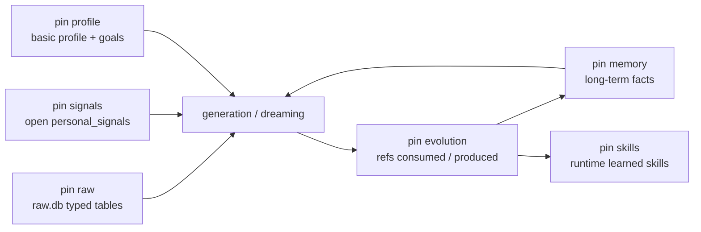

# memory

**先读取 [`../pin-shared/SKILL.md`](../pin-shared/SKILL.md)**

这是 proactive-ai 的上下文总 skill。不要把 profile / raw / signals /
memory 拆成多个互相竞争的 skill：它们共同构成生成卡片和 dreaming 的 Memory
读取面。

## 总规则

卡片生成、dreaming、上下文调研只从本地数据层读取：

```bash
pin profile get
pin memory list --quality 0.7 --limit 30
pin signals recent --hours 24 --limit 30
pin raw gmail recent --hours 24 --limit 20
pin raw gcal today --timezone Asia/Shanghai
```

不要直接调用 Composio tool 命令给生成链路补数据，这类 CLI 入口已禁用。
Composio 数据先由 `connector.init` 初始化拉取默认 100 条，再由
`connector.sync` 默认每 12h 增量写入 `raw.db` 和 `personal_signals`。

## 数据层



| 层 | 标准入口 | 作用 |
|---|---|---|
| Profile | `pin profile get` | 基础画像、timezone、locale、goals |
| Raw | `pin raw ...` | Gmail / Calendar / Slack / Notion / Drive / GitHub / Outlook / device snapshot 原文 |
| Signals | `pin signals recent/list` | 近期未消化观察，默认读 `status=open` |
| Memory | `pin memory list/search` | 已沉淀长期事实、偏好、兴趣 |
| Evolution | `pin evolution recent/get` | 查看某次 run 读了什么、写了什么 |
| Skills | `pin skills list/show` | 用户运行时学到的执行技能 |

## 生成前读取顺序

```bash
# 1. 基础画像
pin profile get

# 2. 长期事实和兴趣
pin memory list --quality 0.7 --limit 30
pin memory list --subjectPrefix topic: --quality 0.6 --limit 20
pin memory search --query "<topic>" --limit 10

# 3. 当前未消化信号
pin signals recent --hours 24 --limit 30
pin signals list --status open --since 2026-04-28T00:00:00Z --limit 50
pin signals get --id <signal_id>

# 4. raw 详情
pin raw gmail recent --hours 24 --limit 20
pin raw gmail thread --threadId <tid>
pin raw gcal today --timezone Asia/Shanghai
pin raw device-apps --top 20
pin raw device-contacts list --limit 200
```

如果 raw 当前读取成功，应优先相信 raw，而不是旧 profile / old evolution
里残留的 connector error。

## 维护入口

```bash
# 长期事实
pin memory add "<text>" --quality 0.7 --subject self
pin memory archive --id <memory_id>
pin memory supersede --old <old_id> --new <new_id>

# 信号消费：只在当前 run 明确使用后执行
pin signals consume --id <signal_id> --runId <run_id>

# evolution 轨迹
pin evolution recent --limit 5
pin evolution get --id <run_id>
pin evolution refs consumed --id <run_id> --table memory --ids m1,m2
pin evolution complete --id <run_id> --durationMs 5000

# 运行时 skill
pin skills list --status enabled
pin skills show --id <skill_id>
pin skills add --id <id> --title "..." --source manual --from-file SKILL.md
```

## 注意

- `quality` / `confidence` 必须是普通数字，如 `0.7`；不要写 `0.7+`。
- `pin raw device-contacts search` 必须带 `--query`。
- `pin raw device-apps` 默认只读最新 snapshot；跨 snapshot 才传 `--all-snapshots true`。
- signals 由 mobile ingest、connector.init / connector.sync handler 写入；CLI 只读和 consume。
- 缺数据先查 `pin tasks list --type connector.init` /
  `pin tasks list --type connector.sync`，不要临时回到 Composio direct tool。
